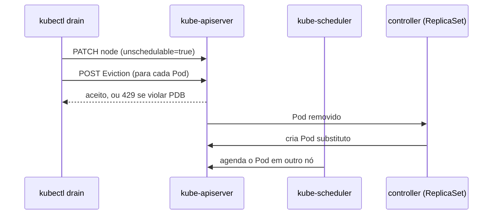

# Drain, cordon e uncordon

> **Versão do Kubernetes:** v1.36 · **Última revisão:** 2026-10-23 · **Domínio:** Cluster Architecture, Installation & Configuration (25%)

## O que é

Três comandos para tirar um nó de serviço com segurança (manutenção, upgrade, troca de hardware) e devolvê-lo depois:

| Comando | O que faz | Pods que já estão no nó |
|---|---|---|
| `kubectl cordon` | Marca o nó como **não agendável**. Pods novos não vão para ele. | Continuam rodando |
| `kubectl drain` | Faz **cordon** e depois **despeja** (evict) os Pods do nó. | São removidos e recriados em outros nós pelos seus controllers |
| `kubectl uncordon` | Marca o nó como agendável de novo. | Nada muda. Pods não voltam sozinhos, só os novos podem ir para lá |

Na prova, drain aparece sozinho ("put node X into maintenance") ou como parte do [upgrade com kubeadm](upgrade-kubeadm.md).

!!! tip "Página separada ou junto do upgrade?"
    O conteúdo é curto e quase sempre usado no upgrade. Ficou numa página própria porque também cai sozinho e porque o comportamento com PodDisruptionBudget merece espaço. Se preferir menos páginas, dá para virar uma seção de *Upgrade com kubeadm*.

## Como funciona por dentro

- **cordon**: o kubectl altera o objeto Node no API server: `spec.unschedulable: true`. O nó ganha o taint `node.kubernetes.io/unschedulable:NoSchedule`. O **kube-scheduler** passa a ignorar o nó para Pods novos.
- **drain**: depois do cordon, o kubectl lista os Pods do nó e cria uma **Eviction** (`policy/v1`) para cada um. O API server só aceita a eviction se ela não violar um **PodDisruptionBudget** (PDB). Se violar, o kubectl espera e tenta de novo.
- O Pod despejado é apagado. O **controller** dono dele (ReplicaSet, StatefulSet…) percebe que faltam réplicas e cria um Pod novo, que o scheduler coloca em outro nó.
- **uncordon**: volta `spec.unschedulable` para `false` e remove o taint.



Por padrão o drain **se recusa** a continuar em três casos:

| Situação | Por que trava | Flag que libera |
|---|---|---|
| Pods de **DaemonSet** | O DaemonSet tolera o taint e recriaria o Pod no mesmo nó | `--ignore-daemonsets` (os Pods ficam lá) |
| Pods com volume **emptyDir** | Os dados do emptyDir são apagados com o Pod | `--delete-emptydir-data` |
| Pods **sem controller** (Pod "solto") | Ninguém vai recriá-los: eles somem de vez | `--force` |

Static Pods (os do control plane, em `/etc/kubernetes/manifests`) não são despejados. O drain os ignora.

## Comandos essenciais

```bash
# Só impedir novos Pods (os atuais continuam)
kubectl cordon node01

# Esvaziar o nó: forma mais comum na prova
kubectl drain node01 --ignore-daemonsets

# Quando há Pods com emptyDir
kubectl drain node01 --ignore-daemonsets --delete-emptydir-data

# Quando há Pods sem controller (eles serão PERDIDOS)
kubectl drain node01 --ignore-daemonsets --force

# Simular sem alterar nada: mostra o que seria despejado
kubectl drain node01 --ignore-daemonsets --dry-run=client

# Não ficar preso para sempre esperando um PDB
kubectl drain node01 --ignore-daemonsets --timeout=120s

# Devolver o nó ao agendamento
kubectl uncordon node01

# Conferir: STATUS mostra "Ready,SchedulingDisabled" quando cordonado
kubectl get nodes

# Ver o que está rodando no nó antes/depois
kubectl get pods -A -o wide --field-selector spec.nodeName=node01
```

`--delete-local-data` aparece em material antigo. Foi substituído por `--delete-emptydir-data` e não existe mais. <!-- VERIFICAR: versão exata em que --delete-local-data foi removido -->

## YAML de referência

O drain não tem manifesto próprio. O objeto que muda o comportamento dele é o **PodDisruptionBudget**:

```yaml
apiVersion: policy/v1           # policy/v1beta1 foi removido na v1.25
kind: PodDisruptionBudget
metadata:
  name: web-pdb
  namespace: default
spec:
  minAvailable: 2               # pelo menos 2 Pods "web" sempre de pé
  # maxUnavailable: 1           # alternativa: use um OU outro, não os dois
  selector:
    matchLabels:
      app: web                  # precisa bater com os labels dos Pods
```

Com 2 réplicas de `web` e `minAvailable: 2`, o drain nunca consegue despejar nenhuma: ele fica tentando até o `--timeout`.

```bash
# Criar o PDB de forma imperativa
kubectl create poddisruptionbudget web-pdb --selector=app=web --min-available=2 --dry-run=client -o yaml
```

## Na documentação oficial

- **Página:** *Safely Drain a Node*. Link: <https://kubernetes.io/docs/tasks/administer-cluster/safely-drain-node/>
- **Referência do comando:** *kubectl drain*. Link: <https://kubernetes.io/docs/reference/kubectl/generated/kubectl_drain/>
- **Busca rápida:** `drain node`
- **Ctrl+F dentro da página:**
    - `ignore-daemonsets`: o comando principal.
    - `PodDisruptionBudget`: como o PDB interage com o drain.
    - `uncordon`: como devolver o nó.

## Pegadinhas da prova

- **Esquecer `--ignore-daemonsets`.** Quase todo cluster tem DaemonSet (kube-proxy, CNI), então o drain trava sem essa flag.
- **Usar `--force` sem ler.** Ele apaga Pods sem controller para sempre. Se o enunciado pede para "não perder" um Pod, `--force` é a resposta errada.
- **Drain não é delete do nó.** O nó continua no cluster. `kubectl delete node` é outra coisa.
- **Esquecer o `uncordon`** depois da manutenção, quando o enunciado pede para o nó voltar a receber Pods.
- **Achar que uncordon traz os Pods de volta.** Não traz. Só Pods criados depois podem cair no nó.
- **Drain travado por PDB.** Não é bug, é o PDB funcionando. Leia a mensagem (`Cannot evict pod as it would violate the pod's disruption budget`) e decida: esperar, escalar o Deployment ou ajustar o PDB, conforme o enunciado.
- **Contexto.** O nome `node01` existe em vários clusters da prova. Confirme o contexto antes.

## Pratique

**Enunciado (como na prova):**

> Mark the node `node01` as unschedulable and evict all the pods running on it, so that it can be taken down for maintenance. Pods managed by DaemonSets should be ignored. After that, confirm that no workload pods (other than DaemonSet pods) are left on `node01`.

**Tradução:** marque o nó `node01` como não agendável e despeje todos os Pods dele, para que possa entrar em manutenção. Ignore os Pods de DaemonSets. Depois, confirme que não sobrou nenhum Pod de workload (além dos de DaemonSet) em `node01`.

??? success "Solução"
    ```bash
    kubectl drain node01 --ignore-daemonsets
    # se reclamar de emptyDir e o enunciado permitir perder esses dados:
    kubectl drain node01 --ignore-daemonsets --delete-emptydir-data
    ```

**Como verificar:**

```bash
kubectl get node node01      # STATUS: Ready,SchedulingDisabled
kubectl get pods -A -o wide --field-selector spec.nodeName=node01
# só devem aparecer Pods de DaemonSet (kube-proxy, CNI...)
```

**No lab / Killercoda:**

- Crie um Deployment com 4 réplicas, um Pod "solto" (`kubectl run solto --image=nginx`) e um Pod com `emptyDir`, todos em `node01`. Rode o drain sem flags e leia cada erro.
- Crie um PDB com `minAvailable` igual ao número de réplicas e veja o drain travar. Teste `--timeout`.
- Depois do `uncordon`, rode `kubectl rollout restart deployment/<nome>` e observe os Pods voltando a se espalhar entre os nós.
