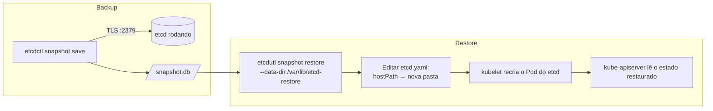

# Backup e restore do etcd

> **Versão do Kubernetes:** v1.36 · **Última revisão:** 2026-10-23 · **Domínio:** Cluster Architecture, Installation & Configuration (25%)

!!! warning "Status no currículo"
    Na revisão do currículo de fevereiro de 2025, *"Implement etcd backup and restore"* **deixou de aparecer como item explícito** do Domínio 1. <!-- VERIFICAR: confirmar na versão atual de https://github.com/cncf/curriculum -->
    Mesmo assim vale estudar, por três motivos: (1) relatos de prova ainda citam a tarefa; (2) ela se encaixa em *"Manage the lifecycle of Kubernetes clusters"*; (3) restaurar o etcd exige editar static Pods, algo que cai em **Troubleshooting (30%)**.
    Se o currículo confirmar a remoção, a página pode ir para uma seção **Extras** sem perder nada.

## O que é

O **etcd** é o banco chave-valor onde o Kubernetes guarda **todo o estado do cluster**: Deployments, Secrets, ConfigMaps, RBAC, Nodes. Perder o etcd é perder o cluster, mesmo com os containers ainda rodando nos nós.

- **Backup** = tirar um *snapshot* do etcd para um arquivo `.db`.
- **Restore** = criar um **novo diretório de dados** a partir desse arquivo e fazer o etcd usar esse diretório.

Ponto-chave: o restore **não sobrescreve** o etcd em execução. Ele gera uma pasta nova, e você aponta o etcd para ela.

## Como funciona por dentro

Num cluster kubeadm o etcd roda como **static Pod** no control plane:

- Manifest: `/etc/kubernetes/manifests/etcd.yaml`. O **kubelet** observa essa pasta e recria o Pod sempre que o arquivo muda.
- Dados: `/var/lib/etcd` no host, montado no container por um volume `hostPath`.
- Certificados: `/etc/kubernetes/pki/etcd/`. O etcd exige TLS mútuo, então todo comando precisa de CA, certificado e chave.
- O **kube-apiserver** é o único componente que conversa com o etcd (`--etcd-servers`).



**etcdctl × etcdutl**:

| Ferramenta | Para quê | Fala com o etcd pela rede? |
|---|---|---|
| `etcdctl` | `snapshot save` e operações num etcd **rodando** | Sim, precisa de endpoint e certificados |
| `etcdutl` | `snapshot restore` e `snapshot status`, operações **sobre arquivos** | Não |

Desde o etcd 3.5, `etcdctl snapshot restore` e `etcdctl snapshot status` são **depreciados** em favor do `etcdutl`. No **etcd 3.6 eles foram removidos** do `etcdctl`. Como o kubeadm do Kubernetes v1.34+ já usa etcd 3.6, na prática o restore é com `etcdutl`.

Para descobrir a versão: `etcdctl version`. Se for 3.5 ou anterior, `etcdctl snapshot restore` ainda funciona (com aviso). Se for 3.6+, use `etcdutl`, que também vem dentro da imagem do etcd.

| Kubernetes (kubeadm) | etcd padrão | `etcdctl snapshot` tem |
|---|---|---|
| v1.33 ou anterior | 3.5.x | `save`, `restore`, `status` (os dois últimos com aviso) |
| v1.34 a v1.36 | 3.6.x (v1.36: 3.6.8) | só `save` |
| v1.37 | 3.7.x (3.7.0) | só `save` |

`ETCDCTL_API=3` aparece em todo material antigo. Desde o etcd 3.4 a API v3 é o padrão, então a variável é opcional. Mantê-la não faz mal.

## Comandos essenciais

**1. Descobrir endpoint e caminhos dos certificados** (nunca decore, leia do manifest):

```bash
grep -E 'listen-client-urls|cert-file|key-file|trusted-ca-file|data-dir' /etc/kubernetes/manifests/etcd.yaml
# --cert-file=/etc/kubernetes/pki/etcd/server.crt
# --key-file=/etc/kubernetes/pki/etcd/server.key
# --trusted-ca-file=/etc/kubernetes/pki/etcd/ca.crt
# --listen-client-urls=https://127.0.0.1:2379,https://<IP>:2379
# --data-dir=/var/lib/etcd
```

**2. Backup:**

```bash
# Snapshot com TLS: os três certificados são obrigatórios
ETCDCTL_API=3 etcdctl \
  --endpoints=https://127.0.0.1:2379 \
  --cacert=/etc/kubernetes/pki/etcd/ca.crt \
  --cert=/etc/kubernetes/pki/etcd/server.crt \
  --key=/etc/kubernetes/pki/etcd/server.key \
  snapshot save /opt/backup/etcd-snapshot.db

# Conferir o arquivo (hash, revisão, nº de chaves)
etcdutl snapshot status /opt/backup/etcd-snapshot.db -w table
```

**3. Restore:**

```bash
# Recomendado: parar o kube-apiserver tirando o manifest da pasta (o kubelet derruba o Pod)
mv /etc/kubernetes/manifests/kube-apiserver.yaml /tmp/

# Restaurar para uma pasta NOVA (que não pode existir antes)
etcdutl snapshot restore /opt/backup/etcd-snapshot.db \
  --data-dir /var/lib/etcd-restore

# Apontar o etcd para a pasta nova: editar o hostPath do volume de dados
vi /etc/kubernetes/manifests/etcd.yaml
#   volumes:
#   - hostPath:
#       path: /var/lib/etcd-restore     # era /var/lib/etcd
#       type: DirectoryOrCreate
#     name: etcd-data

# Devolver o kube-apiserver
mv /tmp/kube-apiserver.yaml /etc/kubernetes/manifests/

# Acompanhar os static Pods voltando (pode levar 1-2 minutos)
watch crictl ps
kubectl get pods -n kube-system
```

**Sem etcdctl no host?** O container do etcd tem o binário. Salve o snapshot dentro de `/var/lib/etcd`, que é hostPath e portanto aparece no host:

```bash
kubectl -n kube-system exec etcd-controlplane -- etcdctl \
  --endpoints=https://127.0.0.1:2379 \
  --cacert=/etc/kubernetes/pki/etcd/ca.crt \
  --cert=/etc/kubernetes/pki/etcd/server.crt \
  --key=/etc/kubernetes/pki/etcd/server.key \
  snapshot save /var/lib/etcd/snapshot.db
```

`--dry-run=client -o yaml` não se aplica aqui: backup e restore não criam objetos Kubernetes.

## YAML de referência

Trecho do `/etc/kubernetes/manifests/etcd.yaml` que importa para o restore:

```yaml
apiVersion: v1
kind: Pod
metadata:
  name: etcd
  namespace: kube-system
spec:
  containers:
    - name: etcd
      command:
        - etcd
        - --data-dir=/var/lib/etcd          # caminho DENTRO do container: pode ficar igual
        - --cert-file=/etc/kubernetes/pki/etcd/server.crt
        - --key-file=/etc/kubernetes/pki/etcd/server.key
        - --trusted-ca-file=/etc/kubernetes/pki/etcd/ca.crt
        - --listen-client-urls=https://127.0.0.1:2379,https://10.0.0.4:2379
      volumeMounts:
        - mountPath: /var/lib/etcd          # onde o container enxerga os dados
          name: etcd-data
  volumes:
    - name: etcd-data
      hostPath:
        path: /var/lib/etcd-restore         # ← o restore muda SÓ isto (pasta no host)
        type: DirectoryOrCreate
```

Trocar só o `hostPath.path` é o caminho mais curto: o container continua vendo `/var/lib/etcd`, mas agora o conteúdo vem da pasta restaurada. Se você mudar `--data-dir`, precisa mudar também o `mountPath`, senão o etcd sobe vazio.

## Na documentação oficial

- **Página:** *Operating etcd clusters for Kubernetes*. Link: <https://kubernetes.io/docs/tasks/administer-cluster/configure-upgrade-etcd/>
- **Busca rápida:** `etcd backup`
- **Ctrl+F dentro da página:**
    - `snapshot save`: comando de backup com os flags de TLS.
    - `snapshot restore`: comando de restore e o aviso sobre `--data-dir`.
    - `etcdutl`: diferença entre as ferramentas.
    - `cacert`: o bloco com `--cacert`, `--cert` e `--key`.

## Pegadinhas da prova

- **Certificado errado.** Use os de `/etc/kubernetes/pki/etcd/` (`server.crt`/`server.key` ou `healthcheck-client.*`), e não `/etc/kubernetes/pki/apiserver.crt`. Leia os caminhos do manifest.
- **Flags com nome parecido.** No `etcdctl` são `--cacert`, `--cert`, `--key`. No manifest do etcd são `--trusted-ca-file`, `--cert-file`, `--key-file`. Não misture.
- **No etcd 3.6+, o erro do `etcdctl snapshot restore` engana.** O subcomando não existe mais, mas a mensagem fala da flag: `Error: unknown flag: --data-dir`. Parece flag digitada errado; a correção é trocar `etcdctl` por `etcdutl`. Sem flags, `etcdctl snapshot restore arquivo.db` só imprime a ajuda de `snapshot` e sai com **código 0**, sem restaurar nada.
- **Restaurar por cima de `/var/lib/etcd`.** O restore exige pasta nova. Use outro caminho.
- **Editar `--data-dir` e esquecer o volume.** O etcd sobe com banco vazio e o cluster "some". Mexa só no `hostPath`.
- **Ter pressa.** Depois de editar o manifest, o kubelet leva um tempo para recriar o etcd e o apiserver. `kubectl` dá erro de conexão nesse intervalo. Espere com `crictl ps` em vez de editar de novo.
- **Caminho do arquivo pedido.** O enunciado dá o caminho exato do snapshot (`/opt/...`). Salve exatamente lá.
- **Nó errado.** O etcd roda no control plane. Faça SSH nele antes.

## Pratique

**Enunciado (como na prova):**

> Create a snapshot of the existing etcd instance running at `https://127.0.0.1:2379` and save it to `/opt/etcd-backup.db`. Then restore the snapshot located at `/opt/etcd-backup-old.db` into the data directory `/var/lib/etcd-from-backup` and make the cluster use it.

**Tradução:** crie um snapshot da instância etcd em `https://127.0.0.1:2379` e salve em `/opt/etcd-backup.db`. Depois restaure o snapshot `/opt/etcd-backup-old.db` no diretório `/var/lib/etcd-from-backup` e faça o cluster usá-lo.

??? success "Solução"
    ```bash
    ssh controlplane && sudo -i

    # 1. Backup
    ETCDCTL_API=3 etcdctl --endpoints=https://127.0.0.1:2379 \
      --cacert=/etc/kubernetes/pki/etcd/ca.crt \
      --cert=/etc/kubernetes/pki/etcd/server.crt \
      --key=/etc/kubernetes/pki/etcd/server.key \
      snapshot save /opt/etcd-backup.db

    # 2. Restore
    mv /etc/kubernetes/manifests/kube-apiserver.yaml /tmp/
    etcdutl snapshot restore /opt/etcd-backup-old.db --data-dir /var/lib/etcd-from-backup
    sed -i 's#path: /var/lib/etcd$#path: /var/lib/etcd-from-backup#' /etc/kubernetes/manifests/etcd.yaml
    mv /tmp/kube-apiserver.yaml /etc/kubernetes/manifests/
    ```
    O `sed` usa `$` para casar só a linha do `hostPath` que termina em `/var/lib/etcd`. Confira com `grep -n etcd-from-backup /etc/kubernetes/manifests/etcd.yaml`: deve haver **uma** ocorrência, no `volumes`.

**Como verificar:**

```bash
etcdutl snapshot status /opt/etcd-backup.db -w table     # backup íntegro
crictl ps | grep -E 'etcd|kube-apiserver'                # os dois rodando de novo
kubectl get pods -A                                      # estado do snapshot antigo
```

**No lab / Killercoda:**

- No lab kubeadm: faça backup, crie um Deployment `teste-restore`, restaure o snapshot e confirme que o Deployment **sumiu**. É a prova de que o restore funcionou.
- Rode `etcdctl version`. Se for 3.5, compare `etcdctl snapshot restore` com `etcdutl snapshot restore` e veja o aviso de depreciação. Se for 3.6+, confirme que o `etcdctl` não tem mais o subcomando `restore`.
- Quebre o restore de propósito (mude `--data-dir` sem mudar o volume) e investigue com `crictl logs <id-do-etcd>`. Ótimo treino de Troubleshooting.
