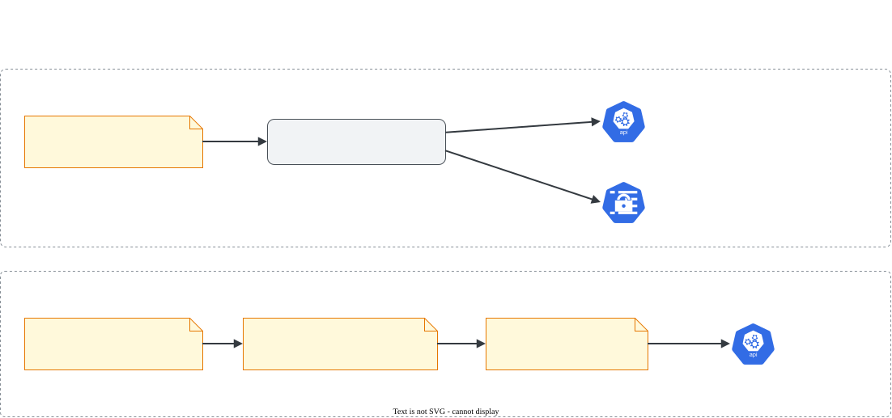

# Helm e Kustomize

> **Versão do Kubernetes:** v1.37 · **Helm:** v4.3.1 · **Kustomize:** v5.8.1 (embutido no kubectl) · **Última revisão:** 2026-10-25 · **Domínio:** Cluster Architecture, Installation & Configuration (25%)

O currículo trata os dois como um item só (*"Use Helm and Kustomize to install cluster components"*), e a prova costuma pedir tarefas curtas de cada um.

## O que é

Duas formas de instalar e customizar conjuntos de manifests sem editar YAML na mão a cada ambiente:

| | Helm | Kustomize |
|---|---|---|
| Ideia | **Gerenciador de pacotes**: um *chart* é um pacote de templates + valores padrão | **Sobreposição**: YAML puro + um `kustomization.yaml` que aplica mudanças por cima |
| Customização | Variáveis (`values.yaml`, `--set`) preenchem templates Go | Patches, prefixos, labels, troca de imagem, sem template |
| Estado no cluster | Guarda **releases** com histórico (permite `rollback`) | Não guarda nada: só gera YAML e aplica |
| Ferramenta | Binário `helm` separado | Embutido no `kubectl` (`-k`) |

Na prova: instalar/atualizar um chart com valores específicos, listar releases, e aplicar ou ajustar um diretório Kustomize.

## Como funciona por dentro

**Helm** (v3 em diante, sem o antigo Tiller):

1. O `helm` lê o chart (local ou de um repositório) e junta com os seus values.
2. Renderiza os templates **no seu computador**, gerando YAML comum.
3. Envia esses objetos ao **kube-apiserver** com as credenciais do seu kubeconfig. Ou seja, o RBAC do seu usuário vale.
4. Grava o estado da *release* como um **Secret** no namespace dela (`sh.helm.release.v1.<nome>.v<revisão>`). É isso que permite `helm history` e `helm rollback`.

**Kustomize**:

1. Lê o `kustomization.yaml`, carrega os arquivos de `resources` e aplica as transformações (namespace, prefixo, patches…).
2. Gera um YAML final. Com `kubectl apply -k`, esse YAML vai para o API server como um `apply` comum.

[](../assets/diagramas/01-helm-kustomize.svg "Abrir o diagrama em tamanho real")

O PodSecurityPolicy, que aparece em charts antigos, foi **removido na v1.25**. Se um chart antigo tentar criar `PodSecurityPolicy`, a instalação falha. O substituto é o **Pod Security Admission**.

## Comandos essenciais

### Helm

```bash
# Adicionar um repositório e atualizar o índice
helm repo add metrics-server https://kubernetes-sigs.github.io/metrics-server/
helm repo update
helm repo list

# Procurar charts (e versões disponíveis)
helm search repo metrics-server
helm search repo metrics-server --versions

# Ver os valores padrão do chart: é onde você descobre o nome da chave para o --set
helm show values metrics-server/metrics-server | less

# Instalar: helm install <nome-da-release> <repo/chart>
helm install metrics-server metrics-server/metrics-server \
  -n monitoring --create-namespace \
  --version 3.14.0 \
  --set replicas=2
# (3.14.0 era a versão mais nova do chart em outubro de 2026: confira com "helm search repo --versions")

# Instalar com arquivo de valores
helm install my-app ./meu-chart -n apps -f valores-prod.yaml

# Instalar ou atualizar (idempotente: bom para "garanta que esteja instalado")
helm upgrade --install metrics-server metrics-server/metrics-server -n monitoring --set replicas=3

# Listar releases: sem -A, só mostra o namespace atual
helm list -A

# Ver valores aplicados, histórico e voltar uma revisão
helm get values metrics-server -n monitoring
helm history metrics-server -n monitoring
helm rollback metrics-server 1 -n monitoring

# Remover a release (e os objetos que ela criou)
helm uninstall metrics-server -n monitoring

# Só gerar o YAML, sem instalar: o "dry-run" do Helm
helm template metrics-server metrics-server/metrics-server -n monitoring --set replicas=2 > render.yaml
helm install metrics-server metrics-server/metrics-server -n monitoring --dry-run=client

# Baixar e descompactar o chart para inspecionar
helm pull metrics-server/metrics-server --untar
```

No Helm 4, o `--dry-run` sem valor ainda funciona, mas avisa: `--dry-run is deprecated and should be replaced with '--dry-run=client'`. Use `--dry-run=client` (renderiza sem falar com o cluster) ou `--dry-run=server` (valida contra a API).

Saída real do histórico depois de install, upgrade e rollback. O rollback cria uma revisão **nova** (3), com os valores da revisão 1:

```console
$ helm rollback hist 1 -n hist-t
Rollback was a success! Happy Helming!
$ helm history hist -n hist-t
REVISION  UPDATED                   STATUS      CHART                  APP VERSION  DESCRIPTION
1         Sun Oct 25 07:29:35 2026  superseded  metrics-server-3.14.0  0.9.0        Install complete
2         Sun Oct 25 07:29:36 2026  superseded  metrics-server-3.14.0  0.9.0        Upgrade complete
3         Sun Oct 25 07:29:36 2026  deployed    metrics-server-3.14.0  0.9.0        Rollback to 1
$ kubectl get secret -n hist-t -l owner=helm -o name
secret/sh.helm.release.v1.hist.v1
secret/sh.helm.release.v1.hist.v2
secret/sh.helm.release.v1.hist.v3
```

### Kustomize

```bash
# Ver o YAML final sem aplicar: o "dry-run" do Kustomize
kubectl kustomize overlays/prod

# Aplicar um diretório que tem kustomization.yaml (-k, não -f)
kubectl apply -k overlays/prod

# Comparar com o que está no cluster antes de aplicar
kubectl diff -k overlays/prod

# Remover tudo que o diretório gera
kubectl delete -k overlays/prod
```

Para criar os YAML que a Kustomize vai usar como base, o `--dry-run=client -o yaml` continua sendo o atalho:

```bash
kubectl create deployment web --image=nginx:1.27 --dry-run=client -o yaml > base/deployment.yaml
kubectl create service clusterip web --tcp=80:80 --dry-run=client -o yaml > base/service.yaml
```

## YAML de referência

Estrutura típica de base + overlay:

```text
app/
├── base/
│   ├── deployment.yaml
│   ├── service.yaml
│   └── kustomization.yaml
└── overlays/
    └── prod/
        ├── kustomization.yaml
        └── replicas-patch.yaml
```

```yaml
# app/base/kustomization.yaml
apiVersion: kustomize.config.k8s.io/v1beta1
kind: Kustomization
resources:                    # arquivos (ou diretórios) que entram no build
  - deployment.yaml
  - service.yaml
```

```yaml
# app/overlays/prod/kustomization.yaml
apiVersion: kustomize.config.k8s.io/v1beta1
kind: Kustomization
resources:
  - ../../base                # reaproveita a base inteira
namespace: prod               # força o namespace em todos os objetos
namePrefix: prod-             # web → prod-web (e ajusta referências internas)
labels:                       # substitui o antigo "commonLabels" (depreciado)
  - pairs:
      env: prod
    includeSelectors: false   # não mexe nos selectors (evita quebrar Deployments existentes)
images:                       # troca a tag sem editar o Deployment
  - name: nginx
    newTag: "1.27.2"
patches:                      # substitui "patchesStrategicMerge" (depreciado)
  - path: replicas-patch.yaml
```

```yaml
# app/overlays/prod/replicas-patch.yaml
# Patch estratégico: só os campos que mudam + o que identifica o objeto
apiVersion: apps/v1
kind: Deployment
metadata:
  name: web                   # nome ORIGINAL (antes do namePrefix)
spec:
  replicas: 3
```

Values de Helm usados com `-f`:

```yaml
# valores-prod.yaml: as chaves precisam existir no values.yaml do chart
replicas: 2
resources:
  requests:
    cpu: 100m
    memory: 128Mi
```

## Na documentação oficial

- **Kustomize:** *Declarative Management of Kubernetes Objects Using Kustomize*. Link: <https://kubernetes.io/docs/tasks/manage-kubernetes-objects/kustomization/>
    - **Busca rápida:** `kustomize`
    - **Ctrl+F:** `namePrefix`, `patches`, `images`, `configMapGenerator`, `bases and overlays`.
- **Helm:** a documentação do Helm fica em <https://helm.sh/docs/>, fora de kubernetes.io, e está na lista de sites permitidos na CKA (página *Resources Allowed* da Linux Foundation).
    - Na prova, o `helm <comando> --help` é a referência mais rápida e sempre disponível. Exemplo: `helm install --help | grep -A2 create-namespace`.
    - Páginas úteis: *Using Helm* (<https://helm.sh/docs/intro/using_helm/>) e *Cheat Sheet* (<https://helm.sh/docs/intro/cheatsheet/>).

## Pegadinhas da prova

- **Ordem dos argumentos.** `helm install <NOME-DA-RELEASE> <CHART>`. Invertido, ele tenta achar um chart com o nome da release.
- **Namespace do Helm.** `helm list` sem `-n`/`-A` só mostra o namespace atual. E `helm uninstall` sem `-n` não acha a release. O namespace precisa existir, ou use `--create-namespace`.
- **`--set` com chave errada.** O Helm **não** reclama de chave inexistente: ela é ignorada em silêncio. Confira o nome com `helm show values`. No teste, `helm upgrade ... --set replicaz=5` terminou com `STATUS: deployed`, sem aviso nenhum.
- **`helm upgrade` esquece os `--set` anteriores.** Sem `--reuse-values`, o upgrade parte dos valores padrão do chart mais o que você passar **agora**. No teste, uma release com `replicas=2` voltou para `1` depois de um `helm upgrade` que não repetiu o `--set replicas=2`. Para mudar um valor e manter os outros: `helm upgrade <release> <chart> --reuse-values --set chave=valor`.
- **Duas releases do mesmo chart no cluster.** Objetos sem namespace (como o `APIService` do metrics-server) só podem ter um dono. A segunda instalação falha com `invalid ownership metadata; annotation validation error: key "meta.helm.sh/release-name" must equal "metrics": current value is "metrics-server"`.
- **`--set` com listas e pontos:** `--set image.tag=1.2` (aninhado), `--set 'args={--a,--b}'` (lista). Use aspas simples no shell.
- **`helm upgrade` sem `--install`** falha se a release ainda não existir.
- **`-k` × `-f`.** `kubectl apply -f` num diretório com `kustomization.yaml` aplica os arquivos crus, **sem** as transformações. E ainda tenta aplicar o próprio `kustomization.yaml`, o que dá erro. Saída real:

    ```console
    $ kubectl apply -f overlays/prod
    resource mapping not found for name: "" namespace: "" from "overlays/prod/kustomization.yaml": no matches for kind "Kustomization" in version "kustomize.config.k8s.io/v1beta1"
    Error from server (Invalid): error when creating "overlays/prod/replicas-patch.yaml": Deployment.apps "web" is invalid: [spec.selector: Required value, ...]
    ```

- **Patch com nome já prefixado.** O patch referencia o nome **da base** (`web`), não o final (`prod-web`). Com o nome final, o build falha: `no resource matches strategic merge patch "Deployment.v1.apps/prod-web.[noNs]"`.
- **Campos depreciados da Kustomize** em material antigo: `bases` (use `resources`), `patchesStrategicMerge`/`patchesJson6902` (use `patches`), `commonLabels` (use `labels`). No kubectl v1.37 (Kustomize v5.8.1) ainda funcionam, com um aviso por campo: `# Warning: 'commonLabels' is deprecated. Please use 'labels' instead. Run 'kustomize edit fix' to update your Kustomization automatically.` Não escreva código novo com eles.
- **Versão do Helm.** O Helm 4 foi lançado em novembro de 2025. Os comandos desta página foram testados no Helm 4.3.1 e são os mesmos do Helm 3; a diferença que aparece é o aviso do `--dry-run` sem valor. Confira com `helm version` no ambiente da prova.

## Pratique

**Enunciado (como na prova):**

> 1. Using Helm, install the chart `metrics-server/metrics-server` as a release named `metrics` in the namespace `observability` (create it if needed), setting the value `replicas` to `2`.
> 2. The directory `/opt/app/overlays/staging` contains a Kustomize overlay. Change it so that all resources are deployed to the namespace `staging` with the image `nginx:1.27.2`, then apply it.

**Tradução:**

1. Com Helm, instale o chart `metrics-server/metrics-server` como uma release chamada `metrics` no namespace `observability` (crie se precisar), definindo o valor `replicas` como `2`.
2. O diretório `/opt/app/overlays/staging` contém um overlay Kustomize. Altere-o para que todos os recursos sejam criados no namespace `staging` com a imagem `nginx:1.27.2` e aplique.

??? success "Solução"
    **Parte 1:**
    ```bash
    helm repo list                     # o repo já existe? senão: helm repo add ...
    helm show values metrics-server/metrics-server | grep -n replicas
    helm install metrics metrics-server/metrics-server \
      -n observability --create-namespace --set replicas=2
    ```
    **Parte 2:** acrescente ao `/opt/app/overlays/staging/kustomization.yaml`:
    ```yaml
    namespace: staging
    images:
      - name: nginx
        newTag: "1.27.2"
    ```
    ```bash
    kubectl kustomize /opt/app/overlays/staging | grep -E 'namespace:|image:'   # confere antes
    kubectl create namespace staging --dry-run=client -o yaml | kubectl apply -f -
    kubectl apply -k /opt/app/overlays/staging
    ```

**Como verificar:**

```bash
helm list -n observability                                  # release "metrics", STATUS deployed
helm get values metrics -n observability                    # replicas: 2
kubectl get deploy -n observability                         # metrics-metrics-server, 2 réplicas

kubectl get all -n staging                                  # recursos no namespace certo
kubectl get deploy -n staging -o jsonpath='{.items[*].spec.template.spec.containers[*].image}'
```

O Deployment se chama `metrics-metrics-server`: o chart monta o nome com a release (`metrics`) e o nome do chart. Num lab kubeadm sem `--kubelet-insecure-tls`, ele fica `READY 0/2`: os Pods rodam, mas não passam no readiness, porque não conseguem ler as métricas dos kubelets. A questão pede a release e o valor, e as duas coisas estão certas.

??? tip "No lab / Killercoda"

    - Instale o metrics-server com Helm no lab kubeadm. Sem `--set args='{--kubelet-insecure-tls}'`, o log mostra `x509: cannot validate certificate for 10.0.1.5 because it doesn't contain any IP SANs` e o `kubectl top nodes` responde `error: Metrics API not available`. Com a flag, o `top` funciona.
    - Faça `helm upgrade` mudando um valor, depois `helm history` e `helm rollback`. Em seguida rode `kubectl get secrets -n <ns> | grep sh.helm` e veja onde o histórico mora.
    - Monte base + overlays `dev` e `prod` e compare `kubectl kustomize` dos dois com `diff`.
    - Use `helm template ... > render.yaml` e coloque o resultado como `resources` numa Kustomize, um padrão comum para customizar charts.
