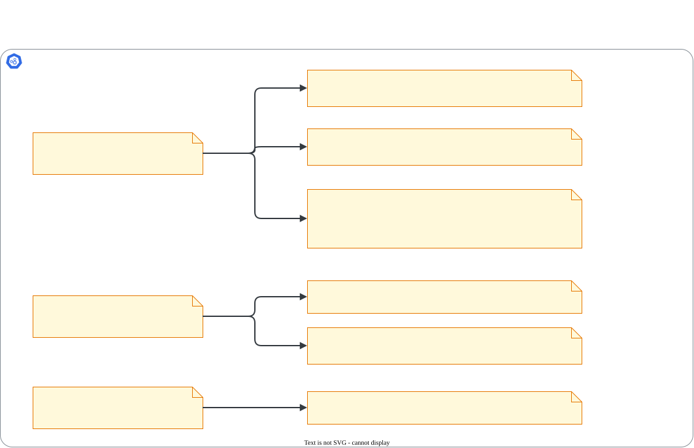

# Certificados com kubeadm

> **Versão do Kubernetes:** v1.37 · **Última revisão:** 2026-10-25 · **Domínio:** Cluster Architecture, Installation & Configuration (25%)

## O que é

Todo componente do Kubernetes se comunica por **TLS mútuo**: cada lado apresenta um certificado assinado por uma **CA** (autoridade certificadora) em que o outro confia. O kubeadm cria essa estrutura (a *PKI* do cluster) no `kubeadm init` e oferece o subcomando `kubeadm certs` para administrá-la.

O que importa para a prova:

- **Onde ficam** os certificados e qual componente usa cada um.
- **Ver a validade**: `kubeadm certs check-expiration` ou `openssl`.
- **Renovar**: `kubeadm certs renew`, e depois **reiniciar** os componentes do control plane.
- **Ler um certificado**: emissor, validade e SANs (os nomes/IPs para os quais o certificado vale).

Validade padrão no kubeadm:

| Tipo | Validade | Renovação |
|---|---|---|
| CAs (`ca.crt`, `etcd/ca.crt`, `front-proxy-ca.crt`) | 10 anos | Manual e trabalhosa: fora do escopo do `kubeadm certs renew` |
| Certificados "folha" (apiserver, etcd server, kubeconfigs...) | 1 ano | `kubeadm certs renew`, ou automática a cada `kubeadm upgrade apply` |

Se o cluster passa um ano sem upgrade nem renovação, os certificados vencem e o `kubectl` para de funcionar com erro `x509: certificate has expired`.

## Como funciona por dentro

Um cluster kubeadm tem **três CAs**, cada uma com seu grupo de certificados:

[](../assets/diagramas/01-kubeadm-certs.svg "Abrir o diagrama em tamanho real")

Arquivos em `/etc/kubernetes/pki/` (control plane):

| Arquivo | Quem usa | Para quê |
|---|---|---|
| `ca.crt` / `ca.key` | Todos | CA principal: assina os demais e valida clientes |
| `apiserver.crt` | kube-apiserver | Certificado de **servidor** HTTPS (os SANs listam IPs e nomes do API server) |
| `apiserver-kubelet-client.crt` | kube-apiserver | **Cliente** ao falar com o kubelet (`logs`, `exec`) |
| `apiserver-etcd-client.crt` | kube-apiserver | **Cliente** ao falar com o etcd |
| `etcd/server.crt`, `etcd/peer.crt` | etcd | Servidor para clientes e comunicação entre membros do etcd |
| `etcd/healthcheck-client.crt` | probe do etcd | Cliente para health check |
| `front-proxy-client.crt` | kube-apiserver | API aggregation (ex.: metrics-server) |
| `sa.key` / `sa.pub` | apiserver, controller-manager | Par de chaves que assina tokens de ServiceAccount. **Não é certificado e não expira.** |

Os kubeconfigs em `/etc/kubernetes/` (`admin.conf`, `super-admin.conf`, `controller-manager.conf`, `scheduler.conf`) têm o certificado de cliente **embutido em base64**. Por isso o `kubeadm certs renew` também regenera esses arquivos.

**Reinício após renovar**: o kubelet **não** recria um static Pod quando um `.crt` muda, só quando o manifest em `/etc/kubernetes/manifests/` muda. O que acontece depois do renew depende do certificado (testado na v1.37.1):

| Certificado renovado | Sem reiniciar |
|---|---|
| `apiserver` (servidor HTTPS da API) | O kube-apiserver **recarrega sozinho**, em até cerca de um minuto: o `openssl s_client` passou a mostrar o certificado novo sem nenhum restart |
| `etcd-server` | O etcd também **recarrega sozinho** |
| Cliente embutido em `scheduler.conf` e `controller-manager.conf` | O arquivo muda, mas o processo segue com o certificado que leu ao iniciar |

Por isso a documentação do kubeadm continua mandando **reiniciar os static Pods depois do renew**: nem todo componente recarrega. Faça o reinício sempre; é o procedimento que a prova espera.

**kubelet**: o certificado de cliente do kubelet (`/var/lib/kubelet/pki/kubelet-client-current.pem`) é **rotacionado automaticamente** pelo próprio kubelet (`rotateCertificates: true` na configuração gerada pelo kubeadm). Por isso o `kubelet.conf` aponta para esse arquivo em vez de embutir o certificado. Por isso também o `kubeadm certs check-expiration` **não lista** o `kubelet.conf` (conferido na v1.37.1).

**Upgrade renova os certificados.** No lab, depois do `kubeadm upgrade apply` para a v1.37.1, todos os certificados folha passaram a vencer um ano depois do horário do upgrade:

```console
$ kubeadm certs check-expiration
CERTIFICATE                EXPIRES                  RESIDUAL TIME   CERTIFICATE AUTHORITY   EXTERNALLY MANAGED
admin.conf                 Oct 25, 2027 06:40 UTC   364d            ca                      no
apiserver                  Oct 25, 2027 06:40 UTC   364d            ca                      no
apiserver-etcd-client      Oct 25, 2027 06:40 UTC   364d            etcd-ca                 no
apiserver-kubelet-client   Oct 25, 2027 06:40 UTC   364d            ca                      no
controller-manager.conf    Oct 25, 2027 06:40 UTC   364d            ca                      no
etcd-healthcheck-client    Oct 25, 2027 06:40 UTC   364d            etcd-ca                 no
etcd-peer                  Oct 25, 2027 06:40 UTC   364d            etcd-ca                 no
etcd-server                Oct 25, 2027 06:40 UTC   364d            etcd-ca                 no
front-proxy-client         Oct 25, 2027 06:40 UTC   364d            front-proxy-ca          no
scheduler.conf             Oct 25, 2027 06:40 UTC   364d            ca                      no
super-admin.conf           Oct 25, 2027 06:40 UTC   364d            ca                      no

CERTIFICATE AUTHORITY   EXPIRES                  RESIDUAL TIME   EXTERNALLY MANAGED
ca                      Oct 22, 2036 05:25 UTC   9y              no
etcd-ca                 Oct 22, 2036 05:25 UTC   9y              no
front-proxy-ca          Oct 22, 2036 05:25 UTC   9y              no
```

## Comandos essenciais

```bash
# Validade de todos os certificados gerenciados pelo kubeadm (rodar no control plane, como root)
kubeadm certs check-expiration

# Renovar TODOS os certificados folha (não renova as CAs)
kubeadm certs renew all

# Renovar só um
kubeadm certs renew apiserver
kubeadm certs renew admin.conf
kubeadm certs renew etcd-server

# Ver os nomes aceitos pelo renew
kubeadm certs renew --help

# Depois de renovar: reiniciar os static Pods do control plane.
# Tirar os manifests da pasta faz o kubelet parar os Pods; devolver faz recriar.
mkdir -p /tmp/manifests
mv /etc/kubernetes/manifests/*.yaml /tmp/manifests/
sleep 20                      # o kubelet verifica a pasta a cada ~20s
mv /tmp/manifests/*.yaml /etc/kubernetes/manifests/
crictl ps                     # conferir que voltaram

# Se o admin.conf foi renovado, atualizar o kubeconfig do usuário
cp /etc/kubernetes/admin.conf ~/.kube/config
```

**Ler um certificado com openssl** (funciona para qualquer `.crt`, gerenciado pelo kubeadm ou não):

```bash
# Validade (notBefore / notAfter)
openssl x509 -in /etc/kubernetes/pki/apiserver.crt -noout -dates

# Só a data de expiração
openssl x509 -in /etc/kubernetes/pki/apiserver.crt -noout -enddate

# Emissor (quem assinou) e sujeito (CN = nome, O = grupo)
openssl x509 -in /etc/kubernetes/pki/apiserver.crt -noout -issuer -subject

# SANs: nomes e IPs para os quais o certificado vale
openssl x509 -in /etc/kubernetes/pki/apiserver.crt -noout -text | grep -A1 "Subject Alternative Name"

# Certificado embutido num kubeconfig: decodificar o base64 e ler
grep client-certificate-data /etc/kubernetes/admin.conf | awk '{print $2}' | base64 -d | openssl x509 -noout -enddate -subject
```

**Descobrir qual arquivo cada componente usa** (essencial em Troubleshooting):

```bash
grep -E -- '--[a-z-]*(file|cafile|certfile|keyfile|certificate)=' /etc/kubernetes/manifests/kube-apiserver.yaml
```

`--dry-run=client -o yaml` não se aplica aqui: nenhum desses comandos cria objeto Kubernetes.

## YAML de referência

Flags de certificado no `/etc/kubernetes/manifests/kube-apiserver.yaml`. São elas que você corrige quando o apiserver não sobe por caminho errado:

```yaml
spec:
  containers:
    - name: kube-apiserver
      command:
        - kube-apiserver
        - --client-ca-file=/etc/kubernetes/pki/ca.crt                     # CA que valida clientes (kubectl, kubelet...)
        - --tls-cert-file=/etc/kubernetes/pki/apiserver.crt                # certificado de servidor
        - --tls-private-key-file=/etc/kubernetes/pki/apiserver.key
        - --kubelet-client-certificate=/etc/kubernetes/pki/apiserver-kubelet-client.crt
        - --kubelet-client-key=/etc/kubernetes/pki/apiserver-kubelet-client.key
        - --etcd-cafile=/etc/kubernetes/pki/etcd/ca.crt                    # CA do etcd, NÃO a ca.crt principal
        - --etcd-certfile=/etc/kubernetes/pki/apiserver-etcd-client.crt
        - --etcd-keyfile=/etc/kubernetes/pki/apiserver-etcd-client.key
        - --service-account-key-file=/etc/kubernetes/pki/sa.pub            # valida tokens de ServiceAccount
        - --service-account-signing-key-file=/etc/kubernetes/pki/sa.key    # assina tokens
```

Configuração do kubeadm que influencia os certificados (usada no `kubeadm init --config`):

```yaml
apiVersion: kubeadm.k8s.io/v1beta4
kind: ClusterConfiguration
apiServer:
  certSANs:                       # nomes/IPs extras no apiserver.crt (ex.: IP público, DNS do load balancer)
    - "k8s.meulab.exemplo"
    - "20.0.0.10"
certificateValidityPeriod: 8760h0m0s     # validade dos certificados folha (padrão 1 ano)
caCertificateValidityPeriod: 87600h0m0s  # validade das CAs (padrão 10 anos)
```

Os dois campos de validade existem na API `v1beta4`: o `kubeadm config validate --config` aceita o arquivo acima, e a configuração que o próprio kubeadm guarda no cluster (`kubectl -n kube-system get cm kubeadm-config -o yaml`) já traz `certificateValidityPeriod: 8760h0m0s` e `caCertificateValidityPeriod: 87600h0m0s`. Campo com nome errado é recusado: `strict decoding error: unknown field "..."`.

## Na documentação oficial

- **Página principal:** *Certificate Management with kubeadm*. Link: <https://kubernetes.io/docs/tasks/administer-cluster/kubeadm/kubeadm-certs/>
- **Complementar:** *PKI certificates and requirements* (lista de todos os certificados e caminhos). Link: <https://kubernetes.io/docs/setup/best-practices/certificates/>
- **Busca rápida:** `kubeadm certs`
- **Ctrl+F dentro da página principal:**
    - `check-expiration`: comando e exemplo de saída.
    - `renew all`: renovação manual.
    - `restart the control plane Pods`: o aviso de que é preciso reiniciar (e como).
    - `automatic certificate renewal`: renovação automática no upgrade.
- **Ctrl+F na página de PKI:** `apiserver-etcd-client` (tabela "certificate paths", com o arquivo de cada flag).

## Pegadinhas da prova

- **Renovar e não reiniciar.** Na v1.37 o apiserver e o etcd trocam o certificado de servidor sozinhos, mas o scheduler e o controller-manager continuam com o certificado de cliente que leram ao iniciar. Reinicie os static Pods depois do renew, como manda a documentação.
- **`kubectl` quebra depois do renew.** O `admin.conf` foi renovado e o `~/.kube/config` ainda tem o certificado antigo. Copie de novo.
- **`renew` não renova as CAs.** CA vencida exige outro procedimento. Na prova, o que costuma cair é renovar certificado folha.
- **CA errada nas flags.** `--etcd-cafile` usa `etcd/ca.crt`, não `ca.crt`. Trocar uma pela outra deixa o apiserver sem falar com o etcd, uma questão clássica de Troubleshooting.
- **`.crt` × `.key` trocados** em flags com nome parecido (`--tls-cert-file` × `--tls-private-key-file`, `--etcd-certfile` × `--etcd-keyfile`).
- **Rodar no nó errado.** `kubeadm certs` funciona no **control plane**, onde está `/etc/kubernetes/pki`. Em worker não há nada para renovar.
- **Esquecer `sudo`.** As chaves privadas só são legíveis por root.
- **Gravar o resultado no lugar pedido.** Questões do tipo "write the expiration date to /opt/..." conferem o arquivo. Grave só o que foi pedido, no caminho exato.

## Pratique

**Enunciado (como na prova):**

> On the control plane node `controlplane`, find the expiration date of the kube-apiserver serving certificate and write it to `/opt/apiserver-expiry.txt`. Then renew the kube-apiserver serving certificate using kubeadm and make sure the API server is using the new certificate.

**Tradução:** no nó `controlplane`, descubra a data de expiração do certificado de servidor do kube-apiserver e grave em `/opt/apiserver-expiry.txt`. Depois renove esse certificado com kubeadm e garanta que o API server está usando o certificado novo.

??? success "Solução"
    ```bash
    ssh controlplane
    sudo -i

    # 1. Data de expiração (qualquer uma das duas formas)
    openssl x509 -in /etc/kubernetes/pki/apiserver.crt -noout -enddate > /opt/apiserver-expiry.txt
    # ou: kubeadm certs check-expiration | grep '^apiserver ' > /opt/apiserver-expiry.txt
    cat /opt/apiserver-expiry.txt

    # 2. Renovar
    kubeadm certs renew apiserver

    # 3. Reiniciar o apiserver (static Pod)
    mv /etc/kubernetes/manifests/kube-apiserver.yaml /tmp/
    sleep 20
    mv /tmp/kube-apiserver.yaml /etc/kubernetes/manifests/
    ```

**Como verificar:**

```bash
# Data do arquivo em disco
openssl x509 -in /etc/kubernetes/pki/apiserver.crt -noout -enddate

# Data do certificado que o apiserver está SERVINDO agora: precisa ser igual à de cima
echo | openssl s_client -connect 127.0.0.1:6443 2>/dev/null | openssl x509 -noout -enddate

kubectl get nodes   # API respondendo normalmente
```

??? tip "No lab / Killercoda"

    - No lab Azure, adicione o **IP público** da VM do control plane ao `apiserver.crt` para usar o `kubectl` de fora. Sem isso, a conexão pelo IP público falha na validação do certificado (no teste, com `curl`: `no alternative certificate subject name matches target host name`). Procedimento testado na v1.37.1:

        ```bash
        cp -a /etc/kubernetes /root/k8s-backup                     # backup antes
        kubectl -n kube-system get cm kubeadm-config -o jsonpath='{.data.ClusterConfiguration}' > cluster.yaml
        # em cluster.yaml, troque "apiServer: {}" por:
        #   apiServer:
        #     certSANs:
        #     - "<IP público>"
        rm /etc/kubernetes/pki/apiserver.crt /etc/kubernetes/pki/apiserver.key
        kubeadm init phase certs apiserver --config cluster.yaml   # "...and IPs [10.96.0.1 10.0.1.4 <IP público>]"
        ```

        O apiserver passou a servir o certificado novo em menos de um minuto, sem restart. A porta 6443 também precisa estar liberada no NSG da VM.
    - Rode `kubeadm certs renew all` e compare, a cada 30 segundos, o `openssl s_client` (o que é servido) com o arquivo em disco: o apiserver e o etcd trocam sozinhos. Depois confira que o scheduler não foi recriado (`crictl ps --name kube-scheduler`, coluna `CREATED`) e reinicie os static Pods.
    - Troque `--etcd-cafile` por `/etc/kubernetes/pki/ca.crt` no manifest do apiserver e investigue com `crictl logs`. É treino direto de Troubleshooting. Depois desfaça.
    - Antes de qualquer experimento, faça backup de `/etc/kubernetes/` (`cp -a /etc/kubernetes /root/k8s-backup`).
