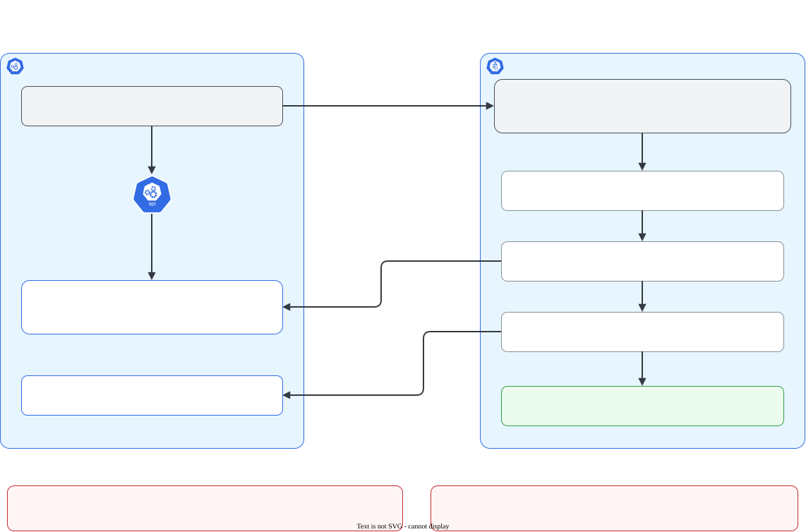

# Adicionar um nó com kubeadm join

> **Versão do Kubernetes:** v1.37 · **Última revisão:** 2026-10-25 · **Domínio:** Cluster Architecture, Installation & Configuration (25%)

## O que é

`kubeadm join` coloca uma máquina num cluster que já existe. Na prova o cluster vem pronto, e a tarefa típica é: "o nó `node01` já tem kubeadm, kubelet e container runtime instalados; faça ele entrar no cluster".

São dois comandos, em dois nós diferentes:

1. **No control plane:** `kubeadm token create --print-join-command` gera um token novo e imprime o comando completo de join.
2. **No nó novo:** rodar esse comando como root.

O comando tem três partes:

| Parte | Para quê |
|---|---|
| `<control-plane>:6443` | Endereço do API server |
| `--token abcdef.0123456789abcdef` | Token de bootstrap: autoriza o nó a se apresentar ao cluster. Validade padrão de **24 horas** |
| `--discovery-token-ca-cert-hash sha256:...` | Hash da chave pública da CA do cluster: o nó confere que está falando com o cluster certo, e não com um impostor |

## Como funciona por dentro

[](../assets/diagramas/01-kubeadm-join.svg "Abrir o diagrama em tamanho real")

O join tem três etapas no nó novo:

1. **Preflight.** Confere portas, arquivos que não podem existir ainda, kubelet, swap, `ip_forward` e container runtime.
2. **Descoberta.** O nó baixa o ConfigMap `cluster-info` do namespace `kube-public`, que é público. Ele traz a CA do cluster e uma assinatura feita com cada token válido. O nó confere duas coisas:
    - a assinatura do **token** existe, ou seja, o token vale;
    - o **hash** da CA bate com o `--discovery-token-ca-cert-hash`.
3. **TLS bootstrap.** O kubelet usa o token para enviar um pedido de certificado (CSR). O kubeadm já deixa o cluster configurado para aprovar esse CSR sozinho. O kubelet recebe o certificado, grava o `/etc/kubernetes/kubelet.conf` e o nó aparece em `kubectl get nodes`.

Testado no lab (VMs Azure, Ubuntu 24.04, v1.37.1), tirando o worker `w2` do cluster e colocando de novo. O CSR do worker aparece aprovado, pedido pelo usuário do token (`system:bootstrap:<id do token>`):

```console
$ kubectl get csr
NAME        AGE   SIGNERNAME                                    REQUESTOR                 REQUESTEDDURATION   CONDITION
csr-c8l46   1s    kubernetes.io/kube-apiserver-client-kubelet   system:bootstrap:a0vcex   <none>              Approved,Issued
```

## Comandos essenciais

```bash
# No CONTROL PLANE: token novo + comando pronto (o mais rápido na prova)
kubeadm token create --print-join-command

# Token com outra validade
kubeadm token create --ttl 2h --print-join-command

# Tokens existentes e validade
kubeadm token list

# Apagar um token
kubeadm token delete <token>

# Calcular o hash da CA à mão (se tiver o token, mas não o hash)
openssl x509 -pubkey -in /etc/kubernetes/pki/ca.crt \
  | openssl rsa -pubin -outform der 2>/dev/null \
  | openssl dgst -sha256 -hex | sed 's/^.* //'

# No NÓ NOVO, como root: colar o comando gerado
kubeadm join <control-plane>:6443 --token <token> --discovery-token-ca-cert-hash sha256:<hash>

# No nó novo: kubelet ligado e habilitado para subir no boot
systemctl enable --now kubelet

# De volta ao control plane: conferir
kubectl get nodes
```

Saída real do `--print-join-command` e do join no lab (o hash calculado com `openssl` deu o mesmo valor, `3fac0804...`):

```console
$ sudo kubeadm token create --print-join-command
kubeadm join 10.0.1.4:6443 --token a0vcex.5biobijwwrk8ptr5 --discovery-token-ca-cert-hash sha256:3fac0804502ef84779a0c8a9e9c2f76721adc56c70ebfd37d97f269ade22de9f
```

```console
$ sudo kubeadm join 10.0.1.4:6443 --token a0vcex.5biobijwwrk8ptr5 --discovery-token-ca-cert-hash sha256:3fac0804502ef84779a0c8a9e9c2f76721adc56c70ebfd37d97f269ade22de9f
[preflight] Running pre-flight checks
[preflight] Reading configuration from the "kubeadm-config" ConfigMap in namespace "kube-system"...
[kubelet-start] Writing kubelet configuration to file "/var/lib/kubelet/config.yaml"
[kubelet-start] Starting the kubelet
[kubelet-check] The kubelet is healthy after 502.745022ms
[kubelet-start] Waiting for the kubelet to perform the TLS Bootstrap

This node has joined the cluster:
* Certificate signing request was sent to apiserver and a response was received.
* The Kubelet was informed of the new secure connection details.

Run 'kubectl get nodes' on the control-plane to see this node join the cluster.
```

**Tirar um nó e colocar de novo** (útil para treinar no lab):

```bash
# No control plane
kubectl drain node01 --ignore-daemonsets --delete-emptydir-data
kubectl delete node node01

# No node01: desfaz o join (apaga kubelet.conf, pki/ca.crt e para o kubelet)
kubeadm reset -f

# Depois: gerar um comando novo no control plane e rodar no node01
```

`--dry-run=client -o yaml` não se aplica aqui: nenhum desses comandos cria um objeto que você escreveria em YAML.

## Na documentação oficial

- **Página principal:** *kubeadm join*. Link: <https://kubernetes.io/docs/reference/setup-tools/kubeadm/kubeadm-join/>
- **Complementar:** *Adding Linux worker nodes*. Link: <https://kubernetes.io/docs/tasks/administer-cluster/kubeadm/adding-linux-nodes/>
- **Complementar:** *kubeadm token*. Link: <https://kubernetes.io/docs/reference/setup-tools/kubeadm/kubeadm-token/>
- **Busca rápida:** `kubeadm join`
- **Ctrl+F dentro da página principal:**
    - `print-join-command`: gerar o comando pronto.
    - `discovery-token-ca-cert-hash`: o que é o hash e o comando `openssl` para calculá-lo.

## Pegadinhas da prova

- **Rodar o join no nó errado.** `token create` roda no control plane; `join` roda no nó **novo**. Rodar o join no próprio control plane falha no preflight, porque `kubelet.conf` e `pki/ca.crt` já existem.
- **Rodar o join duas vezes.** O segundo join falha no preflight. Saída real:

    ```console
    [preflight] Some fatal errors occurred:
    	[ERROR FileAvailable--etc-kubernetes-kubelet.conf]: /etc/kubernetes/kubelet.conf already exists
    	[ERROR Port-10250]: Port 10250 is in use
    	[ERROR FileAvailable--etc-kubernetes-pki-ca.crt]: /etc/kubernetes/pki/ca.crt already exists
    ```

    Se o nó já aparece em `kubectl get nodes`, não há nada para fazer. Se é preciso refazer, rode `kubeadm reset -f` no nó antes.

- **Token vencido ou apagado.** O join **não falha na hora**: fica tentando por **5 minutos** e só então desiste (no lab: das 07:22:52 às 07:27:52). Na prova isso parece travado. Gere outro comando com `--print-join-command`. Saída real depois dos 5 minutos:

    ```console
    error: error execution phase preflight: couldn't validate the identity of the API Server: could not find a JWS signature in the cluster-info ConfigMap for token ID "jqy6ud"
    ```

- **Hash errado** (copiado pela metade, por exemplo). Esse falha na hora:

    ```console
    error: error execution phase preflight: couldn't validate the identity of the API Server: cluster CA found in cluster-info ConfigMap is invalid: none of the public keys "sha256:3fac0804502ef84779a0c8a9e9c2f76721adc56c70ebfd37d97f269ade22de9f" are pinned
    ```

- **`ip_forward` desligado no nó.** O preflight bloqueia. Saída real numa VM Ubuntu 24.04 (v1.37.1), com `sysctl -w net.ipv4.ip_forward=0`:

    ```console
    [preflight] Some fatal errors occurred:
    	[ERROR FileContent--proc-sys-net-ipv4-ip_forward]: /proc/sys/net/ipv4/ip_forward contents are not set to 1
    ```

    Correção: `sysctl -w net.ipv4.ip_forward=1` (e, para valer depois do reboot, `net.ipv4.ip_forward = 1` num arquivo em `/etc/sysctl.d/`). Atenção a testes em cluster kind: lá os nós são containers, e o mesmo join passou com `ip_forward=0`. Em VM, como na prova, ele bloqueia.

- **kubelet não habilitado.** O join funciona e o nó fica Ready, mas o kubelet não sobe sozinho depois de um reboot. O preflight avisa e segue em frente:

    ```console
    [WARNING Service-kubelet]: kubelet service is not enabled, please run 'systemctl enable kubelet.service'
    ```

    Rode `systemctl enable kubelet` no nó.

- **Esquecer `sudo`.** `kubeadm join` precisa de root.
- **Esquecer de voltar ao control plane para conferir.** No nó novo normalmente não há kubeconfig de admin, então o `kubectl get nodes` roda no control plane (ou na máquina de onde você opera o cluster).

## Pratique

**Enunciado (como na prova):**

> The node `node01` has kubeadm, kubelet and containerd installed but is not part of the cluster. Join `node01` to the cluster and make sure it is `Ready`.

**Tradução:** o nó `node01` tem kubeadm, kubelet e containerd instalados, mas não faz parte do cluster. Coloque o `node01` no cluster e garanta que ele fique `Ready`.

??? success "Solução"
    ```bash
    # 1. No control plane: gerar o comando
    ssh controlplane
    sudo kubeadm token create --print-join-command
    # copiar a linha impressa

    # 2. No nó novo: rodar o comando como root
    ssh node01
    sudo kubeadm join <control-plane>:6443 --token <token> --discovery-token-ca-cert-hash sha256:<hash>
    sudo systemctl enable kubelet
    exit
    ```

**Como verificar:**

```bash
# No control plane
kubectl get nodes          # node01 aparece e fica Ready em alguns segundos
kubectl get csr            # CSR com REQUESTOR system:bootstrap:<id> e CONDITION Approved,Issued
```

Se o nó aparece mas fica `NotReady`, o problema já não é o join: veja [Nó NotReady](../05-troubleshooting/no-notready.md).

??? tip "No lab / Killercoda"

    - No lab, tire um worker e coloque de novo: drain e delete no control plane, `kubeadm reset -f` no worker, comando novo com `--print-join-command`. Todas as saídas desta página vieram desse roteiro, num worker de verdade.
    - Desligue o `ip_forward` (`sysctl -w net.ipv4.ip_forward=0`) antes do join e leia o erro do preflight. Ligue de novo antes de seguir.
    - Apague o token com `kubeadm token delete` e tente o join: veja a espera de 5 minutos e a mensagem final.
    - Troque um caractere do hash e compare: esse erro aparece na hora.
    - Rode `kubeadm join ... --v=5` para ver cada verificação do preflight e cada tentativa da descoberta.
