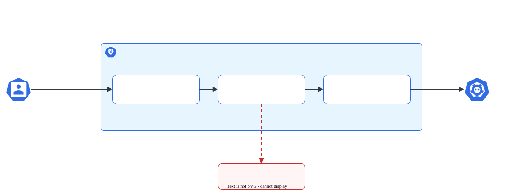

# RBAC

> **Versão do Kubernetes:** v1.36 · **Última revisão:** 2026-10-23 · **Domínio:** Cluster Architecture, Installation & Configuration (25%)

## O que é

RBAC (Role-Based Access Control) é o modelo de **autorização** padrão do Kubernetes. Ele responde a uma pergunta: *"este usuário/ServiceAccount pode fazer este verbo neste recurso, neste namespace?"*.

São quatro objetos, em dois pares:

| Define permissões | Concede permissões | Escopo |
|---|---|---|
| `Role` | `RoleBinding` | Um namespace |
| `ClusterRole` | `ClusterRoleBinding` | O cluster inteiro |

- **Role / ClusterRole** = lista de regras (*quais verbos em quais recursos*). Não diz para quem.
- **RoleBinding / ClusterRoleBinding** = liga um papel a **sujeitos** (`User`, `Group` ou `ServiceAccount`).

RBAC é **somente aditivo**: não existe regra de "negar". Se nenhuma regra permite, a ação é negada.

Na prova, RBAC costuma aparecer como: "crie uma ServiceAccount, dê permissão X em um namespace e confirme".

## Como funciona por dentro

Toda requisição passa pelo **kube-apiserver** em três etapas, nesta ordem:

[](../assets/diagramas/01-rbac.svg "Abrir o diagrama em tamanho real")

1. **Autenticação**: o API server identifica o sujeito (certificado de cliente, token de ServiceAccount, OIDC). Kubernetes **não tem objeto `User`**: usuário é só um nome que vem do certificado (campo `CN`) ou do token. Grupos vêm do campo `O` do certificado.
2. **Autorização**: os autorizadores configurados em `--authorization-mode` (no kubeadm: `Node,RBAC`) avaliam a requisição. O RBAC lê os Roles e Bindings, que ficam no etcd como qualquer outro objeto.
3. **Admission**: só depois de autorizada a requisição passa pelos admission controllers.

ServiceAccounts são autenticadas com o nome `system:serviceaccount:<namespace>:<nome>`. Isso importa para o `--as` do `kubectl auth can-i`.

Um detalhe que cai muito: um **RoleBinding pode referenciar uma ClusterRole**. As permissões valem só no namespace do RoleBinding. Assim você reaproveita papéis prontos como `view` e `edit` sem recriá-los em cada namespace.

## Comandos essenciais

```bash
# Criar uma ServiceAccount
kubectl create serviceaccount app-sa -n dev

# Role: verbos separados por vírgula, recursos no plural
kubectl create role pod-reader --verb=get,list,watch --resource=pods -n dev

# Role para recursos de outro apiGroup (deployments estão em "apps")
kubectl create role deploy-mgr --verb=get,list,create,update --resource=deployments -n dev

# Restringir a um objeto específico pelo nome
kubectl create role cm-reader --verb=get --resource=configmaps --resource-name=app-config -n dev

# Subrecurso (ler logs de pods)
kubectl create role log-reader --verb=get --resource=pods/log -n dev

# ClusterRole (sem -n: é cluster-scoped)
kubectl create clusterrole node-reader --verb=get,list,watch --resource=nodes

# RoleBinding para um usuário
kubectl create rolebinding jane-pod-reader --role=pod-reader --user=jane -n dev

# RoleBinding para uma ServiceAccount (formato namespace:nome)
kubectl create rolebinding app-sa-reader --role=pod-reader --serviceaccount=dev:app-sa -n dev

# RoleBinding apontando para uma ClusterRole: permissão vale só em "dev"
kubectl create rolebinding app-sa-view --clusterrole=view --serviceaccount=dev:app-sa -n dev

# ClusterRoleBinding: permissão em todos os namespaces
kubectl create clusterrolebinding ops-nodes --clusterrole=node-reader --group=ops

# Testar permissões se passando por outro sujeito
kubectl auth can-i list pods -n dev --as=jane
kubectl auth can-i create deployments -n dev --as=system:serviceaccount:dev:app-sa

# Listar tudo o que um sujeito pode fazer no namespace
kubectl auth can-i --list -n dev --as=system:serviceaccount:dev:app-sa

# Gerar YAML para revisar/editar antes de aplicar
kubectl create role pod-reader --verb=get,list --resource=pods -n dev --dry-run=client -o yaml > role.yaml

# Descobrir o apiGroup e o nome exato de um recurso
kubectl api-resources | grep -i deploy
```

Use `--dry-run=client -o yaml` quando o enunciado pedir algo que os flags imperativos não cobrem, como várias regras com apiGroups diferentes no mesmo Role. Gere a base e edite.

## YAML de referência

```yaml
apiVersion: rbac.authorization.k8s.io/v1
kind: Role
metadata:
  name: deploy-mgr
  namespace: dev              # Role sempre tem namespace
rules:
  - apiGroups: ["apps"]       # "" = core (pods, services, configmaps...); "apps" = deployments, statefulsets...
    resources: ["deployments"]
    verbs: ["get", "list", "create", "update"]
  - apiGroups: [""]
    resources: ["pods", "pods/log"]   # subrecurso usa "recurso/subrecurso"
    verbs: ["get", "list"]
---
apiVersion: rbac.authorization.k8s.io/v1
kind: RoleBinding
metadata:
  name: deploy-mgr-binding
  namespace: dev              # a permissão vale neste namespace
subjects:
  - kind: ServiceAccount
    name: app-sa
    namespace: dev            # obrigatório para ServiceAccount
  - kind: User
    name: jane                # User e Group usam apiGroup rbac.authorization.k8s.io
    apiGroup: rbac.authorization.k8s.io
roleRef:                      # imutável depois de criado
  kind: Role                  # ou ClusterRole
  name: deploy-mgr
  apiGroup: rbac.authorization.k8s.io
```

## Na documentação oficial

- **Página:** *Using RBAC Authorization*. Link: <https://kubernetes.io/docs/reference/access-authn-authz/rbac/>
- **Busca rápida:** `rbac`
- **Ctrl+F dentro da página:**
    - `kind: Role`: exemplo de Role pronto para copiar.
    - `kind: RoleBinding`: exemplo de binding com `subjects` e `roleRef`.
    - `kubectl create role`: seção com os comandos imperativos.
    - `system:serviceaccount`: formato do nome de ServiceAccount.
    - `User-facing roles`: tabela das ClusterRoles padrão (`cluster-admin`, `admin`, `edit`, `view`).

## Pegadinhas da prova

- **`roleRef` é imutável.** Para trocar o papel de um binding, apague e recrie. `kubectl edit` vai falhar.
- **ClusterRoleBinding não aceita Role**, só ClusterRole. Já o RoleBinding aceita os dois.
- **apiGroup errado.** `deployments` fica em `apps`, não em `""`. Se `can-i` responder `no` quando deveria ser `yes`, confira o apiGroup com `kubectl api-resources`.
- **Recurso no singular.** Em YAML o campo `resources` usa o plural minúsculo (`pods`, não `Pod`).
- **`--serviceaccount` usa `namespace:nome`**, não só o nome. E `--as` usa `system:serviceaccount:namespace:nome`.
- **Namespace esquecido** no Role ou no RoleBinding: os objetos vão para `default` e a permissão não vale onde a questão pediu.
- **Contexto do kubectl.** Toda questão começa com um `kubectl config use-context ...`. Rode antes de qualquer coisa.
- **PodSecurityPolicy** aparece em material antigo como "controle de acesso de Pods". Foi **removida na v1.25** e substituída por **Pod Security Admission** (labels `pod-security.kubernetes.io/*` no namespace). Não é RBAC.

## Pratique

**Enunciado (como na prova):**

> Create a new ServiceAccount named `deploy-bot` in the namespace `ops`. Create a Role named `deploy-bot-role` in the same namespace that allows only `get`, `list`, `create` and `update` on `deployments`. Bind the Role to the ServiceAccount using a RoleBinding named `deploy-bot-binding`.

**Tradução:** crie uma ServiceAccount `deploy-bot` no namespace `ops`. Crie um Role `deploy-bot-role` no mesmo namespace que permita somente `get`, `list`, `create` e `update` em `deployments`. Ligue o Role à ServiceAccount com um RoleBinding chamado `deploy-bot-binding`.

??? success "Solução"
    ```bash
    kubectl create namespace ops   # só se ainda não existir
    kubectl create serviceaccount deploy-bot -n ops
    kubectl create role deploy-bot-role -n ops \
      --verb=get,list,create,update --resource=deployments
    kubectl create rolebinding deploy-bot-binding -n ops \
      --role=deploy-bot-role --serviceaccount=ops:deploy-bot
    ```

**Como verificar:**

```bash
kubectl auth can-i create deployments -n ops --as=system:serviceaccount:ops:deploy-bot   # yes
kubectl auth can-i delete deployments -n ops --as=system:serviceaccount:ops:deploy-bot   # no
kubectl auth can-i list deployments -n default --as=system:serviceaccount:ops:deploy-bot # no
kubectl describe role deploy-bot-role -n ops   # confira apiGroup "apps"
```

**No lab / Killercoda:**

- Gere um certificado de usuário com a API `CertificateSigningRequest` (`kubectl certificate approve`), monte um kubeconfig para ele e teste o RBAC de verdade, sem `--as`.
- Crie um Pod com `serviceAccountName: deploy-bot` e, de dentro dele, chame a API com o token montado em `/var/run/secrets/kubernetes.io/serviceaccount/token`.
- Faça um RoleBinding para a ClusterRole `view` e compare `kubectl auth can-i --list` antes e depois.
