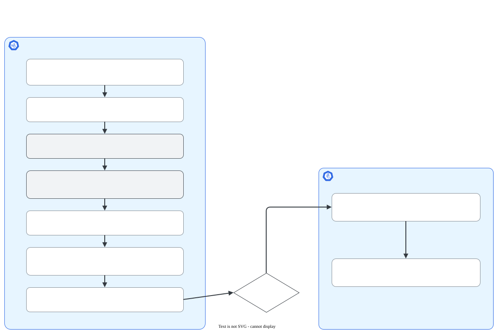

# Upgrade com kubeadm

> **Versão do Kubernetes:** v1.36 → v1.37 (upgrade real do lab: v1.36.5 → v1.37.1, 1 control plane + 2 workers) · **Última revisão:** 2026-10-25 · **Domínio:** Cluster Architecture, Installation & Configuration (25%)

## O que é

Atualizar um cluster criado com kubeadm para a **próxima versão minor** (por exemplo, `1.N` → `1.N+1`; no meu lab, `1.36` → `1.37`). Na prova é uma das tarefas mais longas: você entra por SSH no nó, troca pacotes e roda o `kubeadm upgrade`. Mas é sempre a mesma sequência, então dá para treinar até ficar automático.

Três regras de base:

1. **Um minor por vez.** Não dá para pular de `1.N` para `1.N+2`.
2. **Control plane primeiro, workers depois.**
3. **Um nó por vez**, tirando os Pods dele antes ([drain](drain-cordon-uncordon.md)).

## Como funciona por dentro

São três peças com papéis diferentes:

| Peça | O que o upgrade faz com ela |
|---|---|
| `kubeadm` (binário) | Atualizado **primeiro**, via apt. É ele que sabe migrar o cluster para a versão nova. |
| Componentes do control plane (`kube-apiserver`, `kube-controller-manager`, `kube-scheduler`, `etcd`) | São **static Pods**. O `kubeadm upgrade apply` reescreve os manifests em `/etc/kubernetes/manifests/` com a imagem nova, e o kubelet recria os Pods sozinho. |
| `kubelet` e `kubectl` (pacotes) | Atualizados **por último** em cada nó, via apt. O kubelet é um serviço systemd e precisa ser reiniciado. |

O `kubeadm upgrade apply` também atualiza os addons (CoreDNS e kube-proxy) e, por padrão, **renova os certificados** do control plane (ver [Certificados com kubeadm](kubeadm-certs.md)).

[](../assets/diagramas/01-upgrade-kubeadm.svg "Abrir o diagrama em tamanho real")

**Version skew**: o kubelet pode ficar até **três** versões minor **atrás** do kube-apiserver, nunca à frente (política *Version Skew Policy*, em vigor desde a v1.28). Por isso atualizar o control plane antes dos workers não quebra nada. No lab, com o `cp` já em v1.37.1 e os workers ainda em v1.36.5, os três nós continuaram `Ready`.

## Comandos essenciais

**Antes de tudo, no control plane:**

```bash
# Ver versões atuais dos nós
kubectl get nodes

# Entrar no nó e virar root (na prova o enunciado diz qual nó)
ssh controlplane
sudo -i
```

**1. Apontar o apt para o novo minor.** Os repositórios `pkgs.k8s.io` são separados por versão minor. Sem esse passo, o apt não enxerga a versão nova.

```bash
# Achar o arquivo do repositório (a documentação usa kubernetes.list, mas o nome varia)
grep -rl pkgs.k8s.io /etc/apt/sources.list.d/

# Ver qual minor ele aponta hoje
cat /etc/apt/sources.list.d/kubernetes.list
# deb [signed-by=/etc/apt/keyrings/kubernetes-apt-keyring.gpg] https://pkgs.k8s.io/core:/stable:/v1.36/deb/ /

# Trocar o minor atual pelo de destino (no lab: v1.36 → v1.37)
sed -i 's#/v1.36/#/v1.37/#' /etc/apt/sources.list.d/kubernetes.list
apt-get update
```

No lab, o arquivo se chamava `k8s.list`, e o `cat .../kubernetes.list` respondeu `No such file or directory`. O `grep -rl` acha o arquivo certo em qualquer máquina.

**2. Atualizar o kubeadm:**

```bash
# Listar versões disponíveis e copiar a exata (formato 1.37.Y-1.1)
apt-cache madison kubeadm

# Os pacotes ficam "presos" com hold; solte, instale, prenda de novo
apt-mark unhold kubeadm
apt-get install -y kubeadm='1.37.Y-*'
apt-mark hold kubeadm

kubeadm version   # confirme a versão nova
```

**3. Planejar e aplicar (só no primeiro control plane):**

```bash
# Mostra versão atual, versão de destino e o que será alterado
kubeadm upgrade plan

# Aplica: atualiza static Pods, addons e certificados (pede confirmação "y"; --yes pula a pergunta)
kubeadm upgrade apply v1.37.Y
```

Trecho real do `kubeadm upgrade plan` no lab (v1.36.5 → v1.37.1). Repare que o etcd e o CoreDNS também mudam de versão:

```console
$ kubeadm upgrade plan
[upgrade/versions] Cluster version: 1.36.5
[upgrade/versions] kubeadm version: v1.37.1
[upgrade/versions] Target version: v1.37.1

Components that must be upgraded manually after you have upgraded the control plane with 'kubeadm upgrade apply':
COMPONENT   NODE      CURRENT   TARGET
kubelet     cp        v1.36.5   v1.37.1
kubelet     w1        v1.36.5   v1.37.1
kubelet     w2        v1.36.5   v1.37.1

Upgrade to the latest stable version:

COMPONENT                 NODE      CURRENT   TARGET
kube-apiserver            cp        v1.36.5   v1.37.1
kube-controller-manager   cp        v1.36.5   v1.37.1
kube-scheduler            cp        v1.36.5   v1.37.1
kube-proxy                          1.36.5    v1.37.1
CoreDNS                             v1.14.2   v1.14.6
etcd                      cp        3.6.8-0   3.7.0-0

You can now apply the upgrade by executing the following command:

	kubeadm upgrade apply v1.37.1
```

O fim do `apply`:

```console
[upgrade] SUCCESS! A control plane node of your cluster was upgraded to "v1.37.1".

[upgrade] Now please proceed with upgrading the rest of the nodes by following the right order.
```

Em clusters com **mais de um control plane**, nos demais use `kubeadm upgrade node` (e não `apply`).

**4. Atualizar kubelet e kubectl no próprio control plane:**

```bash
kubectl drain controlplane --ignore-daemonsets

apt-mark unhold kubelet kubectl
apt-get install -y kubelet='1.37.Y-*' kubectl='1.37.Y-*'
apt-mark hold kubelet kubectl

systemctl daemon-reload
systemctl restart kubelet

kubectl uncordon controlplane
```

**5. Cada worker (um por vez):**

```bash
ssh node01
sudo -i
# (repita o passo 1 de troca do repositório neste nó)

apt-mark unhold kubeadm
apt-get install -y kubeadm='1.37.Y-*'
apt-mark hold kubeadm

# Em worker: atualiza a configuração local do kubelet
kubeadm upgrade node

# No control plane (ou onde houver kubeconfig de admin):
kubectl drain node01 --ignore-daemonsets

# De volta ao worker:
apt-mark unhold kubelet kubectl
apt-get install -y kubelet='1.37.Y-*' kubectl='1.37.Y-*'
apt-mark hold kubelet kubectl
systemctl daemon-reload
systemctl restart kubelet

# No control plane:
kubectl uncordon node01
```

O upgrade não tem `--dry-run=client -o yaml`, porque não cria objetos. O equivalente é `kubeadm upgrade plan` (só mostra) e `kubeadm upgrade apply --dry-run` (simula sem alterar nada).

## YAML de referência

O upgrade não usa manifesto próprio. O que vale conhecer é **onde o kubeadm mexe**, porque é aí que você confere se funcionou:

```yaml
# /etc/kubernetes/manifests/kube-apiserver.yaml (trecho)
# Static Pod: o kubelet observa esta pasta e recria o Pod quando o arquivo muda.
apiVersion: v1
kind: Pod
metadata:
  name: kube-apiserver
  namespace: kube-system
spec:
  containers:
    - name: kube-apiserver
      image: registry.k8s.io/kube-apiserver:v1.37.Y   # o "upgrade apply" troca esta tag
      command:
        - kube-apiserver
        - --authorization-mode=Node,RBAC
        # ... demais flags preservadas pelo kubeadm
```

```bash
# Conferir a imagem de cada componente depois do upgrade
grep image: /etc/kubernetes/manifests/*.yaml
```

## Na documentação oficial

- **Página:** *Upgrading kubeadm clusters*. Link: <https://kubernetes.io/docs/tasks/administer-cluster/kubeadm/kubeadm-upgrade/>
- **Complementares:**
    - *Upgrading Linux nodes* (workers): <https://kubernetes.io/docs/tasks/administer-cluster/kubeadm/upgrading-linux-nodes/>
    - *Changing The Kubernetes Package Repository* (troca do minor no apt): <https://kubernetes.io/docs/tasks/administer-cluster/kubeadm/change-package-repository/>
    - *Version Skew Policy*: <https://kubernetes.io/releases/version-skew-policy/>
- **Busca rápida:** `kubeadm upgrade`
- **Ctrl+F dentro da página:**
    - `apt-mark unhold`: bloco de comandos pronto para copiar.
    - `upgrade plan`: o passo de planejamento.
    - `upgrade node`: o que rodar nos outros control planes e nos workers.
    - `daemon-reload`: reinício do kubelet.

A página tem abas por gerenciador de pacotes (*Ubuntu, Debian or HypriotOS* × *CentOS, RHEL or Fedora*). Escolha a do sistema do nó.

## Pegadinhas da prova

- **Esquecer de trocar o repositório apt.** `apt-cache madison kubeadm` só mostra versões do minor atual. É o erro mais comum.
- **Versão exata.** O enunciado costuma pedir uma versão de patch específica (`1.37.Y`). Instale essa, não "a mais nova".
- **`kubeadm upgrade apply` em worker.** Em worker o comando é `kubeadm upgrade node`.
- **Atualizar só o kubeadm.** `kubectl get nodes` mostra a versão do **kubelet**. Se você não atualizou o pacote kubelet e não reiniciou o serviço, o nó continua na versão antiga.
- **Esquecer o `uncordon`.** O nó fica `Ready,SchedulingDisabled` e você perde pontos.
- **Rodar `kubectl` dentro do worker.** Normalmente o worker não tem kubeconfig de admin. Faça drain/uncordon a partir do control plane.
- **Esquecer de sair do SSH.** Depois de terminar no nó, `exit` duas vezes (root e SSH) para voltar ao terminal base antes da próxima questão.
- **Atualizar todos os nós.** Leia o enunciado: às vezes pedem só o control plane.

## Pratique

**Enunciado (como na prova):**

> The cluster is running Kubernetes `1.36.x`. Upgrade the control plane node `controlplane` and the worker node `node01` to version `1.37.Y`. Make sure to drain each node before upgrading kubelet and to make it schedulable again afterwards. Do not upgrade any other node.

**Tradução:** o cluster está na versão `1.36.x`. Atualize o control plane `controlplane` e o worker `node01` para a versão `1.37.Y`. Faça drain de cada nó antes de atualizar o kubelet e devolva-o ao agendamento depois. Não atualize nenhum outro nó.

??? success "Solução"
    **Control plane:**
    ```bash
    ssh controlplane && sudo -i
    sed -i 's#/v1.36/#/v1.37/#' /etc/apt/sources.list.d/kubernetes.list
    apt-get update && apt-cache madison kubeadm
    apt-mark unhold kubeadm && apt-get install -y kubeadm='1.37.Y-*' && apt-mark hold kubeadm
    kubeadm upgrade plan
    kubeadm upgrade apply v1.37.Y          # confirme com "y"
    kubectl drain controlplane --ignore-daemonsets
    apt-mark unhold kubelet kubectl
    apt-get install -y kubelet='1.37.Y-*' kubectl='1.37.Y-*'
    apt-mark hold kubelet kubectl
    systemctl daemon-reload && systemctl restart kubelet
    kubectl uncordon controlplane
    exit; exit
    ```
    **Worker:**
    ```bash
    ssh node01 && sudo -i
    sed -i 's#/v1.36/#/v1.37/#' /etc/apt/sources.list.d/kubernetes.list
    apt-get update
    apt-mark unhold kubeadm && apt-get install -y kubeadm='1.37.Y-*' && apt-mark hold kubeadm
    kubeadm upgrade node
    # em outro terminal, no controlplane: kubectl drain node01 --ignore-daemonsets
    apt-mark unhold kubelet kubectl
    apt-get install -y kubelet='1.37.Y-*' kubectl='1.37.Y-*'
    apt-mark hold kubelet kubectl
    systemctl daemon-reload && systemctl restart kubelet
    exit; exit
    kubectl uncordon node01
    ```

**Como verificar:**

```bash
kubectl get nodes                          # VERSION 1.37.Y e STATUS Ready (sem SchedulingDisabled)
kubectl get pods -n kube-system            # control plane, CoreDNS e kube-proxy rodando
kubectl version                            # Server Version: v1.37.Y
```

Resultado real no lab, depois dos três nós:

```console
$ kubectl get nodes
NAME   STATUS   ROLES           AGE   VERSION
cp     Ready    control-plane   80m   v1.37.1
w1     Ready    <none>          79m   v1.37.1
w2     Ready    <none>          79m   v1.37.1
$ kubectl version
Client Version: v1.37.1
Kustomize Version: v5.8.1
Server Version: v1.37.1
$ sudo grep image: /etc/kubernetes/manifests/*.yaml
/etc/kubernetes/manifests/etcd.yaml:    image: registry.k8s.io/etcd:3.7.0-0
/etc/kubernetes/manifests/kube-apiserver.yaml:    image: registry.k8s.io/kube-apiserver:v1.37.1
/etc/kubernetes/manifests/kube-controller-manager.yaml:    image: registry.k8s.io/kube-controller-manager:v1.37.1
/etc/kubernetes/manifests/kube-scheduler.yaml:    image: registry.k8s.io/kube-scheduler:v1.37.1
```

??? tip "No lab / Killercoda"

    - No lab Azure, tire um **snapshot das VMs** antes de começar. Assim você treina o upgrade várias vezes.
    - Faça **backup do etcd** antes do `upgrade apply`, como numa operação real ([ver página](etcd-backup-restore.md)).
    - Tente pular um minor de propósito (de `1.36` direto para `1.38`) e leia o erro do `kubeadm upgrade plan`.
    - O Killercoda tem cenários de upgrade com kubeadm prontos. Bom para treinar contra o relógio.
