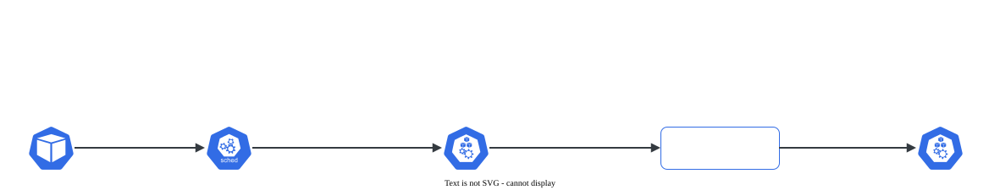

# Affinity e anti-affinity

> **Versão do Kubernetes:** v1.36 · **Última revisão:** 2026-10-23 · **Domínio:** Workloads & Scheduling (15%)

## O que é

A versão expressiva do `nodeSelector`. Três tipos, todos em `spec.affinity` do Pod:

| Tipo | Pergunta que responde | Exemplo |
|---|---|---|
| **nodeAffinity** | Em que **nós** (pelos labels do nó)? | "só em nós com `disco` = `ssd` ou `nvme`" |
| **podAffinity** | Perto de que **Pods** já existentes? | "no mesmo nó que o cache" |
| **podAntiAffinity** | Longe de que **Pods**? | "no máximo uma réplica por nó" |

Cada um tem duas intensidades:

| Campo | Comportamento |
|---|---|
| `requiredDuringSchedulingIgnoredDuringExecution` | **Regra.** Sem nó que atenda, o Pod fica `Pending` |
| `preferredDuringSchedulingIgnoredDuringExecution` | **Preferência** com `weight` de 1 a 100. Sem nó que atenda, agenda em outro |

O `IgnoredDuringExecution` no nome quer dizer: se o label do nó mudar depois, o Pod que já está rodando **não** é expulso.

## Como funciona por dentro

[](../assets/diagramas/02-affinity.svg "Abrir o diagrama em tamanho real")

**nodeAffinity**: lógica dos termos.

- Vários itens em `nodeSelectorTerms` = **OU** (basta um termo casar).
- Vários `matchExpressions` dentro do mesmo termo = **E**.
- Operadores: `In`, `NotIn`, `Exists`, `DoesNotExist`, `Gt`, `Lt` (os dois últimos comparam números inteiros).
- Se o Pod tiver `nodeSelector` **e** `nodeAffinity`, os dois precisam ser atendidos.

**podAffinity / podAntiAffinity**: o `topologyKey` é obrigatório. Ele define o que é "perto":

| `topologyKey` | "Perto" quer dizer |
|---|---|
| `kubernetes.io/hostname` | no mesmo **nó** |
| `topology.kubernetes.io/zone` | na mesma **zona** |

A regra lê assim: "agende este Pod num nó cujo valor de `topologyKey` seja igual (affinity) ou diferente (anti-affinity) ao dos nós onde rodam Pods com estes labels". O `labelSelector` olha Pods do **mesmo namespace** do Pod, a menos que `namespaces` ou `namespaceSelector` diga outra coisa.

## Comandos essenciais

```bash
# Não há flag de affinity no kubectl: gere o YAML e edite
kubectl create deployment web --image=nginx:1.27 --replicas=3 --dry-run=client -o yaml > web.yaml

# Labels dos nós (nodeAffinity) e dos Pods (podAffinity)
kubectl get nodes --show-labels
kubectl get nodes -L disco,topology.kubernetes.io/zone   # labels como colunas
kubectl get pods -o wide --show-labels

# Onde cada réplica caiu
kubectl get pods -l app=web -o wide

# Pending? Os eventos dizem qual regra falhou
kubectl describe pod <pod> | grep -A5 Events

kubectl explain pod.spec.affinity.podAntiAffinity
```

## YAML de referência

**nodeAffinity**: regra + preferência:

```yaml
apiVersion: v1
kind: Pod
metadata:
  name: com-node-affinity
spec:
  affinity:
    nodeAffinity:
      requiredDuringSchedulingIgnoredDuringExecution:
        nodeSelectorTerms:
          - matchExpressions:          # termo 1 (OU com outros termos)
              - key: disco
                operator: In
                values: ["ssd", "nvme"]
              - key: kubernetes.io/os  # E com a expressão acima
                operator: In
                values: ["linux"]
      preferredDuringSchedulingIgnoredDuringExecution:
        - weight: 80                   # 1 a 100: soma pontos, não obriga
          preference:
            matchExpressions:
              - key: topology.kubernetes.io/zone
                operator: In
                values: ["brazilsouth-1"]
  containers:
    - name: c
      image: nginx:1.27
```

**podAntiAffinity**: uma réplica por nó (o caso mais cobrado):

```yaml
apiVersion: apps/v1
kind: Deployment
metadata:
  name: web
spec:
  replicas: 3
  selector:
    matchLabels:
      app: web
  template:
    metadata:
      labels:
        app: web
    spec:
      affinity:
        podAntiAffinity:
          requiredDuringSchedulingIgnoredDuringExecution:
            - labelSelector:
                matchLabels:
                  app: web               # longe das outras réplicas dele mesmo
              topologyKey: kubernetes.io/hostname
      containers:
        - name: web
          image: nginx:1.27
```

**podAffinity**: rodar no mesmo nó que o cache, preferindo não empilhar réplicas:

```yaml
apiVersion: apps/v1
kind: Deployment
metadata:
  name: api
spec:
  replicas: 2
  selector:
    matchLabels:
      app: api
  template:
    metadata:
      labels:
        app: api
    spec:
      affinity:
        podAffinity:
          requiredDuringSchedulingIgnoredDuringExecution:
            - labelSelector:
                matchLabels:
                  app: cache
              topologyKey: kubernetes.io/hostname
        podAntiAffinity:
          preferredDuringSchedulingIgnoredDuringExecution:
            - weight: 100
              podAffinityTerm:           # no preferred, o termo vem dentro de podAffinityTerm
                labelSelector:
                  matchLabels:
                    app: api
                topologyKey: kubernetes.io/hostname
      containers:
        - name: api
          image: nginx:1.27
```

Para espalhar réplicas de forma equilibrada (e não só "uma por nó"), existe `topologySpreadConstraints` com `maxSkew`. Está na mesma área da documentação: *Pod Topology Spread Constraints*.

## Na documentação oficial

- **Página principal:** *Assigning Pods to Nodes*. Link: <https://kubernetes.io/docs/concepts/scheduling-eviction/assign-pod-node/>
- **Tarefa:** *Assign Pods to Nodes using Node Affinity*: <https://kubernetes.io/docs/tasks/configure-pod-container/assign-pods-nodes-using-node-affinity/>
- **Busca rápida:** `node affinity`, `pod anti-affinity`
- **Ctrl+F dentro da página principal:**
    - `requiredDuringSchedulingIgnoredDuringExecution`: o YAML de node affinity com regra e preferência.
    - `nodeSelectorTerms`: a explicação de OU entre termos e E entre expressões.
    - `topologyKey`: o significado de "perto".
    - `redis-cache`: o exemplo de web + cache com affinity e anti-affinity (bom para copiar).

## Pegadinhas da prova

- **Os nomes são longos e iguais no começo.** Copie da documentação em vez de digitar `requiredDuringSchedulingIgnoredDuringExecution`.
- **`preferred` tem estrutura diferente de `required`.** No node affinity: `weight` + `preference`. No pod affinity: `weight` + `podAffinityTerm` (com o `labelSelector` e o `topologyKey` dentro).
- **OU × E:** dois itens em `nodeSelectorTerms` é OU; duas expressões no mesmo `matchExpressions` é E. É o mesmo tipo de armadilha da NetworkPolicy.
- **Anti-affinity `required` com mais réplicas que nós** deixa as réplicas que sobram em `Pending`. Com 3 workers e 4 réplicas, a quarta não sobe. Se o enunciado não exige "nunca", `preferred` evita isso.
- **O control plane tem taint.** Num lab com 1 control plane + 2 workers, "uma réplica por nó" cabe só **2** réplicas, a menos que o Pod também tolere o taint do control plane.
- **`labelSelector` do podAffinity olha os labels dos Pods**, não dos nós. E olha só o namespace do Pod, salvo `namespaces`/`namespaceSelector`.
- **`topologyKey` precisa existir como label nos nós.** `kubernetes.io/hostname` sempre existe; `topology.kubernetes.io/zone` só em nuvem (ou se você criar).
- **Mudar o label do nó não move Pods que já rodam** (`IgnoredDuringExecution`). Para testar uma regra nova, apague os Pods ou faça `kubectl rollout restart`.

## Pratique

**Enunciado (como na prova):**

> Create a Deployment named `frontend` in namespace `default` with image `nginx:1.27` and 2 replicas. Its Pods must only be scheduled on nodes with label `tier=web`, and no two replicas may run on the same node. Label node `w2` with `tier=web` and node `w1` with `tier=web` too.

**Tradução:** crie o Deployment `frontend` no namespace `default`, imagem `nginx:1.27`, 2 réplicas. Os Pods só podem ir para nós com o label `tier=web`, e duas réplicas nunca podem rodar no mesmo nó. Coloque o label `tier=web` nos nós `w1` e `w2`.

??? success "Solução"
    ```bash
    kubectl label nodes w1 w2 tier=web
    kubectl create deployment frontend --image=nginx:1.27 --replicas=2 --dry-run=client -o yaml > frontend.yaml
    ```
    Acrescente o bloco `affinity` em `spec.template.spec`:
    ```yaml
    apiVersion: apps/v1
    kind: Deployment
    metadata:
      name: frontend
    spec:
      replicas: 2
      selector:
        matchLabels:
          app: frontend
      template:
        metadata:
          labels:
            app: frontend
        spec:
          affinity:
            nodeAffinity:
              requiredDuringSchedulingIgnoredDuringExecution:
                nodeSelectorTerms:
                  - matchExpressions:
                      - key: tier
                        operator: In
                        values: ["web"]
            podAntiAffinity:
              requiredDuringSchedulingIgnoredDuringExecution:
                - labelSelector:
                    matchLabels:
                      app: frontend
                  topologyKey: kubernetes.io/hostname
          containers:
            - name: nginx
              image: nginx:1.27
    ```
    ```bash
    kubectl apply -f frontend.yaml
    ```
    O `kubectl create deployment` põe o label `app: frontend` nos Pods; é esse label que a anti-affinity usa para achar as outras réplicas.

**Como verificar:**

```bash
kubectl get pods -l app=frontend -o wide           # um Pod em w1, outro em w2
kubectl scale deployment frontend --replicas=3
kubectl get pods -l app=frontend                    # a terceira fica Pending
kubectl describe pod <pod-pending> | grep -A3 Events
```

Saída esperada (ilustrativa: nomes, IPs e idades mudam no seu cluster):

```console
$ kubectl get pods -l app=frontend -o wide
NAME                        READY   STATUS    RESTARTS   AGE   IP           NODE
frontend-6d8f7c9b5d-4kq2x   1/1     Running   0          20s   10.244.1.9   w1
frontend-6d8f7c9b5d-n7v8p   1/1     Running   0          20s   10.244.2.6   w2
$ kubectl describe pod frontend-6d8f7c9b5d-zz9lm | grep -A3 Events
Events:
  Type     Reason            Age   From               Message
  ----     ------            ----  ----               -------
  Warning  FailedScheduling  5s    default-scheduler  0/3 nodes are available: 1 node(s) had untolerated taint(s), 2 node(s) didn't match pod anti-affinity rules. ...
```

**No lab / Killercoda:**

- Troque a anti-affinity para `preferred` e escale para 4: veja as réplicas extras empilharem em vez de ficarem `Pending`.
- Remova o label `tier` de `w2` com os Pods rodando e confirme que nada muda (`IgnoredDuringExecution`). Depois `kubectl rollout restart deployment frontend` e veja o Pod de `w2` ficar `Pending`.
- Faça um `podAffinity` para um Deployment `api` acompanhar um Pod `cache` e mova o cache de nó (apague e recrie com `nodeName`).
- Ao terminar, remova os labels: `kubectl label nodes w1 w2 tier-`.
