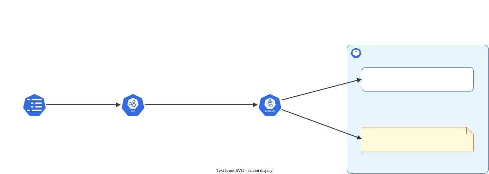

# ConfigMap e Secret

> **Versão do Kubernetes:** v1.36 · **Última revisão:** 2026-10-23 · **Domínio:** Workloads & Scheduling (15%)

## O que é

Os dois objetos que separam a **configuração** da **imagem**. A mesma imagem roda em dev e em produção; o que muda é o ConfigMap/Secret que ela recebe.

| | ConfigMap | Secret |
|---|---|---|
| Para quê | Configuração comum (URL, nível de log, arquivo `.conf`) | Dado sensível (senha, token, certificado) |
| Como guarda | Texto puro em `data` | **base64** em `data` (não é criptografia) |
| Limite | 1 MiB por objeto | 1 MiB por objeto |
| Proteção extra | Nenhuma | RBAC separado; pode ser criptografado no etcd (`EncryptionConfiguration`); o kubelet guarda em memória (tmpfs), não em disco |

Os dois chegam ao Pod de três formas:

| Forma | Campo no Pod | Atualiza sozinho se o objeto mudar? |
|---|---|---|
| Uma variável | `env[].valueFrom.configMapKeyRef` / `secretKeyRef` | **Não**: só com Pod novo |
| Todas as chaves como variáveis | `envFrom[].configMapRef` / `secretRef` | **Não** |
| Arquivos num volume | `volumes[].configMap` / `secret` | **Sim**, depois de até ~1 min (sincronização do kubelet). Exceto com `subPath` |

## Como funciona por dentro

[](../assets/diagramas/02-configmap-secret.svg "Abrir o diagrama em tamanho real")

No volume, **cada chave vira um arquivo** cujo nome é a chave e o conteúdo é o valor. Montar num diretório **esconde** o que a imagem tinha naquele diretório. Para pôr um arquivo só sem apagar o resto, use `subPath`, mas aí ele não é mais atualizado.

Tipos de Secret mais comuns:

| `type` | Criado com | Uso |
|---|---|---|
| `Opaque` | `kubectl create secret generic` | Qualquer par chave/valor |
| `kubernetes.io/tls` | `kubectl create secret tls` | Certificado + chave (Ingress, Gateway) |
| `kubernetes.io/dockerconfigjson` | `kubectl create secret docker-registry` | Login em registry privado (`imagePullSecrets`) |

## Comandos essenciais

```bash
# ConfigMap
kubectl create configmap app-cfg --from-literal=LOG_LEVEL=debug --from-literal=MODO=prod
kubectl create configmap nginx-conf --from-file=nginx.conf                 # chave = nome do arquivo
kubectl create configmap nginx-conf --from-file=default.conf=./site.conf   # chave com outro nome
kubectl create configmap app-env --from-env-file=app.env                   # uma chave por linha K=V
kubectl create configmap app-cfg --from-literal=X=1 --dry-run=client -o yaml > cm.yaml

# Secret
kubectl create secret generic db --from-literal=usuario=app --from-literal=senha='S3nh@!'
kubectl create secret tls web-tls --cert=tls.crt --key=tls.key
kubectl create secret docker-registry regcred --docker-server=registry.exemplo.com \
  --docker-username=user --docker-password=senha

# Ler
kubectl get cm app-cfg -o yaml
kubectl describe secret db                                 # mostra tamanhos, não valores
kubectl get secret db -o jsonpath='{.data.senha}' | base64 -d; echo
echo -n 'S3nh@!' | base64                                  # -n: sem quebra de linha no valor

# Injetar num Deployment sem escrever YAML
kubectl set env deployment/web --from=configmap/app-cfg
kubectl set env deployment/web --from=secret/db --prefix=DB_

# Conferir dentro do Pod
kubectl exec deploy/web -- env | grep -E 'LOG_LEVEL|DB_'
kubectl exec deploy/web -- ls /etc/config
```

## YAML de referência

```yaml
apiVersion: v1
kind: ConfigMap
metadata:
  name: app-cfg
data:
  LOG_LEVEL: debug
  app.properties: |                  # chave com conteúdo de arquivo (multilinha)
    cor=azul
    limite=10
---
apiVersion: v1
kind: Secret
metadata:
  name: db
type: Opaque
stringData:                          # texto puro; a API converte para base64 em data
  usuario: app
  senha: "S3nh@!"
---
apiVersion: v1
kind: Pod
metadata:
  name: app
spec:
  containers:
    - name: app
      image: busybox:1.36
      command: ["sh", "-c", "env; ls /etc/config /etc/db; sleep 3600"]
      env:
        - name: NIVEL_LOG                # nome da variável pode ser diferente da chave
          valueFrom:
            configMapKeyRef:
              name: app-cfg
              key: LOG_LEVEL
        - name: DB_SENHA
          valueFrom:
            secretKeyRef:
              name: db
              key: senha
              optional: false            # padrão: Pod não sobe se a chave não existir
      envFrom:
        - configMapRef:
            name: app-cfg                # todas as chaves válidas como variável
          prefix: CFG_
      volumeMounts:
        - name: config
          mountPath: /etc/config         # arquivos LOG_LEVEL e app.properties
          readOnly: true
        - name: db
          mountPath: /etc/db
          readOnly: true
  volumes:
    - name: config
      configMap:
        name: app-cfg
    - name: db
      secret:
        secretName: db                   # atenção: secretName, não name
        defaultMode: 0400
        items:                           # só algumas chaves, com outro nome de arquivo
          - key: senha
            path: senha.txt
```

Arquivo único sem esconder o diretório da imagem (não atualiza sozinho):

```yaml
apiVersion: v1
kind: Pod
metadata:
  name: nginx-conf
spec:
  containers:
    - name: nginx
      image: nginx:1.27
      volumeMounts:
        - name: conf
          mountPath: /etc/nginx/conf.d/default.conf
          subPath: default.conf          # o resto de /etc/nginx/conf.d continua lá
  volumes:
    - name: conf
      configMap:
        name: nginx-conf
```

ConfigMap/Secret imutável (`immutable: true`): não aceita mais edição, só apagar e recriar. Reduz carga no API server em clusters grandes.

## Na documentação oficial

- **ConfigMap:** *ConfigMaps*: <https://kubernetes.io/docs/concepts/configuration/configmap/>
- **Secret:** *Secrets*: <https://kubernetes.io/docs/concepts/configuration/secret/>
- **Tarefa com todos os YAMLs:** *Configure a Pod to Use a ConfigMap*: <https://kubernetes.io/docs/tasks/configure-pod-container/configure-pod-configmap/>
- **Tarefa:** *Distribute Credentials Securely Using Secrets*: <https://kubernetes.io/docs/tasks/inject-data-application/distribute-credentials-secure/>
- **Busca rápida:** `configmap`, `secret`
- **Ctrl+F dentro das páginas:**
    - `configMapKeyRef` / `secretKeyRef`: uma variável a partir de uma chave.
    - `envFrom`: todas as chaves de uma vez.
    - `Add ConfigMap data to a Volume`: montar como arquivos.
    - `items`: escolher chaves e nomes de arquivo.
    - `stringData`: Secret sem codificar à mão.

## Pegadinhas da prova

- **base64 não é criptografia.** Quem lê o Secret lê o valor. A questão pode pedir para **descobrir** uma senha: `kubectl get secret X -o jsonpath='{.data.chave}' | base64 -d`.
- **`echo` sem `-n` põe uma quebra de linha no valor** ao codificar à mão. Prefira `kubectl create secret ... --from-literal` ou `stringData`.
- **No volume é `secretName`** (Secret) e `name` (ConfigMap). Trocar dá erro de validação.
- **Variável de ambiente não atualiza.** Mudou o ConfigMap usado em `env`/`envFrom`? `kubectl rollout restart deployment/X`.
- **`subPath` não atualiza** e montar sem `subPath` **esconde** o conteúdo original do diretório. Montar um ConfigMap em `/etc/nginx` apaga o `nginx.conf` da imagem.
- **Referência a ConfigMap/Secret inexistente**: o Pod fica em `CreateContainerConfigError` (env) ou `ContainerCreating` (volume). `kubectl describe pod` mostra qual falta.
- **Mesmo namespace.** Pod só usa ConfigMap/Secret do próprio namespace.
- **`envFrom` importa todas as chaves, até as com ponto.** Desde o Kubernetes 1.34, nome de variável aceita qualquer caractere ASCII imprimível exceto `=`, então `app.properties` vira a variável `CFG_app.properties`. Ela existe, mas o shell não consegue lê-la como `$CFG_app.properties`. Se só algumas chaves interessam, use `env` com `configMapKeyRef` em vez de `envFrom`.
- **Aspas em valores especiais:** `--from-literal=senha='S3nh@!'` com aspas simples no shell, para o `!` e o `@` não serem interpretados.

## Pratique

**Enunciado (como na prova):**

> In namespace `config-lab`, create a ConfigMap `web-cfg` with key `COLOR=blue` and a Secret `web-secret` with key `API_KEY=k8s-cka-2026`. Create a Pod `web` with image `nginx:1.27` that exposes `COLOR` as environment variable `APP_COLOR` and mounts the Secret as files under `/etc/secret`, read-only.

**Tradução:** no namespace `config-lab`, crie o ConfigMap `web-cfg` com a chave `COLOR=blue` e o Secret `web-secret` com a chave `API_KEY=k8s-cka-2026`. Crie o Pod `web`, imagem `nginx:1.27`, que exponha `COLOR` como a variável `APP_COLOR` e monte o Secret como arquivos em `/etc/secret`, somente leitura.

??? success "Solução"
    ```bash
    kubectl create namespace config-lab
    kubectl create configmap web-cfg -n config-lab --from-literal=COLOR=blue
    kubectl create secret generic web-secret -n config-lab --from-literal=API_KEY=k8s-cka-2026
    kubectl run web -n config-lab --image=nginx:1.27 --dry-run=client -o yaml > web.yaml
    ```
    Edite `web.yaml`:
    ```yaml
    apiVersion: v1
    kind: Pod
    metadata:
      name: web
      namespace: config-lab
    spec:
      containers:
        - name: web
          image: nginx:1.27
          env:
            - name: APP_COLOR
              valueFrom:
                configMapKeyRef:
                  name: web-cfg
                  key: COLOR
          volumeMounts:
            - name: segredo
              mountPath: /etc/secret
              readOnly: true
      volumes:
        - name: segredo
          secret:
            secretName: web-secret
    ```
    ```bash
    kubectl apply -f web.yaml
    ```

**Como verificar:**

```bash
kubectl exec -n config-lab web -- printenv APP_COLOR
kubectl exec -n config-lab web -- cat /etc/secret/API_KEY; echo
kubectl exec -n config-lab web -- touch /etc/secret/x       # deve falhar: somente leitura
```

Saída esperada (ilustrativa: nomes, IPs e idades mudam no seu cluster):

```console
$ kubectl exec -n config-lab web -- printenv APP_COLOR
blue
$ kubectl exec -n config-lab web -- cat /etc/secret/API_KEY; echo
k8s-cka-2026
$ kubectl exec -n config-lab web -- touch /etc/secret/x
touch: cannot touch '/etc/secret/x': Read-only file system
command terminated with exit code 1
```

**No lab / Killercoda:**

- Edite o ConfigMap (`kubectl edit cm web-cfg -n config-lab`) e confira que `APP_COLOR` não muda. Monte o ConfigMap como volume, edite de novo e veja o arquivo mudar em até um minuto.
- Crie um Pod que referencia um ConfigMap inexistente e leia o status (`CreateContainerConfigError`) e os eventos.
- Codifique um valor com `echo` sem `-n`, ponha no `data` de um Secret e veja o `\n` aparecer no valor lido no Pod.
- No control plane, leia o Secret direto do etcd com `etcdctl get /registry/secrets/config-lab/web-secret` (com as mesmas flags de certificado de [Backup e restore do etcd](../01-cluster-architecture/etcd-backup-restore.md)) e confirme que o valor aparece legível: sem `EncryptionConfiguration`, o etcd guarda o Secret sem criptografia.
