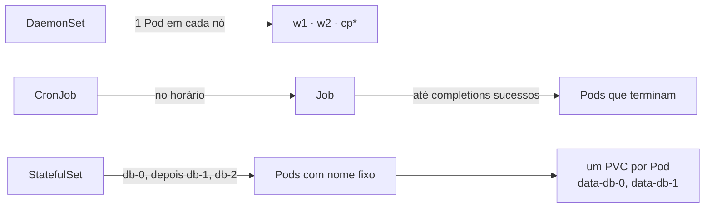

# DaemonSet, Job, CronJob e StatefulSet

> **Versão do Kubernetes:** v1.36 · **Última revisão:** 2026-10-23 · **Domínio:** Workloads & Scheduling (15%)

## O que é

Além do Deployment, quatro controladores, cada um para um formato de carga:

| Controlador | Garante | Exemplo típico | `kubectl create`? |
|---|---|---|---|
| **DaemonSet** | **Um Pod por nó** (todos ou os selecionados), inclusive em nós novos | Agente de log, monitoramento, CNI, kube-proxy | **Não** |
| **Job** | Rodar até **terminar com sucesso** N vezes | Migração de banco, processamento em lote | Sim |
| **CronJob** | Criar um **Job por horário** (sintaxe cron) | Backup noturno, relatório | Sim |
| **StatefulSet** | Pods com **nome, ordem e disco fixos** | Banco de dados, fila, cluster com eleição | **Não** |

Todos são "self-healing": o controlador compara o estado atual com o pedido e recria o que falta.

## Como funciona por dentro



\* o DaemonSet só roda no control plane se tolerar o taint dele.

**DaemonSet**
- O Pod é colocado pelo scheduler com uma node affinity para cada nó. Respeita `nodeSelector`, affinity e **taints** (por isso o taint do control plane o exclui, salvo toleration).
- Recebe automaticamente tolerations para `not-ready`, `unreachable`, `disk-pressure`, `memory-pressure` e afins: continua no nó mesmo com o nó em apuros.
- `updateStrategy`: `RollingUpdate` (padrão) ou `OnDelete` (só troca o Pod quando você o apaga).

**Job**

| Campo | Padrão | Significado |
|---|---|---|
| `completions` | 1 | Quantos Pods precisam terminar com sucesso |
| `parallelism` | 1 | Quantos rodam ao mesmo tempo |
| `backoffLimit` | 6 | Quantas falhas até o Job ser dado como `Failed` |
| `activeDeadlineSeconds` | — | Tempo máximo total. Estourou: Job falha e os Pods são encerrados |
| `ttlSecondsAfterFinished` | — | Apaga o Job (e os Pods) N segundos depois de terminar |
| `restartPolicy` (no template) | **obrigatório** | `Never` (falha = Pod novo) ou `OnFailure` (reinicia o container no mesmo Pod). `Always` é inválido |

**CronJob**

| Campo | Padrão | Significado |
|---|---|---|
| `schedule` | — | `minuto hora dia-do-mês mês dia-da-semana` |
| `concurrencyPolicy` | `Allow` | `Forbid`: pula se o anterior ainda roda. `Replace`: mata o anterior |
| `successfulJobsHistoryLimit` | 3 | Jobs bem-sucedidos guardados |
| `failedJobsHistoryLimit` | 1 | Jobs falhos guardados |
| `startingDeadlineSeconds` | — | Atraso máximo para ainda disparar um horário perdido |
| `suspend` | `false` | `true` pausa os próximos disparos |
| `timeZone` | fuso do kube-controller-manager | Ex.: `America/Sao_Paulo` |

**StatefulSet**
- Precisa de um **Service headless** (`clusterIP: None`) indicado em `serviceName`. Ele dá um DNS por Pod: `db-0.db.<ns>.svc.cluster.local`.
- Pods nomeados `<nome>-0`, `<nome>-1`... Criados **em ordem** (o `-1` só sobe quando o `-0` está Ready) e removidos na ordem inversa. `podManagementPolicy: Parallel` desliga a ordem.
- `volumeClaimTemplates` cria **um PVC por Pod** (`<template>-<pod>`). Se o Pod for recriado, mesmo em outro nó, ele volta com o mesmo nome e o mesmo PVC.
- Reduzir réplicas **não apaga os PVCs** (padrão de `persistentVolumeClaimRetentionPolicy`: `Retain`).

## Comandos essenciais

```bash
# DaemonSet: não há kubectl create. Gere um Deployment e converta
kubectl create deployment agente --image=busybox:1.36 --dry-run=client -o yaml -- sleep 3600 > ds.yaml
#   editar: kind: DaemonSet; apagar replicas, strategy e status
kubectl get ds -A
kubectl rollout status ds/agente
kubectl rollout undo ds/agente

# Job
kubectl create job pi --image=perl:5.40 -- perl -Mbignum=bpi -wle 'print bpi(200)'
kubectl create job lote --image=busybox:1.36 --dry-run=client -o yaml -- sh -c 'echo ok' > job.yaml
kubectl get jobs
kubectl wait --for=condition=complete job/pi --timeout=120s
kubectl logs job/pi

# CronJob
kubectl create cronjob relatorio --image=busybox:1.36 --schedule="*/5 * * * *" -- sh -c 'date; echo relatorio'
kubectl get cronjob                                   # atalho: cj
kubectl create job relatorio-manual --from=cronjob/relatorio   # disparar agora, para testar
kubectl patch cronjob relatorio -p '{"spec":{"suspend":true}}'

# StatefulSet: não há kubectl create. Copie o exemplo da documentação
kubectl get sts,pvc
kubectl scale sts db --replicas=3
kubectl rollout status sts/db
kubectl run dns --image=busybox:1.36 --rm -it --restart=Never -- nslookup db-0.db
```

## YAML de referência

**DaemonSet** que roda também no control plane:

```yaml
apiVersion: apps/v1
kind: DaemonSet
metadata:
  name: agente
  namespace: kube-system
spec:
  selector:
    matchLabels:
      app: agente
  updateStrategy:
    type: RollingUpdate
    rollingUpdate:
      maxUnavailable: 1
  template:
    metadata:
      labels:
        app: agente
    spec:
      tolerations:
        - key: node-role.kubernetes.io/control-plane
          operator: Exists
          effect: NoSchedule
      containers:
        - name: agente
          image: busybox:1.36
          command: ["sh", "-c", "while true; do date; sleep 60; done"]
          resources:
            requests:
              cpu: 10m
              memory: 16Mi
```

**Job** paralelo:

```yaml
apiVersion: batch/v1
kind: Job
metadata:
  name: lote
spec:
  completions: 6                     # 6 sucessos no total
  parallelism: 2                     # de 2 em 2
  backoffLimit: 3
  activeDeadlineSeconds: 300
  ttlSecondsAfterFinished: 600       # some 10 min depois de terminar
  template:
    spec:
      restartPolicy: Never           # obrigatório: Never ou OnFailure
      containers:
        - name: trabalho
          image: busybox:1.36
          command: ["sh", "-c", "echo processando $HOSTNAME; sleep 5"]
```

**CronJob**:

```yaml
apiVersion: batch/v1
kind: CronJob
metadata:
  name: backup
spec:
  schedule: "0 2 * * *"              # todo dia às 02:00
  timeZone: America/Sao_Paulo
  concurrencyPolicy: Forbid
  successfulJobsHistoryLimit: 3
  failedJobsHistoryLimit: 1
  startingDeadlineSeconds: 120
  jobTemplate:                       # o spec de um Job inteiro aqui dentro
    spec:
      backoffLimit: 2
      template:
        spec:
          restartPolicy: OnFailure
          containers:
            - name: backup
              image: busybox:1.36
              command: ["sh", "-c", "date; echo backup feito"]
```

**StatefulSet** com Service headless e um disco por Pod:

```yaml
apiVersion: v1
kind: Service
metadata:
  name: db
spec:
  clusterIP: None                    # headless: DNS por Pod, sem IP virtual
  selector:
    app: db
  ports:
    - port: 80
      name: web
---
apiVersion: apps/v1
kind: StatefulSet
metadata:
  name: db
spec:
  serviceName: db                    # tem que ser o nome do Service headless
  replicas: 3
  selector:
    matchLabels:
      app: db
  template:
    metadata:
      labels:
        app: db
    spec:
      containers:
        - name: nginx
          image: nginx:1.27
          ports:
            - containerPort: 80
              name: web
          volumeMounts:
            - name: data
              mountPath: /usr/share/nginx/html
  volumeClaimTemplates:              # um PVC por Pod: data-db-0, data-db-1, data-db-2
    - metadata:
        name: data
      spec:
        accessModes: ["ReadWriteOnce"]
        resources:
          requests:
            storage: 1Gi
        # storageClassName: <classe>  # sem StorageClass padrão no cluster, os PVCs ficam Pending
```

## Na documentação oficial

- **DaemonSet:** <https://kubernetes.io/docs/concepts/workloads/controllers/daemonset/>
- **Job:** <https://kubernetes.io/docs/concepts/workloads/controllers/job/>
- **CronJob:** <https://kubernetes.io/docs/concepts/workloads/controllers/cron-jobs/>
- **StatefulSet:** <https://kubernetes.io/docs/concepts/workloads/controllers/statefulset/>
- **Busca rápida:** `daemonset`, `job`, `cronjob`, `statefulset`
- **Ctrl+F dentro das páginas:**
    - DaemonSet: `fluentd-elasticsearch`: o YAML completo, já com toleration do control plane.
    - Job: `Parallel execution for Jobs`: `completions` e `parallelism`. `Pod backoff failure policy`: `backoffLimit`.
    - CronJob: `Cron schedule syntax`: a tabela dos cinco campos. `Concurrency policy`.
    - StatefulSet: `Components`: Service headless + StatefulSet + `volumeClaimTemplates` prontos.

## Pegadinhas da prova

- **Não existe `kubectl create daemonset` nem `statefulset`.** DaemonSet: gere um Deployment com `--dry-run=client -o yaml`, troque o `kind` e apague `replicas`, `strategy` e `status`. StatefulSet: copie da documentação.
- **DaemonSet "não roda no control plane"**: falta a toleration do taint `node-role.kubernetes.io/control-plane:NoSchedule`. O `DESIRED` do DaemonSet conta só os nós elegíveis.
- **Job com `restartPolicy: Always` é recusado.** O `kubectl create job` já põe `Never`.
- **`OnFailure` × `Never`:** com `OnFailure` o mesmo Pod reinicia (os logs da tentativa anterior somem); com `Never` cada falha vira um Pod novo, todos visíveis em `kubectl get pods`.
- **`jobTemplate.spec.template.spec`**: o CronJob tem três níveis de `spec`. Erro de indentação aqui é comum.
- **Testar um CronJob sem esperar**: `kubectl create job <nome> --from=cronjob/<cronjob>`.
- **`schedule` usa o fuso do kube-controller-manager** (normalmente UTC) se não houver `timeZone`.
- **StatefulSet sem o Service headless** sobe, mas o DNS por Pod (`db-0.db`) não resolve. O `serviceName` precisa casar com o nome do Service.
- **PVC do StatefulSet `Pending`**: falta StorageClass padrão (ou PV compatível). O evento do PVC diz `no persistent volumes available for this claim and no storage class is set`. O `-0` fica `Pending` e, por causa da ordem, o `-1` nem é criado.
- **Spec do StatefulSet quase toda imutável.** Só dá para mudar `replicas`, `template`, `updateStrategy`, `revisionHistoryLimit`, `persistentVolumeClaimRetentionPolicy`, `minReadySeconds` e `ordinals`. Acrescentar `volumeClaimTemplates` ou trocar `serviceName` exige apagar e recriar (`kubectl delete sts db --cascade=orphan` mantém os Pods enquanto isso).
- **Apagar o StatefulSet não apaga os PVCs.** Apague-os à parte se o enunciado pedir limpeza.

## Pratique

**Enunciado (como na prova):**

> 1. Create a DaemonSet `node-logger` in namespace `default` with image `busybox:1.36` running `sh -c 'while true; do date; sleep 30; done'`. It must run on **every** node of the cluster, including control plane nodes.
> 2. Create a CronJob `cleanup` that runs every 10 minutes with image `busybox:1.36` and command `echo cleanup`. It must never run two Jobs at the same time and must keep only 2 successful Jobs. Trigger it once manually with a Job named `cleanup-now`.

**Tradução:** (1) crie o DaemonSet `node-logger` no namespace `default`, imagem `busybox:1.36`, executando o laço acima. Ele precisa rodar em **todos** os nós, inclusive no control plane. (2) Crie o CronJob `cleanup`, a cada 10 minutos, imagem `busybox:1.36`, comando `echo cleanup`. Nunca pode haver dois Jobs ao mesmo tempo e só 2 Jobs de sucesso devem ser guardados. Dispare uma vez manualmente com o Job `cleanup-now`.

??? success "Solução"
    ```yaml
    apiVersion: apps/v1
    kind: DaemonSet
    metadata:
      name: node-logger
      namespace: default
    spec:
      selector:
        matchLabels:
          app: node-logger
      template:
        metadata:
          labels:
            app: node-logger
        spec:
          tolerations:
            - operator: Exists       # tolera todos os taints: control plane e qualquer outro
          containers:
            - name: logger
              image: busybox:1.36
              command: ["sh", "-c", "while true; do date; sleep 30; done"]
    ```
    ```bash
    kubectl apply -f ds.yaml
    kubectl create cronjob cleanup --image=busybox:1.36 --schedule="*/10 * * * *" --dry-run=client -o yaml -- echo cleanup > cj.yaml
    ```
    Em `cj.yaml`, acrescente em `spec` (no mesmo nível de `schedule`):
    ```yaml
    concurrencyPolicy: Forbid
    successfulJobsHistoryLimit: 2
    ```
    ```bash
    kubectl apply -f cj.yaml
    kubectl create job cleanup-now --from=cronjob/cleanup
    ```
    `operator: Exists` sem `key` cobre o taint do control plane e qualquer outro taint que o lab tenha (por exemplo, um worker com taint). Se o enunciado disser só "control plane", a toleration com `key: node-role.kubernetes.io/control-plane` também é aceita.

**Como verificar:**

```bash
kubectl get ds node-logger                       # DESIRED = número de nós
kubectl get pods -l app=node-logger -o wide      # um por nó, inclusive cp
kubectl get cj cleanup -o jsonpath='{.spec.concurrencyPolicy} {.spec.successfulJobsHistoryLimit}{"\n"}'
kubectl get job cleanup-now
kubectl logs job/cleanup-now
```

Saída esperada (ilustrativa: nomes, IPs e idades mudam no seu cluster):

```console
$ kubectl get ds node-logger
NAME          DESIRED   CURRENT   READY   UP-TO-DATE   AVAILABLE   NODE SELECTOR   AGE
node-logger   3         3         3       3            3           <none>          25s
$ kubectl get cj cleanup -o jsonpath='{.spec.concurrencyPolicy} {.spec.successfulJobsHistoryLimit}{"\n"}'
Forbid 2
$ kubectl get job cleanup-now
NAME          STATUS     COMPLETIONS   DURATION   AGE
cleanup-now   Complete   1/1           4s         10s
$ kubectl logs job/cleanup-now
cleanup
```

**No lab / Killercoda:**

- Aplique o DaemonSet sem a toleration e compare o `DESIRED` com o número de nós.
- Rode o Job paralelo do YAML de referência com `kubectl get pods -w` aberto e veja os Pods de 2 em 2.
- Crie um Job com um comando que falha (`exit 1`), `backoffLimit: 2` e `restartPolicy: Never`: conte os Pods criados e leia o `Reason` do Job.
- Aplique o StatefulSet, apague o `db-1` e veja-o voltar com o mesmo nome. Escale para 1 e confira que `data-db-1` e `data-db-2` continuam em `kubectl get pvc`.
