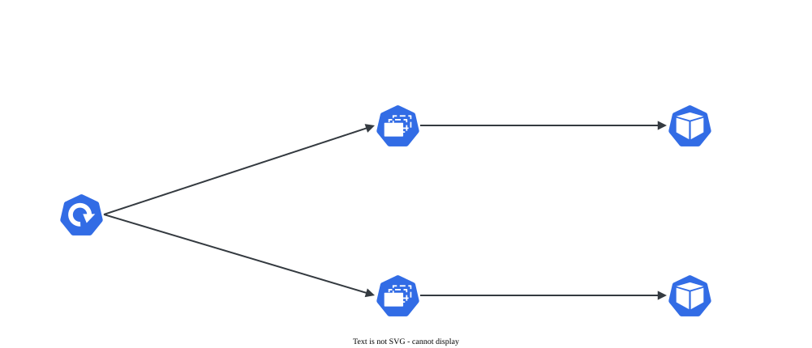

# Deployments: rollout, rollback e scale

> **Versão do Kubernetes:** v1.36 · **Última revisão:** 2026-10-23 · **Domínio:** Workloads & Scheduling (15%)

## O que é

Um **Deployment** mantém N réplicas de um Pod rodando e troca a versão delas sem derrubar a aplicação. Ele não cria Pods diretamente: cria um **ReplicaSet** por versão do template, e cada ReplicaSet mantém seus Pods.

- **Rollout**: qualquer mudança em `spec.template` (imagem, env, recursos, labels do Pod) cria um ReplicaSet novo e migra as réplicas para ele aos poucos.
- **Rollback**: voltar para um ReplicaSet anterior, que continua guardado com 0 réplicas.
- **Scale**: mudar `spec.replicas`. **Não** cria revisão nova, porque não mexe no template.

## Como funciona por dentro

[](../assets/diagramas/02-deployments-rollout.svg "Abrir o diagrama em tamanho real")

Estratégias (`spec.strategy.type`):

| Estratégia | Como troca | Quando usar |
|---|---|---|
| `RollingUpdate` (padrão) | Sobe Pods novos e derruba antigos aos poucos | Quase sempre |
| `Recreate` | Derruba **todos** os antigos e só então sobe os novos | Aplicação que não aceita duas versões ao mesmo tempo |

Os dois parâmetros do `RollingUpdate` (padrão de ambos: `25%`):

| Campo | Significado | Com 4 réplicas e o padrão |
|---|---|---|
| `maxSurge` | Quantos Pods **a mais** que `replicas` podem existir durante a troca (arredonda para cima) | até 5 Pods |
| `maxUnavailable` | Quantos Pods podem estar **indisponíveis** (arredonda para baixo) | no mínimo 3 disponíveis |

`maxSurge: 0` e `maxUnavailable: 0` ao mesmo tempo é inválido: a troca nunca andaria.

Cada ReplicaSet guarda o número da revisão na anotação `deployment.kubernetes.io/revision`. O Deployment mantém os últimos `revisionHistoryLimit` (padrão **10**) ReplicaSets antigos para permitir rollback.

## Comandos essenciais

```bash
# Criar
kubectl create deployment web --image=nginx:1.27 --replicas=3
kubectl create deployment web --image=nginx:1.27 --replicas=3 --port=80 --dry-run=client -o yaml > web.yaml

# Atualizar a imagem (rollout). O nome antes do = é o nome do CONTAINER
kubectl set image deployment/web nginx=nginx:1.28
kubectl get deployment web -o jsonpath='{.spec.template.spec.containers[*].name}'   # descobrir o nome

# Registrar o motivo na história (a flag --record foi descontinuada)
kubectl annotate deployment/web kubernetes.io/change-cause="nginx 1.28"

# Acompanhar
kubectl rollout status deployment/web              # espera terminar; exit 0 = concluído
kubectl rollout history deployment/web
kubectl rollout history deployment/web --revision=2   # detalhe de uma revisão (imagem, env...)
kubectl get rs -l app=web                          # um ReplicaSet por revisão

# Rollback
kubectl rollout undo deployment/web                # volta para a revisão anterior
kubectl rollout undo deployment/web --to-revision=1

# Pausar para juntar várias mudanças num rollout só
kubectl rollout pause deployment/web
kubectl set image deployment/web nginx=nginx:1.28
kubectl set resources deployment/web -c nginx --requests=cpu=100m,memory=64Mi
kubectl rollout resume deployment/web

# Recriar todos os Pods sem mudar nada (ex.: depois de alterar um ConfigMap usado como env)
kubectl rollout restart deployment/web

# Scale
kubectl scale deployment web --replicas=5
kubectl scale deployment web --current-replicas=5 --replicas=2   # só escala se hoje forem 5

# Editar ao vivo
kubectl edit deployment web
```

## YAML de referência

??? example "YAML completo: Deployment"

    ```yaml
    apiVersion: apps/v1
    kind: Deployment
    metadata:
      name: web
      annotations:
        kubernetes.io/change-cause: "nginx 1.27 inicial"   # aparece no rollout history
    spec:
      replicas: 4
      revisionHistoryLimit: 5          # quantos ReplicaSets antigos guardar (padrão 10)
      minReadySeconds: 5               # Pod precisa ficar Ready 5 s para contar como disponível
      progressDeadlineSeconds: 600     # depois disso o rollout é marcado como falho (padrão 600)
      selector:
        matchLabels:
          app: web                     # imutável depois de criado; tem que casar com o template
      strategy:
        type: RollingUpdate
        rollingUpdate:
          maxSurge: 1                  # no máximo 5 Pods durante a troca
          maxUnavailable: 0            # nunca menos de 4 disponíveis
      template:
        metadata:
          labels:
            app: web
        spec:
          containers:
            - name: nginx
              image: nginx:1.27
              ports:
                - containerPort: 80
              readinessProbe:          # sem readiness, "disponível" = container iniciado
                httpGet:
                  path: /
                  port: 80
    ```

Recreate (sem bloco `rollingUpdate`):

```yaml
apiVersion: apps/v1
kind: Deployment
metadata:
  name: legado
spec:
  replicas: 2
  selector:
    matchLabels:
      app: legado
  strategy:
    type: Recreate
  template:
    metadata:
      labels:
        app: legado
    spec:
      containers:
        - name: app
          image: nginx:1.27
```

## Na documentação oficial

- **Página principal:** *Deployments*. Link: <https://kubernetes.io/docs/concepts/workloads/controllers/deployment/>
- **Referência do kubectl:** `kubectl rollout`: <https://kubernetes.io/docs/reference/kubectl/generated/kubectl_rollout/>
- **Busca rápida:** `deployment`, `rollout`
- **Ctrl+F dentro da página principal:**
    - `Rolling Back a Deployment`: `rollout history`, `undo`, `--to-revision`.
    - `change-cause`: como a história ganha a coluna CHANGE-CAUSE.
    - `Max Surge` e `Max Unavailable`: as contas de arredondamento.
    - `Pausing and Resuming`: juntar mudanças.
    - `progressDeadlineSeconds`: quando o rollout é dado como falho.

## Pegadinhas da prova

- **`kubectl set image` usa o nome do container**, não o do Deployment nem o da imagem. Com `kubectl create deployment web --image=nginx:1.27`, o container se chama `nginx`. Nome errado dá `error: unable to find container named ...`.
- **Scale não é rollout.** `kubectl scale` não gera revisão nova nem aparece no `rollout history`.
- **`rollout undo` também é um rollout**: a revisão antiga volta com um número **novo** (a 1 vira 3, por exemplo) e some da lista com o número antigo.
- **Imagem errada não derruba tudo.** Com `RollingUpdate`, os Pods novos ficam em `ImagePullBackOff` e os antigos continuam atendendo. `kubectl rollout status` não termina; a correção é `rollout undo` ou `set image` com a tag certa.
- **`selector` é imutável.** Para mudar o seletor é preciso apagar e recriar o Deployment.
- **Mudar um ConfigMap usado como variável de ambiente não reinicia os Pods.** Use `kubectl rollout restart`.
- **Não edite o ReplicaSet**: o Deployment desfaz. Edite sempre o Deployment.
- **Questão pede "registre a mudança"?** Use a anotação `kubernetes.io/change-cause`. A flag `--record` foi descontinuada.

## Pratique

**Enunciado (como na prova):**

> In namespace `default`, create a Deployment `webapp` with image `nginx:1.26` and 3 replicas. Update it to `nginx:1.27` making sure that at no time fewer than 3 Pods are available, and record the change cause as `upgrade to 1.27`. Then roll back to the previous revision and scale the Deployment to 5 replicas.

**Tradução:** no namespace `default`, crie o Deployment `webapp`, imagem `nginx:1.26`, 3 réplicas. Atualize para `nginx:1.27` garantindo que nunca haja menos de 3 Pods disponíveis, e registre o motivo como `upgrade to 1.27`. Depois volte para a revisão anterior e escale para 5 réplicas.

??? success "Solução"
    ```bash
    kubectl create deployment webapp --image=nginx:1.26 --replicas=3
    kubectl patch deployment webapp -p '{"spec":{"strategy":{"rollingUpdate":{"maxUnavailable":0,"maxSurge":1}}}}'
    kubectl set image deployment/webapp nginx=nginx:1.27
    kubectl annotate deployment/webapp kubernetes.io/change-cause="upgrade to 1.27"
    kubectl rollout status deployment/webapp
    kubectl rollout undo deployment/webapp
    kubectl rollout status deployment/webapp
    kubectl scale deployment webapp --replicas=5
    ```
    `maxUnavailable: 0` é o que garante "nunca menos de 3". O `maxSurge: 1` precisa ser maior que zero para a troca andar. O patch não mexe no template, então não gera revisão.

**Como verificar:**

```bash
kubectl rollout history deployment/webapp
kubectl get deployment webapp -o jsonpath='{.spec.template.spec.containers[0].image}{"\n"}'
kubectl get deployment webapp -o jsonpath='{.spec.strategy.rollingUpdate}{"\n"}'
kubectl get deployment webapp                      # READY 5/5
```

Saída esperada (ilustrativa: nomes, IPs e idades mudam no seu cluster):

```console
$ kubectl rollout history deployment/webapp
deployment.apps/webapp
REVISION  CHANGE-CAUSE
2         upgrade to 1.27
3         <none>
$ kubectl get deployment webapp -o jsonpath='{.spec.template.spec.containers[0].image}{"\n"}'
nginx:1.26
$ kubectl get deployment webapp
NAME     READY   UP-TO-DATE   AVAILABLE   AGE
webapp   5/5     5            5           2m
```

A revisão 1 sumiu porque virou a 3 no rollback. A anotação `change-cause` fica no Deployment e é copiada para o ReplicaSet da vez, por isso a revisão 3 mostra `<none>` ou o valor anterior, conforme a ordem dos comandos.

??? tip "No lab / Killercoda"

    - Faça `kubectl set image deployment/webapp nginx=nginx:naoexiste` e observe: Pods novos em `ImagePullBackOff`, antigos atendendo, `rollout status` parado. Corrija com `rollout undo`.
    - Rode `kubectl get rs -w` em outro terminal durante um rollout e veja os números dos dois ReplicaSets mudando conforme `maxSurge`/`maxUnavailable`.
    - Troque a estratégia para `Recreate` e compare: todos os Pods somem antes de os novos subirem.
    - Use `rollout pause`, faça três mudanças e `rollout resume`: confira no `history` que entrou uma revisão só.
