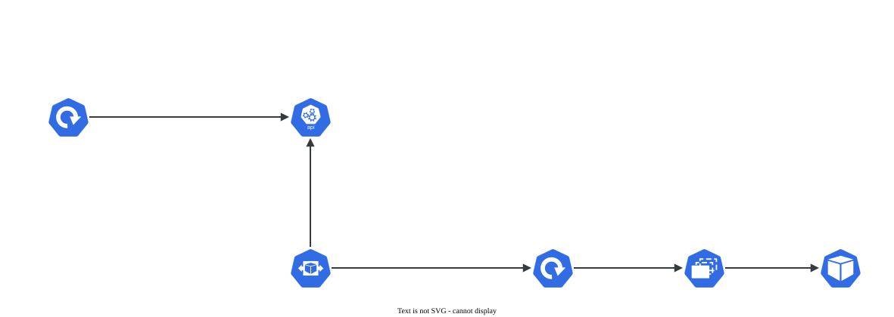

# HPA (HorizontalPodAutoscaler)

> **Versão do Kubernetes:** v1.36 · **Última revisão:** 2026-10-23 · **Domínio:** Workloads & Scheduling (15%)

## O que é

O **HPA** ajusta sozinho o `replicas` de um Deployment (ou StatefulSet, ou qualquer recurso com o subrecurso `scale`) conforme uma métrica, normalmente CPU ou memória. Mais carga, mais Pods; menos carga, menos Pods, sempre entre `minReplicas` e `maxReplicas`.

Três pré-requisitos, e a falta de qualquer um deixa o HPA com `<unknown>`:

1. **metrics-server** instalado (é ele que fornece a API `metrics.k8s.io`, a mesma do `kubectl top`).
2. **`requests`** declarado no container para o recurso medido. A meta é uma **porcentagem do request**: 50% de CPU com `requests.cpu: 200m` = 100m por Pod.
3. Um alvo que exista e tenha Pods rodando.

Escala **horizontal** (mais Pods). A vertical (mais CPU para o mesmo Pod) é o VPA, que não vem no Kubernetes.

## Como funciona por dentro

[](../assets/diagramas/02-hpa.svg "Abrir o diagrama em tamanho real")

A conta, a cada 15 segundos:

```
réplicas desejadas = teto( réplicas atuais × uso atual / meta )
```

Exemplo: 2 réplicas, uso médio 90%, meta 50% → teto(2 × 90 / 50) = teto(3,6) = **4**.

- Diferença menor que 10% (tolerância) não muda nada.
- **Subir** é imediato. **Descer** espera a janela de estabilização de **300 s**: o HPA usa a maior recomendação dos últimos 5 minutos, para não ficar sobe-e-desce.
- Com várias métricas, vence a que pede **mais** réplicas.
- O HPA é dono do `replicas`. Um `kubectl scale` manual é desfeito no próximo ciclo.

## Comandos essenciais

```bash
# Criar (a flag atual é --cpu com %; --cpu-percent=50 ainda funciona, mas está descontinuada)
kubectl autoscale deployment web --cpu=50% --min=2 --max=10
kubectl autoscale deployment web --cpu=50% --memory=70% --min=2 --max=10
kubectl autoscale deployment web --cpu=50% --min=2 --max=10 --dry-run=client -o yaml > hpa.yaml

# Ver
kubectl get hpa                          # TARGETS: uso/meta; <unknown> = sem métrica
kubectl get hpa web -w                   # acompanhar enquanto gera carga
kubectl describe hpa web                 # Conditions e Events dizem por que não escala

# Pré-requisitos
kubectl top pods                         # "Metrics API not available" = falta metrics-server
kubectl get apiservice v1beta1.metrics.k8s.io
kubectl get deploy web -o jsonpath='{.spec.template.spec.containers[0].resources}{"\n"}'

# Gerar carga
kubectl run carga --image=busybox:1.36 --rm -it --restart=Never -- \
  sh -c 'while true; do wget -q -O- http://web; done'

kubectl explain hpa.spec.behavior
```

## YAML de referência

??? example "YAML completo: HorizontalPodAutoscaler"

    ```yaml
    apiVersion: autoscaling/v2
    kind: HorizontalPodAutoscaler
    metadata:
      name: web
    spec:
      scaleTargetRef:                    # quem escalar
        apiVersion: apps/v1
        kind: Deployment
        name: web
      minReplicas: 2
      maxReplicas: 10
      metrics:
        - type: Resource
          resource:
            name: cpu
            target:
              type: Utilization          # porcentagem do request
              averageUtilization: 50
        - type: Resource
          resource:
            name: memory
            target:
              type: AverageValue         # valor absoluto por Pod, não depende do request
              averageValue: 200Mi
      behavior:                          # opcional: velocidade de subir e descer
        scaleDown:
          stabilizationWindowSeconds: 120   # padrão 300
          policies:
            - type: Pods
              value: 1                   # no máximo 1 Pod a menos
              periodSeconds: 60          # por minuto
        scaleUp:
          stabilizationWindowSeconds: 0
          policies:
            - type: Percent
              value: 100                 # pode dobrar
              periodSeconds: 15
    ```

O alvo precisa de `requests` para a meta de `Utilization`:

??? example "YAML completo: Deployment"

    ```yaml
    apiVersion: apps/v1
    kind: Deployment
    metadata:
      name: web
    spec:
      replicas: 2
      selector:
        matchLabels:
          app: web
      template:
        metadata:
          labels:
            app: web
        spec:
          containers:
            - name: nginx
              image: nginx:1.27
              resources:
                requests:
                  cpu: 100m              # 50% de meta = 50m por Pod
                  memory: 64Mi
                limits:
                  cpu: 200m
    ```

## Na documentação oficial

- **Página principal:** *Horizontal Pod Autoscaling*. Link: <https://kubernetes.io/docs/concepts/workloads/autoscaling/horizontal-pod-autoscale/>
- **Tarefa com carga de exemplo:** *HorizontalPodAutoscaler Walkthrough*: <https://kubernetes.io/docs/tasks/run-application/horizontal-pod-autoscale-walkthrough/>
- **Busca rápida:** `hpa`, `horizontal pod autoscaler`
- **Ctrl+F dentro das páginas:**
    - `Algorithm details`: a fórmula e a tolerância de 10%.
    - `stabilizationWindowSeconds`: a janela de descida.
    - `behavior`: as políticas de subir e descer.
    - `kubectl autoscale` (no walkthrough): o comando pronto e o gerador de carga `php-apache`.

## Pegadinhas da prova

- **`TARGETS <unknown>`**: falta metrics-server, falta `requests` do recurso no container, ou os Pods ainda não têm métrica (espere ~1 min). `kubectl describe hpa` mostra qual (`FailedGetResourceMetric`, `missing request for cpu`).
- **A porcentagem é do request, não do limit nem do nó.**
- **`autoscaling/v2`** é a versão atual. Em `v2` a meta fica em `metrics[].resource.target`. O campo `targetCPUUtilizationPercentage` é da `v1`.
- **Não use `kubectl scale` num Deployment com HPA**: o HPA volta o valor. Mude `minReplicas`/`maxReplicas` no HPA.
- **Descer demora 5 minutos** por padrão. Na prova, não espere a descida para conferir: confira a configuração (`kubectl get hpa -o yaml`).
- **`--min` ausente** no `kubectl autoscale` usa 1. Se a questão pede mínimo, informe.
- **O nome do HPA criado pelo `kubectl autoscale` é o nome do alvo.** Se a questão pede outro nome, use `--name`.

## Pratique

**Enunciado (como na prova):**

> In namespace `autoscale`, a Deployment `php` already exists. Create a HorizontalPodAutoscaler named `php-hpa` that keeps between 2 and 6 replicas, targeting 60% average CPU utilization. Scale-down must wait at most 60 seconds of stabilization. Make sure the HPA can actually read metrics.

**Tradução:** no namespace `autoscale` já existe o Deployment `php`. Crie o HPA `php-hpa`, entre 2 e 6 réplicas, com meta de 60% de uso médio de CPU. A estabilização de descida deve ser de no máximo 60 segundos. Garanta que o HPA consiga ler as métricas.

??? success "Solução"
    ```bash
    # Pré-requisito: o container precisa de requests de CPU
    kubectl get deploy php -n autoscale -o jsonpath='{.spec.template.spec.containers[0].resources}{"\n"}'
    kubectl set resources deployment php -n autoscale --requests=cpu=100m   # só se estiver vazio

    kubectl autoscale deployment php -n autoscale --name=php-hpa --cpu=60% --min=2 --max=6 \
      --dry-run=client -o yaml > hpa.yaml
    ```
    Acrescente o `behavior` em `hpa.yaml`:
    ```yaml
    apiVersion: autoscaling/v2
    kind: HorizontalPodAutoscaler
    metadata:
      name: php-hpa
      namespace: autoscale
    spec:
      scaleTargetRef:
        apiVersion: apps/v1
        kind: Deployment
        name: php
      minReplicas: 2
      maxReplicas: 6
      metrics:
        - type: Resource
          resource:
            name: cpu
            target:
              type: Utilization
              averageUtilization: 60
      behavior:
        scaleDown:
          stabilizationWindowSeconds: 60
    ```
    ```bash
    kubectl apply -f hpa.yaml
    ```
    "Garanta que consiga ler as métricas" = conferir `requests.cpu` no Deployment e o metrics-server (`kubectl top pods -n autoscale`). Sem eles, o HPA é criado mas fica em `<unknown>`.

**Como verificar:**

```bash
kubectl get hpa php-hpa -n autoscale
kubectl describe hpa php-hpa -n autoscale | grep -A6 Conditions
kubectl get hpa php-hpa -n autoscale -o jsonpath='{.spec.behavior.scaleDown.stabilizationWindowSeconds}{"\n"}'
```

Saída esperada (ilustrativa: nomes, IPs e idades mudam no seu cluster):

```console
$ kubectl get hpa php-hpa -n autoscale
NAME      REFERENCE        TARGETS       MINPODS   MAXPODS   REPLICAS   AGE
php-hpa   Deployment/php   cpu: 1%/60%   2         6         2          90s
$ kubectl get hpa php-hpa -n autoscale -o jsonpath='{.spec.behavior.scaleDown.stabilizationWindowSeconds}{"\n"}'
60
```

??? tip "No lab / Killercoda"

    - No lab kubeadm o metrics-server não vem instalado. Crie o HPA antes de instalar e leia o `<unknown>` e as Conditions; depois instale e veja a métrica aparecer. Em kubeadm costuma ser preciso o argumento `--kubelet-insecure-tls` no metrics-server, porque os certificados do kubelet são autoassinados.
    - Tire o `requests.cpu` do Deployment e leia o erro `missing request for cpu` no `describe hpa`.
    - Gere carga com o laço de `wget` e acompanhe `kubectl get hpa -w`. Pare a carga e cronometre a descida (5 min no padrão, 1 min com o `behavior` da solução).
    - Faça `kubectl scale deployment php --replicas=1` com o HPA ativo e veja o número voltar para 2.
