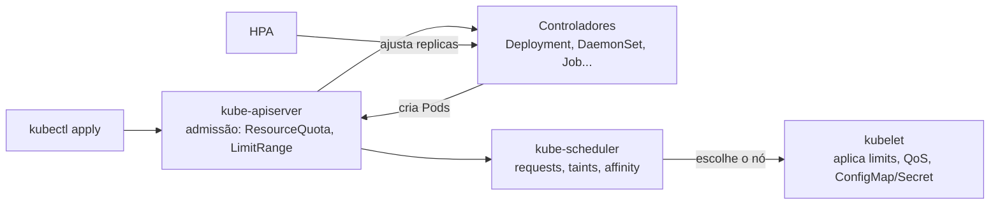

# 2. Workloads & Scheduling (15%)

O domínio de **o que roda e onde roda**: os controladores que mantêm as aplicações de pé (Deployment, DaemonSet, Job, CronJob, StatefulSet), como elas recebem configuração (ConfigMap e Secret), quanto de recurso cada uma pode usar (requests, limits, quota) e em que nó o scheduler as coloca (taints, nodeSelector, affinity).

## Itens do currículo e onde estão

| Item do currículo | Página |
|---|---|
| Understand application deployments and how to perform rolling update and rollbacks | [Deployments: rollout, rollback e scale](deployments-rollout.md) |
| Use ConfigMaps and Secrets to configure applications | [ConfigMap e Secret](configmap-secret.md) |
| Configure workload autoscaling | [HPA](hpa.md) |
| Understand the primitives used to create robust, self-healing, application deployments | [DaemonSet, Job, CronJob e StatefulSet](daemonset-job-cronjob-statefulset.md) |
| Configure Pod admission and scheduling (limits, node affinity, etc.) | [Taints, tolerations e nodeSelector](taints-tolerations-nodeselector.md) · [Affinity e anti-affinity](affinity.md) · [Requests, limits e QoS](requests-limits-qos.md) · [ResourceQuota](resourcequota.md) |

<!-- VERIFICAR: conferir a lista acima contra a versão atual do currículo em https://github.com/cncf/curriculum -->

## Ordem sugerida de estudo

1. **Deployments**: o controlador que mais aparece na prova. Rollout, rollback e scale são comandos de uma linha.
2. **ConfigMap e Secret**: toda aplicação real recebe configuração por eles.
3. **Requests, limits e QoS**: a base para entender scheduling, quota e HPA.
4. **ResourceQuota**: o teto por namespace, que depende de requests e limits.
5. **Taints, tolerations e nodeSelector**: o jeito simples de controlar onde o Pod vai.
6. **Affinity e anti-affinity**: o jeito expressivo (preferências, espalhar réplicas).
7. **DaemonSet, Job, CronJob e StatefulSet**: os outros controladores, cada um para um formato de carga.
8. **HPA**: escala automática, que junta Deployment, requests e métricas.

## Quem decide o quê

