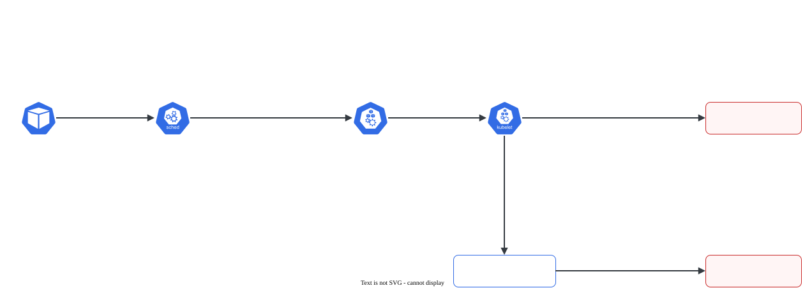

# Requests, limits e QoS

> **Versão do Kubernetes:** v1.37 · **Última revisão:** 2026-10-25 · **Domínio:** Workloads & Scheduling (15%)

## O que é

Cada container declara quanto de CPU e memória **precisa** e quanto **pode usar no máximo**:

| | `requests` | `limits` |
|---|---|---|
| Quem usa | **kube-scheduler** | **kubelet / kernel** (cgroups) |
| Significado | Reserva. O Pod só vai para um nó com esse tanto **livre de reservas** | Teto. O container não passa disso |
| Passar do valor | Pode (se o nó tiver sobra) | CPU: **throttling** (fica lento). Memória: **OOMKilled** (exit 137) |

Unidades:

| Recurso | Unidade | Exemplos |
|---|---|---|
| CPU | núcleos ou milicores (`m`) | `1` = 1 núcleo; `500m` = meio núcleo; `0.1` = `100m` |
| Memória | bytes com sufixo binário | `128Mi`, `1Gi`. Cuidado: `M` = 10⁶ e `Mi` = 2²⁰; `128m` = 0,128 **byte** |

A combinação de requests e limits define a **classe de QoS** do Pod, que decide **quem sai primeiro** quando o nó fica sem memória:

| Classe | Regra (todos os containers do Pod) | Expulso |
|---|---|---|
| **Guaranteed** | Todo container tem `requests` = `limits` de CPU **e** de memória | Por último |
| **Burstable** | Pelo menos um container tem algum request ou limit, mas não é Guaranteed | No meio (primeiro quem mais passou do request) |
| **BestEffort** | Nenhum container tem request nem limit | **Primeiro** |

Atalho: se você declara só `limits`, o Kubernetes copia o valor para `requests`. Por isso um container só com limits de CPU e memória já é Guaranteed.

## Como funciona por dentro

[](../assets/diagramas/02-requests-limits-qos.svg "Abrir o diagrama em tamanho real")

- O scheduler olha **requests**, nunca o uso real. Um nó com CPU a 5% pode recusar Pods se as reservas já somam 100% do `Allocatable`.
- `Allocatable` = capacidade do nó menos o que é reservado para sistema e kubelet. Está no `kubectl describe node`.
- **LimitRange** (por namespace) pode preencher requests/limits padrão para containers que não declaram nada, e impor mínimo/máximo.

## Comandos essenciais

```bash
# Declarar sem editar YAML
kubectl run app --image=nginx:1.27 --dry-run=client -o yaml > app.yaml   # depois edite resources
kubectl set resources deployment/web -c nginx --requests=cpu=100m,memory=128Mi --limits=cpu=500m,memory=256Mi

# Ver a classe de QoS
kubectl get pod app -o jsonpath='{.status.qosClass}{"\n"}'
kubectl get pods -o custom-columns=NOME:.metadata.name,QOS:.status.qosClass

# Quanto o nó tem e quanto já está reservado
kubectl describe node w1 | grep -A8 "Allocated resources"
kubectl describe node w1 | grep -A6 Allocatable

# Uso real (precisa do metrics-server)
kubectl top pods
kubectl top nodes

# Por que reiniciou?
kubectl describe pod app | grep -A3 "Last State"     # Reason: OOMKilled, Exit Code: 137
kubectl get pod app -o jsonpath='{.status.containerStatuses[0].lastState.terminated.reason}{"\n"}'

# LimitRange
kubectl get limitrange -n dev
kubectl describe limitrange -n dev

# Mudar recursos de um Pod rodando, sem recriar (in-place resize)
kubectl patch pod burstable --subresource resize -p '{"spec":{"containers":[{"name":"app","resources":{"requests":{"cpu":"200m"}}}]}}'
```

O *in-place resize* deixa mudar CPU e memória de um Pod que já está rodando. O limite é a classe de QoS: um resize que mudaria a classe é recusado (saída real, v1.37.1):

```console
$ kubectl patch pod guaranteed --subresource resize -p '{"spec":{"containers":[{"name":"app","resources":{"limits":{"cpu":"400m"}}}]}}'
The Pod "guaranteed" is invalid: spec: Invalid value: "Guaranteed": Pod QOS Class may not change as a result of resizing
```

O OOMKilled do Pod `estoura` (YAML abaixo), lido no `describe`:

```console
$ kubectl describe pod estoura | grep -A3 "State:"
    State:          Terminated
      Reason:       OOMKilled
      Exit Code:    137
```

## YAML de referência

??? example "YAML completo: Pod"

    ```yaml
    apiVersion: v1
    kind: Pod
    metadata:
      name: burstable
    spec:
      containers:
        - name: app
          image: nginx:1.27
          resources:
            requests:
              cpu: 100m                  # o scheduler reserva 0,1 núcleo
              memory: 128Mi
            limits:
              cpu: 500m                  # acima disso: throttling
              memory: 256Mi              # acima disso: OOMKilled
    ---
    apiVersion: v1
    kind: Pod
    metadata:
      name: guaranteed
    spec:
      containers:
        - name: app
          image: nginx:1.27
          resources:
            limits:                      # só limits: requests = limits → Guaranteed
              cpu: 250m
              memory: 128Mi
    ```

LimitRange com padrões e teto por container:

```yaml
apiVersion: v1
kind: LimitRange
metadata:
  name: padroes
  namespace: dev
spec:
  limits:
    - type: Container
      defaultRequest:                # request para quem não declarou
        cpu: 100m
        memory: 64Mi
      default:                       # limit para quem não declarou
        cpu: 500m
        memory: 256Mi
      max:                           # acima disso o Pod é recusado
        cpu: "1"
        memory: 512Mi
```

Container que estoura a memória de propósito (para ver o OOMKilled):

```yaml
apiVersion: v1
kind: Pod
metadata:
  name: estoura
spec:
  restartPolicy: Never
  containers:
    - name: estoura
      image: busybox:1.36
      command: ["sh", "-c", "head -c 200m /dev/zero | tail"]   # tenta segurar 200 MB
      resources:
        limits:
          memory: 64Mi
```

## Na documentação oficial

- **Página principal:** *Resource Management for Pods and Containers*. Link: <https://kubernetes.io/docs/concepts/configuration/manage-resources-containers/>
- **QoS:** *Pod Quality of Service Classes*: <https://kubernetes.io/docs/concepts/workloads/pods/pod-qos/>
- **LimitRange:** *Limit Ranges*: <https://kubernetes.io/docs/concepts/policy/limit-range/>
- **Tarefa com o OOMKilled:** *Assign Memory Resources to Containers and Pods*: <https://kubernetes.io/docs/tasks/configure-pod-container/assign-memory-resource/>
- **Busca rápida:** `resources limits`, `qos`
- **Ctrl+F dentro das páginas:**
    - `Meaning of CPU` e `Meaning of memory`: as unidades.
    - `Guaranteed`, `Burstable`, `BestEffort`: as regras de cada classe.
    - `OOMKilled`: o exemplo de memória acima do limite.
    - `defaultRequest`: o LimitRange com padrões.

## Pegadinhas da prova

- **Scheduler usa requests, não uso real nem limits.** Pod `Pending` com `Insufficient cpu` quer dizer que as **reservas** não cabem.
- **`m` em memória é mili.** `memory: 128m` não é 128 MB, é 0,128 byte. A API **aceita** e só mostra um aviso (`Warning: spec.containers[0].resources.requests[memory]: fractional byte value "128m" is invalid, must be an integer`), fácil de passar despercebido. No lab, um Pod assim bagunçou até o `kubectl describe node`, que passou a mostrar a memória reservada como `283115520128m`. O certo é `128Mi`.
- **Guaranteed exige CPU e memória**, iguais, em **todos** os containers (inclusive init containers e sidecars). Faltou um, vira Burstable.
- **OOMKilled = exit 137** e `Reason: OOMKilled` em `Last State`. CPU acima do limite **não mata**, só deixa lento.
- **A QoS é calculada na criação** e não muda. O in-place resize altera CPU e memória, mas recusa qualquer mudança que troque a classe. Para mudar a classe, recrie o Pod.
- **LimitRange vale só para Pods novos** e só no namespace dele. Com `max`, o Pod acima do teto é recusado: `pods "grandao" is forbidden: maximum cpu usage per Container is 1, but limit is 2`.
- **Questão "o Pod não sobe no nó"**: compare o request com o que sobra em `kubectl describe node` → `Allocated resources`.

## Pratique

**Enunciado (como na prova):**

> In namespace `qos-lab`, create a Pod `critical` with image `nginx:1.27` that has QoS class `Guaranteed`, using 200m CPU and 256Mi memory. Then create a Pod `besteffort` with image `nginx:1.27` and QoS class `BestEffort`. Write the QoS class of both Pods to `/opt/qos.txt`, one per line, in the format `<pod>:<class>`.

**Tradução:** no namespace `qos-lab`, crie o Pod `critical`, imagem `nginx:1.27`, com classe de QoS `Guaranteed`, usando 200m de CPU e 256Mi de memória. Depois crie o Pod `besteffort`, imagem `nginx:1.27`, com classe `BestEffort`. Grave a classe de QoS dos dois em `/opt/qos.txt`, uma por linha, no formato `<pod>:<classe>`.

??? success "Solução"
    ```bash
    kubectl create namespace qos-lab
    kubectl run critical -n qos-lab --image=nginx:1.27 --dry-run=client -o yaml > critical.yaml
    ```
    Edite `critical.yaml` e acrescente `resources` ao container:
    ```yaml
    apiVersion: v1
    kind: Pod
    metadata:
      name: critical
      namespace: qos-lab
    spec:
      containers:
        - name: critical
          image: nginx:1.27
          resources:
            requests:
              cpu: 200m
              memory: 256Mi
            limits:
              cpu: 200m
              memory: 256Mi
    ```
    ```bash
    kubectl apply -f critical.yaml
    kubectl run besteffort -n qos-lab --image=nginx:1.27      # sem resources = BestEffort
    kubectl get pods -n qos-lab -o jsonpath='{range .items[*]}{.metadata.name}:{.status.qosClass}{"\n"}{end}' > /opt/qos.txt
    cat /opt/qos.txt
    ```
    Se o namespace tiver um LimitRange com padrões, o `besteffort` ganharia requests e viraria Burstable. Confira com `kubectl get limitrange -n qos-lab` antes. Se o `>` responder `Permission denied` (usuário sem acesso a `/opt`), grave com `... | sudo tee /opt/qos.txt`.

**Como verificar:**

```bash
kubectl get pods -n qos-lab -o custom-columns=NOME:.metadata.name,QOS:.status.qosClass
cat /opt/qos.txt
```

Saída real (v1.37.1):

```console
$ kubectl get pods -n qos-lab -o custom-columns=NOME:.metadata.name,QOS:.status.qosClass
NOME         QOS
besteffort   BestEffort
critical     Guaranteed
$ cat /opt/qos.txt
besteffort:BestEffort
critical:Guaranteed
```

??? tip "No lab / Killercoda"

    - Aplique o Pod `estoura` do YAML de referência e leia `Last State` com `kubectl describe pod estoura`: `OOMKilled`, exit 137.
    - Crie um Pod com `requests.cpu` maior que o `Allocatable` de qualquer worker (ex.: `cpu: "64"`) e leia o evento `Insufficient cpu`.
    - Crie um LimitRange com `defaultRequest` no namespace e recrie o `besteffort`: veja a classe virar `Burstable`.
    - Tire o `cpu` só do `limits` do `critical` e confira que ele deixa de ser Guaranteed.
