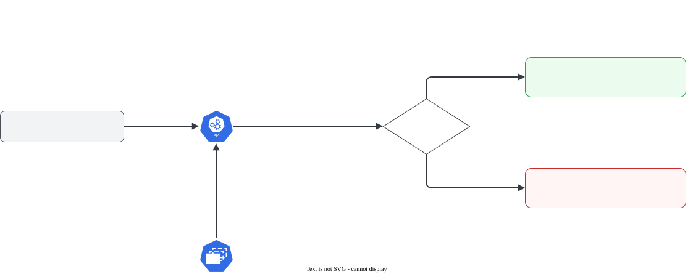

# ResourceQuota

> **Versão do Kubernetes:** v1.36 · **Última revisão:** 2026-10-23 · **Domínio:** Workloads & Scheduling (15%)

## O que é

Um **teto por namespace**: limita a soma de recursos e a quantidade de objetos que podem existir ali. Serve para um time não consumir o cluster inteiro.

| Tipo de limite | Chaves | Exemplo |
|---|---|---|
| Computação (soma dos Pods) | `requests.cpu`, `requests.memory`, `limits.cpu`, `limits.memory` (`cpu` e `memory` = atalho de `requests.*`) | `requests.cpu: "2"` |
| Quantidade de objetos | `pods`, `services`, `configmaps`, `secrets`, `persistentvolumeclaims`, `services.loadbalancers`, `services.nodeports` | `pods: "10"` |
| Quantidade de qualquer recurso | `count/<recurso>.<grupo>` | `count/deployments.apps: "5"` |
| Armazenamento | `requests.storage`, `<storageclass>.storageclass.storage.k8s.io/requests.storage` | `requests.storage: 50Gi` |

**ResourceQuota × LimitRange**: a quota é o total do namespace; o LimitRange é o mínimo/máximo/padrão **por container**. Os dois costumam andar juntos.

## Como funciona por dentro

[](../assets/diagramas/02-resourcequota.svg "Abrir o diagrama em tamanho real")

- A checagem é feita **na admissão** (na criação), pelo API server. Pods que já existiam quando a quota foi criada **não** são removidos, mesmo que estourem o limite.
- O uso atual fica em `status.used` da quota (`kubectl describe quota`).
- **Regra decisiva:** se a quota limita `requests.cpu` (ou `limits.memory`, etc.), **todo Pod novo precisa declarar esse valor**, senão é recusado. É por isso que quota e LimitRange vêm juntos: o LimitRange preenche o padrão.
- Quando o Pod é criado por um **controlador** (Deployment, Job), quem recebe a recusa é o controlador. O `kubectl apply` do Deployment funciona, mas os Pods não aparecem: o erro está nos eventos do **ReplicaSet**.

## Comandos essenciais

```bash
# Criar sem YAML
kubectl create quota cota-dev -n dev --hard=requests.cpu=2,requests.memory=2Gi,limits.cpu=4,limits.memory=4Gi,pods=10
kubectl create quota cota-objs -n dev --hard=count/deployments.apps=3,services=5,configmaps=10
kubectl create quota cota-dev -n dev --hard=pods=10 --dry-run=client -o yaml > quota.yaml

# Ver uso × limite
kubectl get quota -n dev                     # atalho de resourcequota
kubectl describe quota cota-dev -n dev       # colunas Used / Hard
kubectl get quota -A

# Deployment com 0 réplicas prontas? Olhe o ReplicaSet
kubectl get deploy,rs -n dev
kubectl describe rs -n dev -l app=web | grep -A5 Events
kubectl get events -n dev --field-selector reason=FailedCreate

kubectl explain resourcequota.spec
```

## YAML de referência

??? example "YAML completo: ResourceQuota + LimitRange"

    ```yaml
    apiVersion: v1
    kind: ResourceQuota
    metadata:
      name: cota-dev
      namespace: dev
    spec:
      hard:
        requests.cpu: "2"                # soma dos requests de CPU de todos os Pods
        requests.memory: 2Gi
        limits.cpu: "4"
        limits.memory: 4Gi
        pods: "10"
        services: "5"
        count/deployments.apps: "3"
        persistentvolumeclaims: "4"
        requests.storage: 20Gi
    ---
    # Padrões para os Pods que não declaram resources (senão a quota acima os recusa)
    apiVersion: v1
    kind: LimitRange
    metadata:
      name: padroes
      namespace: dev
    spec:
      limits:
        - type: Container
          defaultRequest:
            cpu: 100m
            memory: 64Mi
          default:
            cpu: 200m
            memory: 128Mi
    ```

Quota só para uma classe de prioridade (escopo):

```yaml
apiVersion: v1
kind: ResourceQuota
metadata:
  name: cota-alta-prioridade
  namespace: dev
spec:
  hard:
    pods: "2"
  scopeSelector:
    matchExpressions:
      - scopeName: PriorityClass
        operator: In
        values: ["alta"]
```

Outros escopos (`scopes`): `BestEffort`, `NotBestEffort`, `Terminating`, `NotTerminating`.

## Na documentação oficial

- **Página principal:** *Resource Quotas*. Link: <https://kubernetes.io/docs/concepts/policy/resource-quotas/>
- **Tarefa:** *Configure Memory and CPU Quotas for a Namespace*: <https://kubernetes.io/docs/tasks/administer-cluster/manage-resources/quota-memory-cpu-namespace/>
- **Tarefa:** *Configure a Pod Quota for a Namespace*: <https://kubernetes.io/docs/tasks/administer-cluster/manage-resources/quota-pod-namespace/>
- **Busca rápida:** `resource quota`
- **Ctrl+F dentro da página principal:**
    - `Compute Resource Quota`: as chaves de CPU e memória.
    - `Object Count Quota`: `count/<recurso>.<grupo>`.
    - `Quota Scopes`: `BestEffort`, `PriorityClass`.
    - `must specify`: a regra de declarar requests/limits quando há quota.

## Pegadinhas da prova

- **Deployment `0/N` sem erro no `kubectl apply`**: o ReplicaSet foi barrado pela quota. A mensagem está em `kubectl describe rs` (`exceeded quota` ou `must specify limits.cpu...`), não no Deployment.
- **Quota de CPU/memória obriga os Pods a declararem esses valores.** Sem LimitRange, um `kubectl run` sem `resources` é recusado com `failed quota: ... must specify ...`.
- **Quota nova não mexe no que já existe.** Ela só barra criações a partir dali.
- **`cpu: "2"` entre aspas** no YAML evita que vire número. A API aceita os dois, mas `--hard` na linha de comando não aceita espaços entre os itens.
- **`count/deployments.apps`**, com o grupo. `count/deployments` não conta nada.
- **Quota é por namespace.** Criou no `default` por engano? Ela não vale para `dev`.
- **A quota conta Pods criados, não Pods prontos.** Um Pod `Pending` por falta de CPU no nó (`Insufficient cpu`) já ocupa a vaga dele na quota. Se `READY` está abaixo do esperado e `describe quota` mostra o limite cheio, olhe também os eventos dos Pods.
- **Escalar acima da quota**: `kubectl scale --replicas=10` é aceito no Deployment, mas o ReplicaSet só consegue criar até o limite. `READY` fica parado em, por exemplo, `3/10`.

## Pratique

**Enunciado (como na prova):**

> Create namespace `team-a`. Limit it so that at most 4 Pods can run, the total CPU requests cannot exceed `1` and the total memory limits cannot exceed `1Gi`. Pods created without resources must still be accepted, receiving a default request of `100m` CPU / `128Mi` memory and a default limit of `200m` CPU / `256Mi` memory. Then create a Deployment `api` with image `nginx:1.27` and 5 replicas, and explain how many become ready.

**Tradução:** crie o namespace `team-a` com no máximo 4 Pods, soma de requests de CPU até `1` e soma de limits de memória até `1Gi`. Pods criados sem resources devem ser aceitos, recebendo request padrão de `100m`/`128Mi` e limit padrão de `200m`/`256Mi`. Depois crie o Deployment `api`, imagem `nginx:1.27`, 5 réplicas, e explique quantas ficam prontas.

??? success "Solução"
    ```bash
    kubectl create namespace team-a
    kubectl create quota cota -n team-a --hard=pods=4,requests.cpu=1,limits.memory=1Gi
    ```
    ```yaml
    apiVersion: v1
    kind: LimitRange
    metadata:
      name: padroes
      namespace: team-a
    spec:
      limits:
        - type: Container
          defaultRequest:
            cpu: 100m
            memory: 128Mi
          default:
            cpu: 200m
            memory: 256Mi
    ```
    ```bash
    kubectl apply -f limitrange.yaml
    kubectl create deployment api -n team-a --image=nginx:1.27 --replicas=5
    ```
    Ficam **4 prontas**. Cada Pod recebe `limits.memory: 256Mi` do LimitRange: 4 × 256Mi = 1Gi, que é o teto. O quinto estoura tanto `pods=4` quanto `limits.memory=1Gi`. CPU não é o gargalo: 4 × 100m = 400m de 1.

**Como verificar:**

```bash
kubectl get deploy api -n team-a
kubectl describe quota cota -n team-a
kubectl describe rs -n team-a -l app=api | grep -A4 Events
```

Saída esperada (ilustrativa: nomes, IPs e idades mudam no seu cluster):

```console
$ kubectl get deploy api -n team-a
NAME   READY   UP-TO-DATE   AVAILABLE   AGE
api    4/5     4            4           30s
$ kubectl describe quota cota -n team-a
Name:            cota
Namespace:       team-a
Resource         Used  Hard
--------         ----  ----
limits.memory    1Gi   1Gi
pods             4     4
requests.cpu     400m  1
$ kubectl describe rs -n team-a -l app=api | grep -A4 Events
  Warning  FailedCreate      10s   replicaset-controller  Error creating: pods "api-7c9d8b6f5-x2k4j" is forbidden: exceeded quota: cota, requested: limits.memory=256Mi,pods=1, used: limits.memory=1Gi,pods=4, limited: limits.memory=1Gi,pods=4
```

??? tip "No lab / Killercoda"

    - Apague o LimitRange e rode `kubectl run x -n team-a --image=nginx:1.27`: leia a recusa `must specify`.
    - Crie a quota **depois** de já ter 5 Pods no namespace e confira que nenhum é removido; só o sexto é barrado.
    - Faça uma quota com `count/deployments.apps=1` e tente criar o segundo Deployment.
    - Use `kubectl get events -n team-a -w` em outro terminal enquanto escala o Deployment para 10.
