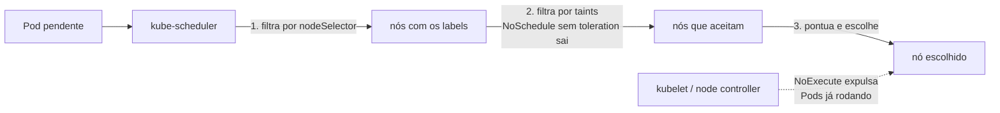

# Taints, tolerations e nodeSelector

> **Versão do Kubernetes:** v1.36 · **Última revisão:** 2026-10-23 · **Domínio:** Workloads & Scheduling (15%)

## O que é

Três mecanismos simples para controlar **em que nó** um Pod roda:

| Mecanismo | Onde fica | Efeito |
|---|---|---|
| **Taint** | no **nó** | Repele Pods. Só entra quem tem a tolerância correspondente |
| **Toleration** | no **Pod** | Permite (não obriga) o Pod a ir para um nó com aquele taint |
| **nodeSelector** | no **Pod** | Obriga o Pod a ir para nós com aqueles labels |

A diferença que a prova cobra: **taint + toleration repele; nodeSelector atrai.** Uma toleration sozinha não leva o Pod para o nó com taint: ela só tira o bloqueio. Para "dedicar" um nó a uma aplicação, use os dois: taint no nó (os outros não entram) e toleration + nodeSelector no Pod (ele entra e só vai para lá).

## Como funciona por dentro



Os três efeitos de taint:

| Efeito | Pod novo sem toleration | Pod já rodando sem toleration |
|---|---|---|
| `NoSchedule` | não é agendado | continua rodando |
| `PreferNoSchedule` | o scheduler evita, mas usa se não houver outro nó | continua rodando |
| `NoExecute` | não é agendado | **é expulso** (na hora, ou depois de `tolerationSeconds`) |

Como a toleration casa com o taint:

| `operator` | Casa quando |
|---|---|
| `Equal` (padrão) | `key`, `value` e `effect` iguais aos do taint |
| `Exists` | `key` igual (o `value` não pode ser informado) |
| `Exists` sem `key` | tolera **todos** os taints |

Sem `effect` na toleration = casa com qualquer efeito daquela chave.

Taints que o próprio Kubernetes coloca:

- `node-role.kubernetes.io/control-plane:NoSchedule`: no control plane do kubeadm. É por isso que Pods comuns não rodam lá.
- `node.kubernetes.io/not-ready` e `node.kubernetes.io/unreachable` (`NoExecute`): quando o nó cai. Todo Pod recebe automaticamente uma toleration de **300 s** para eles; é o tempo até os Pods serem tirados de um nó morto.
- `node.kubernetes.io/unschedulable:NoSchedule`: colocado pelo `kubectl cordon`.

## Comandos essenciais

```bash
# Taints
kubectl taint nodes w1 dedicado=gpu:NoSchedule      # adicionar
kubectl taint nodes w1 dedicado=gpu:NoSchedule-     # remover (sinal de menos no fim)
kubectl taint nodes w1 dedicado-                    # remover todos os taints dessa chave
kubectl describe node w1 | grep -A3 Taints
kubectl get nodes -o custom-columns=NOME:.metadata.name,TAINTS:.spec.taints

# Labels (para o nodeSelector)
kubectl label nodes w2 disco=ssd
kubectl label nodes w2 disco=nvme --overwrite
kubectl label nodes w2 disco-                       # remover o label
kubectl get nodes --show-labels
kubectl get nodes -l disco=ssd

# Não existe flag de toleration/nodeSelector no kubectl run: gere o YAML e edite
kubectl run web --image=nginx:1.27 --dry-run=client -o yaml > web.yaml

# Por que o Pod está Pending? A resposta está nos eventos
kubectl describe pod web | grep -A5 Events
kubectl get pod web -o wide                         # coluna NODE

kubectl explain pod.spec.tolerations
```

## YAML de referência

```yaml
apiVersion: v1
kind: Pod
metadata:
  name: web
spec:
  nodeSelector:
    disco: ssd                       # só nós com este label (E entre vários labels)
  tolerations:
    - key: dedicado                  # tolera dedicado=gpu:NoSchedule
      operator: Equal
      value: gpu
      effect: NoSchedule
    - key: manutencao                # tolera qualquer valor dessa chave
      operator: Exists
      effect: NoExecute
      tolerationSeconds: 60          # só vale com NoExecute: fica 60 s e depois sai
  containers:
    - name: web
      image: nginx:1.27
```

Pod que roda em qualquer nó, inclusive no control plane (é o que DaemonSets de sistema fazem):

```yaml
apiVersion: v1
kind: Pod
metadata:
  name: em-todo-lugar
spec:
  tolerations:
    - operator: Exists               # sem key: tolera todos os taints
  containers:
    - name: c
      image: busybox:1.36
      command: ["sleep", "3600"]
```

`nodeName` pula o scheduler e manda o Pod direto para o nó. Por isso **ignora** taints `NoSchedule` (quem aplica `NoSchedule` é o scheduler), mas o `NoExecute` continua valendo:

```yaml
apiVersion: v1
kind: Pod
metadata:
  name: direto
spec:
  nodeName: w2                       # sem scheduler: sem filtro de recursos nem de taint NoSchedule
  containers:
    - name: c
      image: busybox:1.36
      command: ["sleep", "3600"]
```

## Na documentação oficial

- **Página principal:** *Taints and Tolerations*. Link: <https://kubernetes.io/docs/concepts/scheduling-eviction/taint-and-toleration/>
- **nodeSelector:** *Assigning Pods to Nodes*: <https://kubernetes.io/docs/concepts/scheduling-eviction/assign-pod-node/>
- **Busca rápida:** `taint`, `nodeSelector`
- **Ctrl+F dentro das páginas:**
    - `kubectl taint nodes`: adicionar e remover taint.
    - `tolerationSeconds`: o tempo de permanência com `NoExecute`.
    - `operator: "Exists"`: tolerar sem valor.
    - `nodeSelector` (em *Assigning Pods to Nodes*): o YAML pronto com `disktype: ssd`.
    - `nodeName`: as limitações de pular o scheduler.

## Pegadinhas da prova

- **Toleration não atrai.** Se a questão pede "o Pod deve rodar **só** no nó X", toleration não basta: some `nodeSelector` (ou node affinity) com um label do nó. `kubernetes.io/hostname` já existe em todo nó.
- **Remover taint é com `-` no fim**, repetindo a chave e o efeito: `kubectl taint nodes w1 dedicado=gpu:NoSchedule-`.
- **`NoSchedule` não expulsa ninguém.** Pods que já estavam no nó continuam. Só `NoExecute` expulsa.
- **`tolerationSeconds` só vale com `NoExecute`**: com outro efeito a API recusa (`effect must be 'NoExecute' when tolerationSeconds is set`).
- **Com `operator: Exists`, não informe `value`**: a API recusa (`value must be empty when operator is 'Exists'`).
- **`value` é string**: valores como `true` ou `1` precisam de aspas no YAML da toleration (`value: "true"`).
- **Pod Pending com "untolerated taint"**: leia os eventos. A mensagem diz quantos nós foram descartados e por quê (`0/3 nodes are available: 1 node(s) didn't match Pod's node affinity/selector, 2 node(s) had untolerated taint(s)`). O `kubectl describe node` mostra qual taint cada nó tem.
- **O control plane tem taint.** Um Pod que precisa rodar lá (ou um DaemonSet que precisa rodar em todos os nós) precisa tolerar `node-role.kubernetes.io/control-plane:NoSchedule`.
- **nodeSelector é E**: todos os labels listados precisam existir no nó. Para OU, use node affinity.

## Pratique

**Enunciado (como na prova):**

> Node `w1` must be dedicated to the `analytics` team. Taint it with `team=analytics:NoSchedule`. Then create a Pod named `report` with image `busybox:1.36` running `sleep 3600` that runs **only** on `w1`. Make sure no other new Pod without the toleration can be scheduled on `w1`.

**Tradução:** o nó `w1` deve ser dedicado ao time `analytics`. Aplique o taint `team=analytics:NoSchedule` nele. Depois crie o Pod `report`, imagem `busybox:1.36`, executando `sleep 3600`, que rode **somente** em `w1`. Garanta que nenhum outro Pod novo sem a toleration seja agendado em `w1`.

??? success "Solução"
    ```bash
    kubectl taint nodes w1 team=analytics:NoSchedule
    kubectl label nodes w1 team=analytics          # label para atrair (o taint só repele)
    kubectl run report --image=busybox:1.36 --dry-run=client -o yaml -- sleep 3600 > report.yaml
    ```
    Edite `report.yaml` e acrescente em `spec`:
    ```yaml
    apiVersion: v1
    kind: Pod
    metadata:
      name: report
    spec:
      nodeSelector:
        team: analytics
      tolerations:
        - key: team
          operator: Equal
          value: analytics
          effect: NoSchedule
      containers:
        - name: report
          image: busybox:1.36
          args: ["sleep", "3600"]
    ```
    ```bash
    kubectl apply -f report.yaml
    ```
    O taint impede os outros Pods; a toleration libera o `report`; o `nodeSelector` o prende ao `w1`. Se não quiser criar label, `kubernetes.io/hostname: w1` no `nodeSelector` também resolve.

**Como verificar:**

```bash
kubectl get pod report -o wide                       # NODE = w1
kubectl run intruso --image=busybox:1.36 -- sleep 3600
kubectl get pod intruso -o wide                      # nunca em w1
kubectl describe node w1 | grep Taints
```

Saída esperada (ilustrativa: nomes, IPs e idades mudam no seu cluster):

```console
$ kubectl get pod report -o wide
NAME     READY   STATUS    RESTARTS   AGE   IP           NODE   NOMINATED NODE   READINESS GATES
report   1/1     Running   0          12s   10.244.1.7   w1     <none>           <none>
$ kubectl describe node w1 | grep Taints
Taints:             team=analytics:NoSchedule
```

**No lab / Killercoda:**

- Aplique um taint `NoSchedule` num worker com Pods rodando e veja que eles continuam. Troque por `NoExecute` e veja os Pods saírem.
- Crie uma toleration `NoExecute` com `tolerationSeconds: 30` e cronometre a expulsão.
- Tire o `nodeSelector` da solução e crie várias réplicas: veja que algumas vão para outros nós (toleration não atrai).
- Crie um Pod com `nodeName: cp` e confira que ele roda no control plane mesmo sem toleration.
- Ao terminar, remova o taint e o label: `kubectl taint nodes w1 team-` e `kubectl label nodes w1 team-`.
