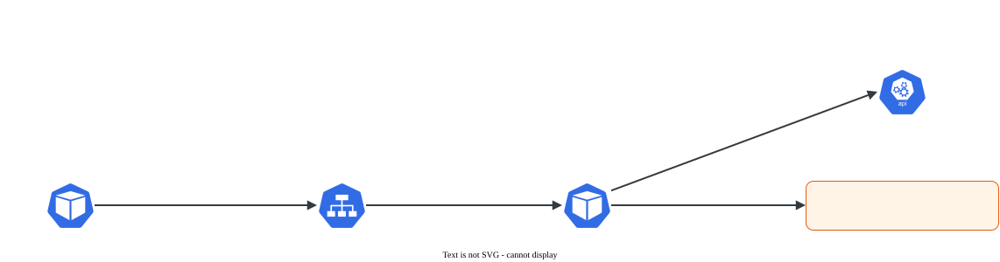

# DNS do cluster

> **Versão do Kubernetes:** v1.36 · **Última revisão:** 2026-10-23 · **Domínio:** Services & Networking (20%)

## O que é

Todo cluster tem um **servidor DNS interno** que dá nome a Services e Pods. Em vez de usar `10.96.45.12`, um Pod chama `web-svc` ou `web-svc.shop.svc.cluster.local`. Em clusters kubeadm esse servidor é o **CoreDNS**.

Formato dos nomes (domínio padrão `cluster.local`):

| Registro | Nome | Resolve para |
|---|---|---|
| Service (ClusterIP) | `<service>.<namespace>.svc.cluster.local` | IP do Service |
| Service headless | `<service>.<namespace>.svc.cluster.local` | IPs de **todos os Pods** prontos |
| Pod de StatefulSet (com headless) | `<pod>.<service-headless>.<namespace>.svc.cluster.local` | IP daquele Pod |
| Pod (qualquer) | `<ip-com-hifens>.<namespace>.pod.cluster.local`, ex.: `10-244-1-5.shop.pod.cluster.local` | IP do Pod |
| Porta nomeada (SRV) | `_<porta>._<protocolo>.<service>.<namespace>.svc.cluster.local` | Porta + nome do Service |
| ExternalName | `<service>.<namespace>.svc.cluster.local` | CNAME para o nome externo |

Na prova: resolver nomes de Service e de Pod de dentro de um Pod (e gravar a saída num arquivo), e diagnosticar DNS quebrado.

## Como funciona por dentro

[](../assets/diagramas/03-dns.svg "Abrir o diagrama em tamanho real")

As peças:

| Peça | Onde | Papel |
|---|---|---|
| Deployment `coredns` | `kube-system` | Os Pods que respondem DNS (2 réplicas no kubeadm) |
| Service `kube-dns` | `kube-system` | IP fixo do DNS (no kubeadm, `10.96.0.10`). O nome continua `kube-dns` por compatibilidade |
| ConfigMap `coredns` | `kube-system` | O `Corefile`, a configuração do CoreDNS |
| kubelet (`clusterDNS`, `clusterDomain`) | `/var/lib/kubelet/config.yaml` em cada nó | Escreve o `/etc/resolv.conf` de cada Pod |

O `/etc/resolv.conf` que o kubelet gera para um Pod no namespace `shop`:

```text
nameserver 10.96.0.10
search shop.svc.cluster.local svc.cluster.local cluster.local
options ndots:5
```

- **`search`** é o que permite usar nome curto. `web-svc` vira `web-svc.shop.svc.cluster.local`, e `web-svc.outro-ns` vira `web-svc.outro-ns.svc.cluster.local`.
- **`ndots:5`**: nomes com menos de 5 pontos passam primeiro pelas buscas do `search`. Por isso uma consulta a `google.com` gera algumas tentativas internas antes da externa.
- Nome curto só funciona **no mesmo namespace**. Para outro namespace, use pelo menos `<service>.<namespace>`.

**dnsPolicy** (campo do Pod):

| Valor | Efeito |
|---|---|
| `ClusterFirst` (padrão) | Usa o CoreDNS; o que não for do cluster é encaminhado |
| `Default` | Herda o DNS do **nó** (sim, o nome engana: `Default` não é o padrão) |
| `ClusterFirstWithHostNet` | Para Pods com `hostNetwork: true` que precisam do DNS do cluster |
| `None` | Ignora tudo e usa só o que estiver em `dnsConfig` |

## Comandos essenciais

```bash
# Ver as peças do DNS
kubectl -n kube-system get deploy coredns
kubectl -n kube-system get svc kube-dns
kubectl -n kube-system get pods -l k8s-app=kube-dns
kubectl -n kube-system get endpointslices -l kubernetes.io/service-name=kube-dns

# Ver a configuração (Corefile)
kubectl -n kube-system get configmap coredns -o yaml

# Logs do CoreDNS
kubectl -n kube-system logs -l k8s-app=kube-dns

# Testar resolução com Pod temporário (busybox 1.28: o nslookup das versões novas tem saída problemática)
kubectl run dns-test --image=busybox:1.28 --rm -it --restart=Never -- nslookup web-svc.shop

# Gravar a saída num arquivo (formato comum na prova)
kubectl run dns-test --image=busybox:1.28 --rm -it --restart=Never -- nslookup web-svc.shop > /opt/svc-dns.txt

# Resolver o nome DNS de um Pod: IP com hifens no lugar dos pontos
kubectl get pod web-0 -n shop -o wide          # pega o IP, ex.: 10.244.1.5
kubectl run dns-test --image=busybox:1.28 --rm -it --restart=Never -- nslookup 10-244-1-5.shop.pod.cluster.local

# Ver o resolv.conf de um Pod
kubectl exec -it <pod> -- cat /etc/resolv.conf

# Imagem de diagnóstico usada na documentação oficial (tem dig e nslookup)
kubectl run dnsutils --image=registry.k8s.io/e2e-test-images/jessie-dnsutils:1.3 --restart=Never -- sleep infinity
kubectl exec -it dnsutils -- dig +search web-svc.shop

# Depois de editar o ConfigMap: o plugin "reload" aplica sozinho em até ~2 min; para forçar:
kubectl -n kube-system rollout restart deployment coredns

# Conferir o que o kubelet passa aos Pods (em um nó)
grep -A2 -E 'clusterDNS|clusterDomain' /var/lib/kubelet/config.yaml
```

`--dry-run=client -o yaml` serve aqui para gerar um Pod de teste e acrescentar `dnsPolicy`/`dnsConfig`:

```bash
kubectl run dns-custom --image=nginx --dry-run=client -o yaml > pod-dns.yaml
```

<!-- VERIFICAR: tag mais recente da imagem jessie-dnsutils citada na página "Debugging DNS Resolution" -->

## YAML de referência

`Corefile` padrão do kubeadm (ConfigMap `coredns` em `kube-system`), comentado:

```yaml
apiVersion: v1
kind: ConfigMap
metadata:
  name: coredns
  namespace: kube-system
data:
  Corefile: |
    .:53 {
        errors                      # loga erros
        health {                    # /health na porta 8080 (livenessProbe)
           lameduck 5s
        }
        ready                       # /ready na porta 8181 (readinessProbe)
        kubernetes cluster.local in-addr.arpa ip6.arpa {   # responde pelo domínio do cluster
           pods insecure            # habilita os registros <ip-com-hifens>.<ns>.pod
           fallthrough in-addr.arpa ip6.arpa
           ttl 30
        }
        prometheus :9153            # métricas
        forward . /etc/resolv.conf {   # o que não é do cluster vai para o DNS do nó
           max_concurrent 1000
        }
        cache 30
        loop                        # detecta loop de encaminhamento e derruba o CoreDNS de propósito
        reload                      # recarrega quando o ConfigMap muda
        loadbalance
    }
```

Pod com DNS personalizado:

```yaml
apiVersion: v1
kind: Pod
metadata:
  name: dns-custom
spec:
  containers:
    - name: app
      image: nginx
  dnsPolicy: "None"           # ignora o DNS do cluster
  dnsConfig:
    nameservers:
      - 1.1.1.1
    searches:
      - meu.dominio.local
    options:
      - name: ndots
        value: "2"
```

Para encaminhar um domínio específico a outro servidor (ex.: DNS da empresa), acrescente um bloco ao Corefile:

```text
empresa.local:53 {
    errors
    cache 30
    forward . 10.0.0.53
}
```

## Na documentação oficial

- **Página principal:** *DNS for Services and Pods*. Link: <https://kubernetes.io/docs/concepts/services-networking/dns-pod-service/>
- **Complementares:**
    - *Debugging DNS Resolution*: <https://kubernetes.io/docs/tasks/administer-cluster/dns-debugging-resolution/>
    - *Customizing DNS Service* (Corefile e domínios encaminhados): <https://kubernetes.io/docs/tasks/administer-cluster/dns-custom-nameservers/>
- **Busca rápida:** `dns pod service`
- **Ctrl+F dentro da página principal:**
    - `pod.cluster.local`: formato do nome de Pod.
    - `dnsPolicy`: tabela das políticas.
    - `dnsConfig`: exemplo de DNS personalizado.
    - `SRV records`: formato para portas nomeadas.
- **Ctrl+F na página de debugging:** `dnsutils` (YAML do Pod de teste) e `resolv.conf`.

## Pegadinhas da prova

- **Nome curto em outro namespace não resolve.** `web-svc` só funciona no namespace do Service. De fora dele, use `web-svc.shop` ou o FQDN.
- **Service se chama `kube-dns`, Pods e Deployment se chamam `coredns`.** O label dos Pods é `k8s-app=kube-dns`.
- **busybox novo e `nslookup`.** Versões recentes do busybox mostram erro ou saída estranha em nomes do cluster. Use `busybox:1.28` ou a imagem `dnsutils`.
- **Nome de Pod com pontos.** É `10-244-1-5.shop.pod.cluster.local`, com hifens. E o namespace vem antes de `pod`.
- **`dnsPolicy: Default` não é o padrão.** O padrão é `ClusterFirst`.
- **Pod com `hostNetwork: true`** usa o DNS do nó, a menos que tenha `dnsPolicy: ClusterFirstWithHostNet`.
- **Headless não tem IP de Service.** O `nslookup` devolve vários IPs (um por Pod). É o comportamento esperado.
- **Editar o Corefile e esperar efeito na hora.** O `reload` leva um tempo. Se a questão for cronometrada, faça `rollout restart`. Antes, confira os logs do CoreDNS: erro de sintaxe no Corefile derruba o CoreDNS em `CrashLoopBackOff`.
- **Gravar a saída no arquivo pedido.** Com `kubectl run ... --rm -it`, o redirecionamento `>` roda no **seu** terminal e grava a saída no host, que é o que a prova quer. Confira o arquivo com `cat` depois.

## Pratique

**Enunciado (como na prova):**

> Create a Pod named `nginx-resolver` using image `nginx` and expose it internally with a Service named `nginx-resolver-svc` on port `80`. Using a Pod with image `busybox:1.28`, look up the DNS record of the Service and of the Pod. Write the results to `/root/CKA/nginx.svc` and `/root/CKA/nginx.pod` respectively.

**Tradução:** crie um Pod `nginx-resolver` com a imagem `nginx` e exponha-o internamente com um Service `nginx-resolver-svc` na porta `80`. Com um Pod `busybox:1.28`, consulte o registro DNS do Service e do Pod. Grave os resultados em `/root/CKA/nginx.svc` e `/root/CKA/nginx.pod`, respectivamente.

??? success "Solução"
    ```bash
    kubectl run nginx-resolver --image=nginx
    kubectl expose pod nginx-resolver --name=nginx-resolver-svc --port=80

    mkdir -p /root/CKA

    # Service
    kubectl run test-nslookup --image=busybox:1.28 --rm -it --restart=Never \
      -- nslookup nginx-resolver-svc > /root/CKA/nginx.svc

    # Pod: pegar o IP e trocar pontos por hifens
    IP=$(kubectl get pod nginx-resolver -o jsonpath='{.status.podIP}')
    kubectl run test-nslookup --image=busybox:1.28 --rm -it --restart=Never \
      -- nslookup ${IP//./-}.default.pod.cluster.local > /root/CKA/nginx.pod
    ```
    `${IP//./-}` é substituição do bash: troca todo `.` por `-`. Pode digitar o nome à mão, se preferir.

**Como verificar:**

```bash
cat /root/CKA/nginx.svc     # Name: nginx-resolver-svc.default.svc.cluster.local + IP do Service
cat /root/CKA/nginx.pod     # Name: 10-244-x-y.default.pod.cluster.local + IP do Pod
kubectl get svc nginx-resolver-svc -o wide; kubectl get pod nginx-resolver -o wide   # IPs batem?
```

O arquivo pode conter também a linha `pod "test-nslookup" deleted`, gerada pelo `--rm`. Normalmente isso é aceito. Se quiser o arquivo limpo, rode o Pod sem `--rm`, use `kubectl logs` para gravar e apague o Pod depois.

Saída esperada (ilustrativa: nomes, IPs e idades mudam no seu cluster):

```console
$ cat /root/CKA/nginx.svc
Server:    10.96.0.10
Address 1: 10.96.0.10 kube-dns.kube-system.svc.cluster.local

Name:      nginx-resolver-svc
Address 1: 10.96.45.12 nginx-resolver-svc.default.svc.cluster.local
pod "test-nslookup" deleted
```

**No lab / Killercoda:**

- Escale o CoreDNS para 0 (`kubectl -n kube-system scale deploy coredns --replicas=0`) e veja o que acontece com a resolução. Depois volte para 2. É treino direto de Troubleshooting.
- Crie um StatefulSet com Service headless e resolva `web-0.<svc>.<ns>.svc.cluster.local`.
- Adicione um bloco de domínio encaminhado ao Corefile apontando para um DNS que não existe e acompanhe os logs do CoreDNS.
- Crie um Pod com `dnsPolicy: Default` e compare o `/etc/resolv.conf` dele com o de um Pod comum e com o do nó.
- No lab kubeadm, procure `clusterDNS` em `/var/lib/kubelet/config.yaml` dos nós e confirme que bate com o IP do Service `kube-dns`.
