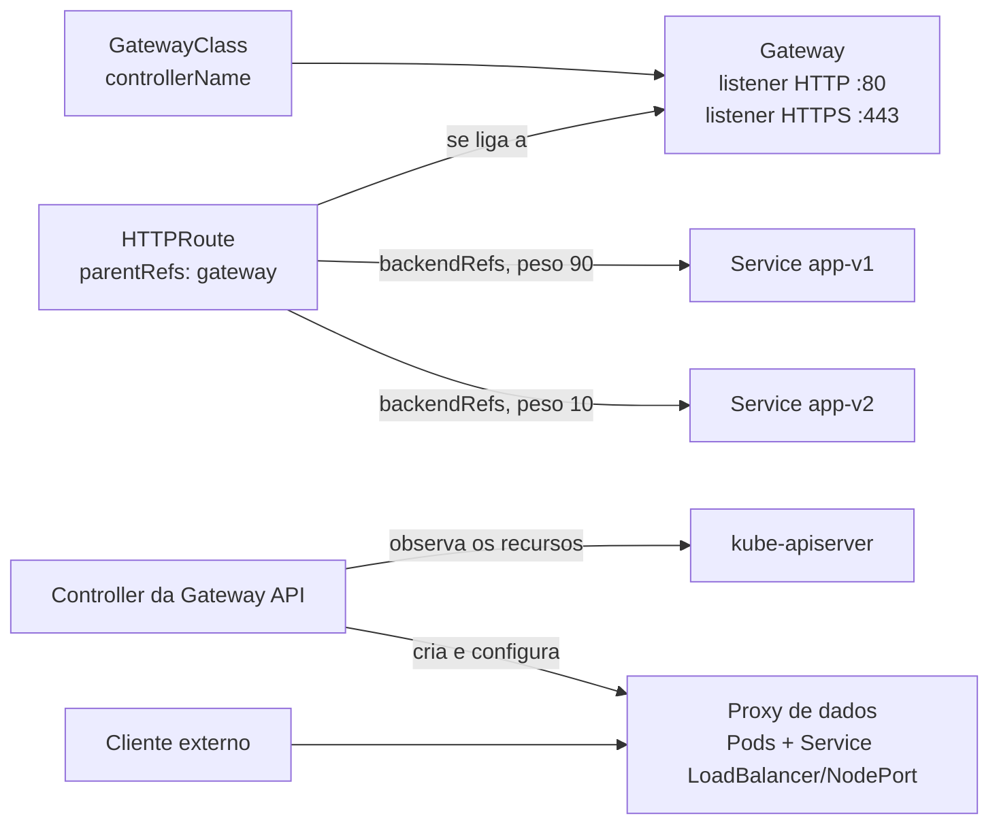

# Gateway API

> **Versão do Kubernetes:** v1.36 · **Versão da Gateway API:** v1.X · **Última revisão:** AAAA-MM-DD · **Domínio:** Services & Networking (20%)

## O que é

A **Gateway API** é a sucessora do Ingress para levar tráfego de fora até os Services. Ela resolve o que o Ingress deixava para anotações específicas de cada controller: divisão de tráfego por peso, roteamento por cabeçalho, redirect, rewrite, protocolos além de HTTP e rotas em outros namespaces.

Em vez de um objeto só, ela separa **papéis** em recursos diferentes:

| Recurso | Quem cuida (na ideia do projeto) | O que define | Escopo |
|---|---|---|---|
| `GatewayClass` | Provedor da infraestrutura | Qual controller implementa (`spec.controllerName`) | Cluster |
| `Gateway` | Operador do cluster | O ponto de entrada: **listeners** (porta, protocolo, hostname, TLS) e quais rotas podem se ligar | Namespace |
| `HTTPRoute` | Time da aplicação | Regras: host, path, cabeçalho → Services, com peso e filtros | Namespace |
| `ReferenceGrant` | Dono do namespace de destino | Autoriza uma rota de **outro namespace** a usar um Service daqui | Namespace |

Também existem `GRPCRoute` (estável) e, no canal experimental, `TLSRoute`, `TCPRoute` e `UDPRoute`. <!-- VERIFICAR: canal (standard/experimental) de TLSRoute na versão atual da Gateway API -->

**Ela não vem com o Kubernetes.** Os recursos são **CRDs** instalados à parte (grupo `gateway.networking.k8s.io`), e também é preciso um **controller** que os implemente: Envoy Gateway, NGINX Gateway Fabric, Istio, Cilium, Traefik, Kong, Contour etc. Na prova, o ambiente já vem com os CRDs e um controller.

## Como funciona por dentro



1. A `GatewayClass` diz qual controller cuida dos Gateways dessa classe. O controller marca a classe como `Accepted`.
2. Você cria um `Gateway`. O controller provisiona o proxy (Pods e um Service), coloca o endereço em `status.addresses` e marca o Gateway como `Programmed`.
3. Uma `HTTPRoute` aponta para o Gateway em `parentRefs`. Ela só **se liga** se o listener permitir (`allowedRoutes`) e se o hostname for compatível.
4. Os backends ficam em `backendRefs` (Services, com `weight` opcional). Se o Service estiver em outro namespace, precisa de `ReferenceGrant` lá.
5. O resultado aparece no **status** de cada objeto. É lá que se depura: `Accepted`, `ResolvedRefs`, `Programmed`.

**Ingress × Gateway API:**

| | Ingress | Gateway API |
|---|---|---|
| Objetos | Ingress (+ IngressClass) | GatewayClass, Gateway, *Route, ReferenceGrant |
| Instalação | Objeto nativo | CRDs + controller |
| Header, peso, redirect, rewrite | Anotações por controller | Campos padrão (`matches`, `filters`, `weight`) |
| Outro namespace | Não | Sim (`allowedRoutes` + `ReferenceGrant`) |
| `kubectl create` | Sim | Não: escrever YAML |
| Protocolos | HTTP/HTTPS | HTTP, HTTPS, gRPC; TLS/TCP/UDP no experimental |

## Comandos essenciais

```bash
# Os CRDs estão instalados? Quais recursos existem?
kubectl get crd | grep gateway.networking.k8s.io
kubectl api-resources --api-group=gateway.networking.k8s.io

# Classe, gateways e rotas
kubectl get gatewayclass                      # CONTROLLER, ACCEPTED
kubectl get gateway -A                        # CLASS, ADDRESS, PROGRAMMED
kubectl get httproute -A                      # HOSTNAMES
kubectl get referencegrant -A

# Depurar: o status diz por que não funciona
kubectl describe gateway web-gw -n infra      # Listeners: Attached Routes, Conditions
kubectl describe httproute app -n shop        # Parents: Accepted / ResolvedRefs (com o motivo)

# Documentação dos campos sem sair do terminal (funciona com CRDs)
kubectl explain httproute.spec.rules.matches
kubectl explain gateway.spec.listeners.allowedRoutes

# Testar
curl -H "Host: app.exemplo.com" http://<endereço-do-gateway>/
curl -H "Host: app.exemplo.com" -H "env: canary" http://<endereço-do-gateway>/

# Instalar os CRDs (fora da prova). Versão em https://gateway-api.sigs.k8s.io/
kubectl apply --server-side -f https://github.com/kubernetes-sigs/gateway-api/releases/download/v1.X.Y/standard-install.yaml
```

Não há `kubectl create gateway` nem `kubectl create httproute`. Copie o YAML da documentação, ou parta de um objeto existente com `kubectl get httproute <nome> -o yaml`.

## YAML de referência

`GatewayClass` (normalmente já existe, criada na instalação do controller):

```yaml
apiVersion: gateway.networking.k8s.io/v1
kind: GatewayClass
metadata:
  name: envoy
spec:
  controllerName: gateway.envoyproxy.io/gatewayclass-controller   # valor definido pelo controller
```

`Gateway` com HTTP e HTTPS:

```yaml
apiVersion: gateway.networking.k8s.io/v1
kind: Gateway
metadata:
  name: web-gw
  namespace: infra
spec:
  gatewayClassName: envoy
  listeners:
    - name: http
      protocol: HTTP
      port: 80
      allowedRoutes:
        namespaces:
          from: All                 # Same (padrão) | All | Selector
    - name: https
      protocol: HTTPS
      port: 443
      hostname: "*.exemplo.com"     # opcional: restringe os hosts aceitos
      tls:
        mode: Terminate             # o Gateway descriptografa
        certificateRefs:
          - kind: Secret
            name: exemplo-tls       # Secret tls no namespace do Gateway
      allowedRoutes:
        namespaces:
          from: Selector
          selector:
            matchLabels:
              gateway-access: "true"
```

`HTTPRoute` com path, cabeçalho e divisão por peso:

```yaml
apiVersion: gateway.networking.k8s.io/v1
kind: HTTPRoute
metadata:
  name: app
  namespace: shop
spec:
  parentRefs:
    - name: web-gw
      namespace: infra              # obrigatório se o Gateway estiver em outro namespace
      sectionName: http             # opcional: liga só a este listener
  hostnames:
    - app.exemplo.com
  rules:
    - matches:                      # regra 1: /api COM cabeçalho env=canary → só v2
        - path:
            type: PathPrefix
            value: /api
          headers:                  # path e headers no mesmo match = E
            - name: env
              value: canary
      backendRefs:
        - name: app-v2
          port: 8080
    - matches:                      # regra 2: /api → 90% v1, 10% v2
        - path:
            type: PathPrefix        # PathPrefix (padrão) | Exact | RegularExpression
            value: /api
      backendRefs:
        - name: app-v1
          port: 8080                # porta do SERVICE
          weight: 90
        - name: app-v2
          port: 8080
          weight: 10
```

Filtros comuns (vão em `rules[].filters`):

```yaml
apiVersion: gateway.networking.k8s.io/v1
kind: HTTPRoute
metadata:
  name: redirect-https
  namespace: infra
spec:
  parentRefs:
    - name: web-gw
      sectionName: http
  hostnames:
    - app.exemplo.com
  rules:
    - filters:
        - type: RequestRedirect     # HTTP → HTTPS
          requestRedirect:
            scheme: https
            statusCode: 301
---
apiVersion: gateway.networking.k8s.io/v1
kind: HTTPRoute
metadata:
  name: rewrite
  namespace: shop
spec:
  parentRefs:
    - name: web-gw
      namespace: infra
  rules:
    - matches:
        - path:
            type: PathPrefix
            value: /loja
      filters:
        - type: URLRewrite          # /loja/x chega ao Pod como /x
          urlRewrite:
            path:
              type: ReplacePrefixMatch
              replacePrefixMatch: /
        - type: RequestHeaderModifier
          requestHeaderModifier:
            add:
              - name: x-origem
                value: gateway
      backendRefs:
        - name: web-svc
          port: 80
```

`ReferenceGrant`: rota em `shop` usando um Service em `backend`. Fica no namespace **do Service**:

```yaml
apiVersion: gateway.networking.k8s.io/v1beta1
kind: ReferenceGrant
metadata:
  name: shop-pode-usar-backend
  namespace: backend                # namespace do alvo
spec:
  from:
    - group: gateway.networking.k8s.io
      kind: HTTPRoute
      namespace: shop               # quem pode referenciar
  to:
    - group: ""                     # "" = grupo core (Service)
      kind: Service
```

Confira a versão servida no cluster com `kubectl api-resources | grep referencegrant`. <!-- VERIFICAR: se ReferenceGrant já tem v1 na versão atual da Gateway API -->

## Na documentação oficial

- **Página principal (kubernetes.io):** *Gateway API*. Link: <https://kubernetes.io/docs/concepts/services-networking/gateway/>
- **Site do projeto** (referência de campos e guias): <https://gateway-api.sigs.k8s.io/>
    - *HTTP routing*, *HTTP traffic splitting*, *HTTP redirects and rewrites*, *HTTP header modifiers*, *Cross-Namespace routing*: seção *Guides*.
- **Busca rápida:** `gateway api`
- **Ctrl+F dentro da página principal:**
    - `kind: GatewayClass`, `kind: Gateway`, `kind: HTTPRoute`: YAML mínimo de cada um.
    - `Request flow`: o caminho de uma requisição.
- **Alternativa no terminal:** `kubectl explain httproute.spec --recursive` mostra a árvore de campos sem abrir o navegador.

## Pegadinhas da prova

- **`gatewayClassName` certo:** confira com `kubectl get gatewayclass`. Não existe classe padrão automática como no Ingress.
- **`parentRefs` com namespace:** se o Gateway está em outro namespace, sem `namespace:` a rota procura o Gateway no **próprio** namespace e não se liga.
- **`allowedRoutes` padrão é `Same`:** uma rota de outro namespace é recusada (`NotAllowedByListeners`) até o listener permitir com `All` ou `Selector`.
- **Service em outro namespace** exige `ReferenceGrant` **no namespace do Service**. Sem ele: `ResolvedRefs=False`, motivo `RefNotPermitted`.
- **Hostname incompatível:** se o listener tem `hostname: "*.exemplo.com"` e a rota usa `app.outro.com`, a rota não se liga (`NoMatchingListenerHostname`).
- **`port` em `backendRefs` é obrigatório** para Service e é a porta **do Service**.
- **`weight`** é proporcional, não porcentagem: 1 e 3 dão 25%/75%. Peso `0` = não recebe tráfego.
- **Precedência:** vence o match mais específico, nesta ordem: path `Exact`, depois o prefixo mais longo, depois método, depois mais cabeçalhos, depois mais query params. Só em empate total contam a rota mais antiga e a ordem das regras. Consequência: uma regra `/api` (sem cabeçalho) ganha de uma regra `/` com cabeçalho, para uma requisição em `/api`.
- **Sempre olhe o status** (`kubectl describe`). Rota criada sem erro não significa rota funcionando.
- **Migrar Ingress → HTTPRoute:** `pathType: Prefix` vira `type: PathPrefix`; `ingressClassName` vira `parentRefs` para um Gateway; anotações de rewrite e redirect viram `filters`. A ferramenta `ingress2gateway` faz a conversão, mas na prova é à mão.

## Pratique

**Enunciado (como na prova):**

> A Gateway named `web-gw` exists in namespace `infra` with an HTTP listener on port `80` that allows routes from all namespaces. In namespace `shop`, create an HTTPRoute named `shop-route` for hostname `shop.example.com` that sends 80% of the traffic to Service `shop-v1` and 20% to Service `shop-v2`, both on port `8080`. Additionally, requests with header `x-version: v2` must always go to `shop-v2`.

**Tradução:** existe um Gateway `web-gw` no namespace `infra`, com listener HTTP na porta `80` aceitando rotas de todos os namespaces. No namespace `shop`, crie uma HTTPRoute `shop-route` para o host `shop.example.com` que mande 80% do tráfego para `shop-v1` e 20% para `shop-v2`, ambos na porta `8080`. Requisições com o cabeçalho `x-version: v2` devem ir sempre para `shop-v2`.

??? success "Solução"
    ```yaml
    apiVersion: gateway.networking.k8s.io/v1
    kind: HTTPRoute
    metadata:
      name: shop-route
      namespace: shop
    spec:
      parentRefs:
        - name: web-gw
          namespace: infra
      hostnames:
        - shop.example.com
      rules:
        - matches:
            - headers:
                - name: x-version
                  value: v2
          backendRefs:
            - name: shop-v2
              port: 8080
        - backendRefs:
            - name: shop-v1
              port: 8080
              weight: 80
            - name: shop-v2
              port: 8080
              weight: 20
    ```
    A regra com cabeçalho é mais específica, por isso tem prioridade sobre a regra sem `matches` (que equivale a `PathPrefix /`).

**Como verificar:**

```bash
kubectl get httproute shop-route -n shop
kubectl describe httproute shop-route -n shop          # Parents: Accepted=True, ResolvedRefs=True
kubectl get gateway web-gw -n infra                    # ADDRESS e PROGRAMMED=True
kubectl describe gateway web-gw -n infra | grep -i "attached routes"

GW=$(kubectl get gateway web-gw -n infra -o jsonpath='{.status.addresses[0].value}')
for i in $(seq 1 20); do curl -s -H "Host: shop.example.com" http://$GW/; done | sort | uniq -c   # ~16 x ~4
curl -s -H "Host: shop.example.com" -H "x-version: v2" http://$GW/                               # sempre v2
```

**No lab / Killercoda:**

- No lab kubeadm, instale os CRDs (`standard-install.yaml`) e um controller (ex.: Envoy Gateway ou NGINX Gateway Fabric) seguindo o quickstart dele. Sem cloud controller, o Service do proxy fica `<pending>`: use o NodePort dele.
- Mude o `allowedRoutes` do listener para `Same` e veja o status da rota passar a `Accepted=False`.
- Aponte um `backendRef` para um Service em outro namespace, veja `RefNotPermitted` e corrija com `ReferenceGrant`.
- Pegue um Ingress da [página de Ingress](ingress.md) e reescreva como Gateway + HTTPRoute.
- Monte o redirect HTTP → HTTPS com dois listeners e um filtro `RequestRedirect`.
