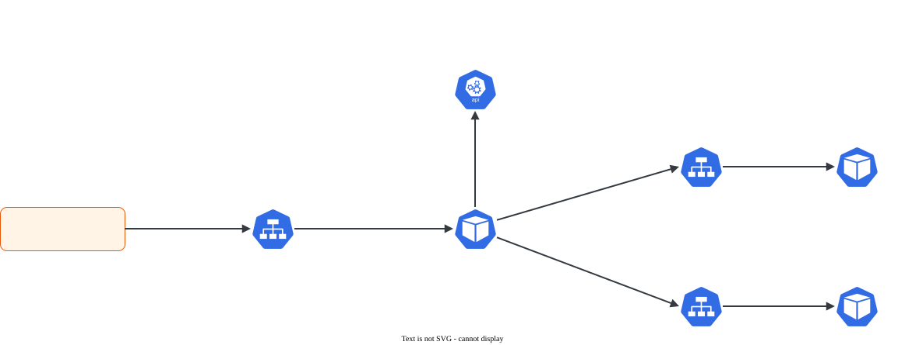

# Ingress

> **Versão do Kubernetes:** v1.36 · **Última revisão:** 2026-10-23 · **Domínio:** Services & Networking (20%)

## O que é

Um **Ingress** é um conjunto de **regras HTTP/HTTPS** que leva tráfego de fora do cluster até Services, decidindo pelo **host** (`loja.exemplo.com`) e pelo **caminho** (`/api`, `/carrinho`). Com ele, um único ponto de entrada atende várias aplicações, em vez de um NodePort ou LoadBalancer por Service.

O Ingress sozinho não faz nada: é só um objeto guardado na API. Quem lê as regras e de fato recebe o tráfego é o **Ingress controller** (ingress-nginx, Traefik, HAProxy, Contour, o controller da nuvem etc.), que **não vem instalado** com o cluster.

| Peça | O que é | Escopo |
|---|---|---|
| Ingress controller | Pods (geralmente um proxy reverso) que observam Ingresses e configuram o roteamento | Instalado à parte |
| `IngressClass` | Diz qual controller cuida de quais Ingresses (`spec.controller`) | Cluster |
| `Ingress` | As regras: host + path → Service:porta, e TLS | Namespace |

A API `networking.k8s.io/v1` do Ingress é **estável e congelada**: não recebe recursos novos. A evolução acontece na [Gateway API](gateway-api.md). O currículo cobra as duas.

!!! warning "ingress-nginx aposentado"
    O projeto comunitário **ingress-nginx** (`kubernetes/ingress-nginx`) foi aposentado pelo SIG Network: a manutenção terminou em março de 2026 e não há mais releases nem correções de segurança. O **objeto Ingress continua** no Kubernetes e na prova. Ambientes de prova e labs ainda podem usar o ingress-nginx; em produção, prefira outro controller ou a Gateway API. <!-- VERIFICAR: controller usado nos ambientes de prova atuais -->

## Como funciona por dentro

[](../assets/diagramas/03-ingress.svg "Abrir o diagrama em tamanho real")

1. O controller roda como Pods, normalmente expostos por um Service `LoadBalancer` (nuvem) ou `NodePort` (kubeadm/bare metal).
2. Ele observa os Ingresses **da sua IngressClass** e monta a configuração do proxy.
3. Chega uma requisição: o controller compara o cabeçalho `Host` e o caminho com as regras e escolhe o backend.
4. Na maioria dos controllers, o proxy manda direto para os **IPs dos Pods** (lidos nas EndpointSlices do Service). O Service serve para achar os Pods, não necessariamente como salto de rede.

**Como o Ingress escolhe o controller:**

- `spec.ingressClassName: nginx` aponta para a `IngressClass` chamada `nginx`.
- Sem `ingressClassName`, vale a IngressClass marcada com a anotação `ingressclass.kubernetes.io/is-default-class: "true"`.
- Sem campo e sem classe padrão, **nenhum controller assume** o Ingress: ele fica criado, mas não funciona (a coluna `ADDRESS` fica vazia).
- A anotação antiga `kubernetes.io/ingress.class` está depreciada. Use o campo.

**pathType** (obrigatório em cada path):

| Valor | Casa com |
|---|---|
| `Prefix` | O caminho e tudo abaixo dele, **por segmento**: `/api` casa com `/api` e `/api/v1`, mas **não** com `/apiv1` |
| `Exact` | Só o caminho exato (`/api` não casa com `/api/`) |
| `ImplementationSpecific` | Fica a critério do controller |

Quando mais de uma regra casa, vence o caminho **mais longo**. Em empate de tamanho, `Exact` vence `Prefix`.

## Comandos essenciais

```bash
# Ver controllers e classes disponíveis (sempre o primeiro passo)
kubectl get ingressclass
kubectl get pods -A | grep -i ingress
kubectl get svc -A | grep -i ingress          # porta NodePort/IP do controller

# Criar Ingress pela linha de comando
#   path terminado em *  → pathType Prefix
#   path sem *           → pathType Exact
kubectl create ingress web --class=nginx \
  --rule="loja.exemplo.com/=web-svc:80" \
  --rule="loja.exemplo.com/api*=api-svc:8080"

# Sem host (qualquer host), só por caminho
kubectl create ingress web --class=nginx --rule="/*=web-svc:80"

# Com TLS (o Secret precisa existir no mesmo namespace)
kubectl create secret tls loja-tls --cert=loja.crt --key=loja.key
kubectl create ingress web-tls --class=nginx --rule="loja.exemplo.com/*=web-svc:80,tls=loja-tls"

# Backend padrão (quando nenhuma regra casa)
kubectl create ingress web --class=nginx --default-backend=web-svc:80

# Com anotação
kubectl create ingress web --class=nginx --rule="/app*=web-svc:80" \
  --annotation nginx.ingress.kubernetes.io/rewrite-target=/

# Gerar o YAML para editar
kubectl create ingress web --class=nginx --rule="/*=web-svc:80" --dry-run=client -o yaml > ing.yaml

# Conferir
kubectl get ingress                           # CLASS, HOSTS, ADDRESS, PORTS
kubectl describe ingress web                  # regras e backends (procure "error: endpoints not found")

# Testar sem DNS: forçar o cabeçalho Host
curl -H "Host: loja.exemplo.com" http://<IP-do-nó>:<nodePort-do-controller>/api
curl --resolve loja.exemplo.com:443:<IP> https://loja.exemplo.com/ -k
```

## YAML de referência

```yaml
apiVersion: networking.k8s.io/v1
kind: Ingress
metadata:
  name: loja
  namespace: shop                   # mesmo namespace dos Services de backend
  annotations:
    nginx.ingress.kubernetes.io/rewrite-target: /   # específico do ingress-nginx
spec:
  ingressClassName: nginx           # qual controller cuida deste Ingress
  tls:
    - hosts:
        - loja.exemplo.com
      secretName: loja-tls          # Secret tipo kubernetes.io/tls, no mesmo namespace
  defaultBackend:                   # opcional: quando nenhuma regra casa
    service:
      name: web-svc
      port:
        number: 80
  rules:
    - host: loja.exemplo.com        # omitir = qualquer host
      http:
        paths:
          - path: /api
            pathType: Prefix        # obrigatório: Prefix | Exact | ImplementationSpecific
            backend:
              service:
                name: api-svc
                port:
                  number: 8080      # porta do SERVICE (ou port.name)
          - path: /
            pathType: Prefix
            backend:
              service:
                name: web-svc
                port:
                  number: 80
```

`IngressClass` (normalmente criada pela instalação do controller):

```yaml
apiVersion: networking.k8s.io/v1
kind: IngressClass
metadata:
  name: nginx
  annotations:
    ingressclass.kubernetes.io/is-default-class: "true"   # vira a classe padrão
spec:
  controller: k8s.io/ingress-nginx
```

## Na documentação oficial

- **Página principal:** *Ingress*. Link: <https://kubernetes.io/docs/concepts/services-networking/ingress/>
- **Complementares:**
    - *Ingress Controllers*: <https://kubernetes.io/docs/concepts/services-networking/ingress-controllers/>
    - *Set up Ingress on Minikube with the NGINX Ingress Controller* (tutorial com YAML completo): <https://kubernetes.io/docs/tasks/access-application-cluster/ingress-minikube/>
- **Busca rápida:** `ingress`
- **Ctrl+F dentro da página principal:**
    - `minimal-ingress`: o primeiro YAML completo, bom para copiar.
    - `pathType`: tabela de exemplos de casamento de caminho.
    - `Default IngressClass`: anotação de classe padrão.
    - `TLS`: Secret e bloco `tls`.
    - `Name based virtual hosting`: vários hosts no mesmo IP.

## Pegadinhas da prova

- **Ingress sem controller não faz nada.** Antes de tudo, `kubectl get ingressclass`. Use o nome que aparecer ali no `ingressClassName`, e não um nome de cabeça.
- **`ingressClassName` ausente** e nenhuma classe padrão: o Ingress é criado sem erro, mas ninguém o atende.
- **`pathType` é obrigatório** no YAML. O `kubectl create ingress` preenche sozinho: `*` no fim vira `Prefix`; sem `*` vira `Exact`. Um `--rule="/api=svc:80"` **não** atende `/api/users`.
- **A porta do backend é a do Service**, não a do container.
- **Namespace:** o Ingress só aponta para Services do **próprio namespace**. Para outro namespace, crie outro Ingress lá (ou use Gateway API com ReferenceGrant).
- **Secret TLS no namespace errado** é ignorado: o controller passa a usar um certificado padrão (autoassinado).
- **`rewrite-target`** é anotação do ingress-nginx. Sem ela, o Pod recebe o caminho original (`/app/...`). Se a aplicação só responde em `/`, dá 404.
- **`ADDRESS` vazio** em cluster kubeadm é comum mesmo funcionando, porque o controller costuma ficar em NodePort. Teste com `curl` na porta NodePort do controller.
- **404 do controller** (resposta do nginx, não da aplicação) = nenhuma regra casou: host ou path errados. **503** = a regra casou, mas o Service não tem endpoints.

## Pratique

**Enunciado (como na prova):**

> In the namespace `shop`, there are two Services: `web-svc` (port `80`) and `api-svc` (port `8080`). Create an Ingress named `shop-ingress` using the existing IngressClass `nginx` so that requests to host `shop.example.com` with path `/` go to `web-svc` and requests with path `/api` (and everything below it) go to `api-svc`.

**Tradução:** no namespace `shop` existem dois Services, `web-svc` (porta `80`) e `api-svc` (porta `8080`). Crie um Ingress `shop-ingress` usando a IngressClass `nginx`, de forma que o host `shop.example.com` com caminho `/` vá para `web-svc`, e o caminho `/api` (e tudo abaixo dele) vá para `api-svc`.

??? success "Solução"
    ```bash
    kubectl get ingressclass                       # confirmar que "nginx" existe
    kubectl create ingress shop-ingress -n shop --class=nginx \
      --rule="shop.example.com/*=web-svc:80" \
      --rule="shop.example.com/api*=api-svc:8080"
    ```
    O `*` no fim de cada caminho gera `pathType: Prefix`. Sem ele, `/api/users` não casaria com a regra.

**Como verificar:**

```bash
kubectl get ingress shop-ingress -n shop
kubectl describe ingress shop-ingress -n shop      # dois paths, backends com IPs de Pods
kubectl get ingress shop-ingress -n shop -o jsonpath='{.spec.rules[0].http.paths[*].pathType}'   # Prefix Prefix
kubectl get svc -A | grep -i ingress               # descobrir o NodePort do controller
curl -H "Host: shop.example.com" http://<IP-do-nó>:<nodePort>/api
curl -H "Host: shop.example.com" http://<IP-do-nó>:<nodePort>/
```

Saída esperada (ilustrativa: nomes, IPs e idades mudam no seu cluster):

```console
$ kubectl get ingress shop-ingress -n shop
NAME           CLASS   HOSTS              ADDRESS    PORTS   AGE
shop-ingress   nginx   shop.example.com   10.0.0.4   80      30s
$ kubectl get ingress shop-ingress -n shop -o jsonpath='{.spec.rules[0].http.paths[*].pathType}'
Prefix Prefix
```

**No lab / Killercoda:**

- No lab kubeadm, instale um controller em modo NodePort e repita o exercício. Libere o NodePort no NSG para testar de fora.
- Troque `/api*` por `/api` (pathType `Exact`) e compare `curl .../api` com `curl .../api/users`.
- Apague o `ingressClassName` e veja o Ingress parar de funcionar. Depois marque a IngressClass como padrão e veja voltar.
- Escale `api-svc` para 0 réplicas e observe o 503 do controller. Compare com o 404 de um host que não existe.
- Crie um certificado autoassinado (`openssl req -x509 -nodes -newkey rsa:2048 -subj "/CN=shop.example.com" -keyout tls.key -out tls.crt`), monte o Secret e ative o TLS.
