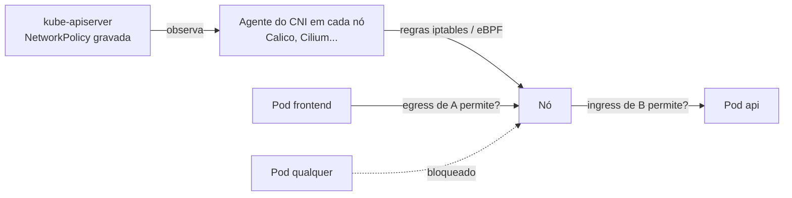

# NetworkPolicy

> **Versão do Kubernetes:** v1.XX · **Última revisão:** AAAA-MM-DD · **Domínio:** Services & Networking (20%)

## O que é

Por padrão, **todo Pod fala com todo Pod**, em qualquer namespace. Uma **NetworkPolicy** restringe isso: diz quais Pods podem **receber** tráfego (`ingress`) e para onde podem **enviar** (`egress`), na camada de IP e porta (L3/L4).

Três regras definem o comportamento:

1. **Pod não selecionado por nenhuma política = tudo liberado** naquela direção.
2. **Pod selecionado por uma política com `Ingress` (ou `Egress`)** = naquela direção, só passa o que alguma política permitir explicitamente. Vira "nega por padrão".
3. **Políticas somam** (união). Não existe regra de "negar": uma política só acrescenta permissões. Não há ordem nem prioridade.

Para uma conexão de A para B passar, é preciso que **o egress de A permita** e que **o ingress de B permita**. A resposta da conexão é liberada automaticamente: o controle é por conexão, não por pacote.

**Quem aplica é o plugin de rede (CNI)**, não o Kubernetes. Calico e Cilium aplicam. O Flannel sozinho **não** aplica: a política é aceita pela API e simplesmente ignorada.

## Como funciona por dentro



Os campos de uma política:

| Campo | Significado |
|---|---|
| `spec.podSelector` | **A quem** a política se aplica (Pods do namespace da política). `{}` = todos os Pods do namespace |
| `spec.policyTypes` | `Ingress`, `Egress` ou os dois. Define em qual direção os Pods selecionados viram "nega por padrão" |
| `ingress[].from` | Origens permitidas |
| `egress[].to` | Destinos permitidos |
| `ports` | Porta (número ou nome), `protocol` (TCP padrão, UDP, SCTP), `endPort` para faixa |

Seletores dentro de `from`/`to`:

| Seletor | Seleciona |
|---|---|
| `podSelector` | Pods com esses labels **no namespace da política** |
| `namespaceSelector` | **Todos** os Pods dos namespaces com esses labels |
| `namespaceSelector` + `podSelector` **no mesmo item** | Pods com esses labels **naqueles** namespaces (E) |
| `ipBlock` (`cidr`, `except`) | Faixa de IPs, normalmente para fora do cluster |

Todo namespace tem o label automático **`kubernetes.io/metadata.name: <nome>`**, o jeito mais seguro de selecionar um namespace pelo nome.

## Comandos essenciais

```bash
# Não existe kubectl create networkpolicy: escreva o YAML (copie da documentação)
kubectl get networkpolicy -A                  # atalho: netpol
kubectl describe netpol api-allow -n shop     # mostra em texto o que é permitido

# Labels que a política vai usar
kubectl get pods -n shop --show-labels
kubectl get ns --show-labels                  # inclui kubernetes.io/metadata.name
kubectl label ns monitoring team=ops

# O CNI aplica política? (Calico, Cilium sim; Flannel puro não)
kubectl get pods -n kube-system -o wide | grep -Ei 'calico|cilium|flannel|weave'

# Testar a partir de um Pod com os labels certos (a política olha os labels da ORIGEM)
kubectl run tst -n shop --image=busybox:1.36 --labels=app=frontend --rm -it --restart=Never \
  -- wget -qO- -T 2 http://api-svc:8080
# Mesmo teste sem o label: deve falhar com timeout
kubectl run tst -n shop --image=busybox:1.36 --rm -it --restart=Never -- wget -qO- -T 2 http://api-svc:8080

# Testar porta TCP sem HTTP
kubectl run tst --image=busybox:1.36 --rm -it --restart=Never -- nc -zv -w 2 <IP-ou-svc> 5432

# Ver a documentação dos campos
kubectl explain networkpolicy.spec.ingress.from
```

## YAML de referência

Política completa (exemplo da documentação, comentado):

```yaml
apiVersion: networking.k8s.io/v1
kind: NetworkPolicy
metadata:
  name: api-allow
  namespace: shop
spec:
  podSelector:
    matchLabels:
      app: api                      # a política vale para os Pods app=api deste namespace
  policyTypes:
    - Ingress
    - Egress
  ingress:
    - from:
        - podSelector:              # item 1: Pods frontend DESTE namespace
            matchLabels:
              app: frontend
        - namespaceSelector:        # item 2 (OU): qualquer Pod do namespace monitoring
            matchLabels:
              kubernetes.io/metadata.name: monitoring
      ports:
        - protocol: TCP
          port: 8080                # porta do CONTAINER (não a do Service)
  egress:
    - to:
        - ipBlock:
            cidr: 10.0.0.0/24       # banco fora do cluster
            except:
              - 10.0.0.99/32
      ports:
        - protocol: TCP
          port: 5432
    - to:                           # liberar DNS, senão nenhum nome resolve
        - namespaceSelector:
            matchLabels:
              kubernetes.io/metadata.name: kube-system
          podSelector:
            matchLabels:
              k8s-app: kube-dns
      ports:
        - protocol: UDP
          port: 53
        - protocol: TCP
          port: 53
```

**E × OU**: o detalhe que mais derruba na prova. Muda tudo com um `-`:

```yaml
# E: Pods app=frontend QUE ESTÃO em namespaces team=web (um item, dois seletores)
ingress:
  - from:
      - namespaceSelector:
          matchLabels:
            team: web
        podSelector:
          matchLabels:
            app: frontend
---
# OU: qualquer Pod de namespaces team=web, OU Pods app=frontend do namespace da política
ingress:
  - from:
      - namespaceSelector:
          matchLabels:
            team: web
      - podSelector:
          matchLabels:
            app: frontend
```

Políticas padrão (o ponto de partida de "nega tudo e libera o necessário"):

```yaml
# Nega todo ingress para todos os Pods do namespace
apiVersion: networking.k8s.io/v1
kind: NetworkPolicy
metadata:
  name: default-deny-ingress
  namespace: shop
spec:
  podSelector: {}
  policyTypes:
    - Ingress                       # sem bloco ingress = nada permitido
---
# Nega todo egress (lembre de liberar DNS depois)
apiVersion: networking.k8s.io/v1
kind: NetworkPolicy
metadata:
  name: default-deny-egress
  namespace: shop
spec:
  podSelector: {}
  policyTypes:
    - Egress
---
# Libera todo ingress (anula o deny para esses Pods, porque políticas somam)
apiVersion: networking.k8s.io/v1
kind: NetworkPolicy
metadata:
  name: allow-all-ingress
  namespace: shop
spec:
  podSelector: {}
  ingress:
    - {}                            # uma regra vazia = qualquer origem, qualquer porta
  policyTypes:
    - Ingress
```

## Na documentação oficial

- **Página principal:** *Network Policies*. Link: <https://kubernetes.io/docs/concepts/services-networking/network-policies/>
- **Complementar:** *Declare Network Policy* (tarefa passo a passo): <https://kubernetes.io/docs/tasks/administer-cluster/declare-network-policy/>
- **Busca rápida:** `network policy`
- **Ctrl+F dentro da página principal:**
    - `test-network-policy`: o YAML completo comentado acima (bom para copiar e adaptar).
    - `Behavior of to and from selectors`: a diferença E × OU.
    - `Default policies`: deny/allow de ingress e egress prontos.
    - `endPort`: faixa de portas.
    - `kubernetes.io/metadata.name`: selecionar namespace pelo nome.

## Pegadinhas da prova

- **E × OU:** `- namespaceSelector` e `podSelector` no **mesmo item** (sem `-` no segundo) é E. Com `-` nos dois, é OU e libera muito mais do que o pedido.
- **`podSelector: {}` no `spec`** = todos os Pods do namespace. **`podSelector` vazio dentro de `from`** = todos os Pods **do namespace da política**, não do cluster. Para "qualquer Pod do cluster", use `namespaceSelector: {}`.
- **A porta é a do container (targetPort)**, porque a política vê o tráfego depois que o Service já traduziu o IP. Liberar a porta `80` do Service quando o container escuta em `8080` não funciona.
- **Egress negado quebra o DNS.** Ao restringir egress, libere UDP **e** TCP 53 para o CoreDNS (`k8s-app: kube-dns` em `kube-system`), senão o teste falha por "bad address" e parece problema da política de destino.
- **Os dois lados contam:** se o namespace de origem tem default-deny de egress, liberar só o ingress no destino não basta.
- **Namespace da política:** a política só seleciona Pods do próprio namespace (`metadata.namespace`). Criar no namespace errado não dá erro, só não faz efeito.
- **`namespaceSelector` usa labels do namespace**, não o nome. Se a questão disser "namespace `monitoring`", use `kubernetes.io/metadata.name: monitoring` ou confira os labels com `kubectl get ns --show-labels`.
- **Não existe "deny" explícito.** Para bloquear um Pod específico, não crie uma regra que o nega: crie as regras que permitem só os outros.
- **Política sem efeito nenhum?** Confira se o CNI aplica NetworkPolicy antes de suspeitar do YAML.
- **Não apague políticas que já existem** na questão, a menos que o enunciado peça. Muitas vezes a tarefa é *acrescentar* uma política que convive com um default-deny já aplicado.

## Pratique

**Enunciado (como na prova):**

> In namespace `shop`, a default-deny ingress policy is already in place. Create a NetworkPolicy named `allow-frontend-to-api` that allows Pods with label `app=frontend` in namespace `shop`, and any Pod in namespace `monitoring`, to connect to Pods with label `app=api` on TCP port `8080`. No other ingress traffic to the `api` Pods may be allowed.

**Tradução:** no namespace `shop` já existe uma política default-deny de ingress. Crie a NetworkPolicy `allow-frontend-to-api`, permitindo que Pods `app=frontend` do namespace `shop` e qualquer Pod do namespace `monitoring` se conectem aos Pods `app=api` na porta TCP `8080`. Nenhum outro tráfego de entrada para os Pods `api` pode ser permitido.

??? success "Solução"
    ```yaml
    apiVersion: networking.k8s.io/v1
    kind: NetworkPolicy
    metadata:
      name: allow-frontend-to-api
      namespace: shop
    spec:
      podSelector:
        matchLabels:
          app: api
      policyTypes:
        - Ingress
      ingress:
        - from:
            - podSelector:
                matchLabels:
                  app: frontend
            - namespaceSelector:
                matchLabels:
                  kubernetes.io/metadata.name: monitoring
          ports:
            - protocol: TCP
              port: 8080
    ```
    Aqui é OU de propósito (dois itens com `-`): o frontend de `shop` **ou** qualquer Pod de `monitoring`. O `podSelector` sem `namespaceSelector` só vale para o namespace da política (`shop`), que é exatamente o pedido.

**Como verificar:**

```bash
kubectl describe netpol allow-frontend-to-api -n shop
API=$(kubectl get pod -n shop -l app=api -o jsonpath='{.items[0].status.podIP}')

# Deve funcionar: frontend em shop
kubectl run t1 -n shop --image=busybox:1.36 --labels=app=frontend --rm -it --restart=Never -- wget -qO- -T 2 http://$API:8080
# Deve funcionar: qualquer Pod em monitoring
kubectl run t2 -n monitoring --image=busybox:1.36 --rm -it --restart=Never -- wget -qO- -T 2 http://$API:8080
# Deve FALHAR (timeout): Pod sem label em shop
kubectl run t3 -n shop --image=busybox:1.36 --rm -it --restart=Never -- wget -qO- -T 2 http://$API:8080
# Deve FALHAR: Pod app=frontend em outro namespace
kubectl run t4 -n default --image=busybox:1.36 --labels=app=frontend --rm -it --restart=Never -- wget -qO- -T 2 http://$API:8080
```

**No lab / Killercoda:**

- Confira o CNI do lab kubeadm. Se for Flannel, aplique uma default-deny e veja que nada muda; com Calico ou Cilium, o tráfego para.
- Troque a solução para a forma E (um item só) e repita os quatro testes: veja quais mudam de resultado.
- Aplique uma default-deny de **egress** no namespace `shop` e veja o `wget http://api-svc` falhar por DNS. Depois libere a porta 53 e veja voltar.
- Libere a porta do Service (ex.: `80`) em vez da do container (`8080`) e confirme que o tráfego continua bloqueado.
- Use `ipBlock` para liberar egress só para um IP fora do cluster (ex.: o IP privado de outra VM do lab) e teste com `nc -zv`.
