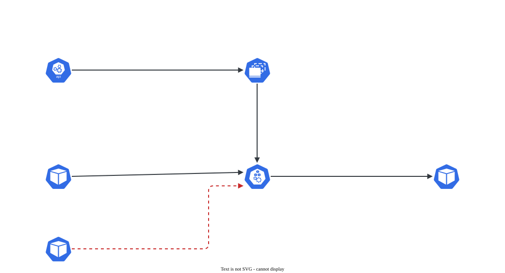

# NetworkPolicy

> **Versão do Kubernetes:** v1.37 (CNI: Calico v3.33.0) · **Última revisão:** 2026-10-25 · **Domínio:** Services & Networking (20%)

## O que é

Por padrão, **todo Pod fala com todo Pod**, em qualquer namespace. Uma **NetworkPolicy** restringe isso: diz quais Pods podem **receber** tráfego (`ingress`) e para onde podem **enviar** (`egress`), na camada de IP e porta (L3/L4).

Três regras definem o comportamento:

1. **Pod não selecionado por nenhuma política = tudo liberado** naquela direção.
2. **Pod selecionado por uma política com `Ingress` (ou `Egress`)** = naquela direção, só passa o que alguma política permitir explicitamente. Vira "nega por padrão".
3. **Políticas somam** (união). Não existe regra de "negar": uma política só acrescenta permissões. Não há ordem nem prioridade.

Para uma conexão de A para B passar, é preciso que **o egress de A permita** e que **o ingress de B permita**. A resposta da conexão é liberada automaticamente: o controle é por conexão, não por pacote.

**Quem aplica é o plugin de rede (CNI)**, não o Kubernetes. Calico e Cilium aplicam. O Flannel sozinho **não** aplica: a política é aceita pela API e simplesmente ignorada.

**A política olha o IP de origem.** Se algo no caminho fizer NAT entre Pods, o destino passa a ver o IP do **nó**, nenhum `podSelector` casa, e tudo é bloqueado, inclusive o que a política libera. Isso aconteceu no lab: depois de trocar o Flannel pelo Calico, sobraram nos nós as regras de NAT do Flannel (cadeia `FLANNEL-POSTRTG`). A API via todo cliente como `10.0.1.5`, o IP do nó. Removidas as regras, a API passou a ver o IP real do Pod e a política funcionou. Para conferir o IP que chega, a imagem de teste `agnhost` (`/agnhost netexec`) responde o IP do cliente em `/clientip`.

## Como funciona por dentro

[](../assets/diagramas/03-network-policy.svg "Abrir o diagrama em tamanho real")

Os campos de uma política:

| Campo | Significado |
|---|---|
| `spec.podSelector` | **A quem** a política se aplica (Pods do namespace da política). `{}` = todos os Pods do namespace |
| `spec.policyTypes` | `Ingress`, `Egress` ou os dois. Define em qual direção os Pods selecionados viram "nega por padrão" |
| `spec.policyTypes` (omitido) | `Ingress` sempre; `Egress` só se houver bloco `egress` |
| `ingress[].from` | Origens permitidas |
| `egress[].to` | Destinos permitidos |
| `ports` | Porta (número ou nome), `protocol` (TCP padrão, UDP, SCTP), `endPort` para faixa |

Seletores dentro de `from`/`to`:

| Seletor | Seleciona |
|---|---|
| `podSelector` | Pods com esses labels **no namespace da política** |
| `namespaceSelector` | **Todos** os Pods dos namespaces com esses labels |
| `namespaceSelector` + `podSelector` **no mesmo item** | Pods com esses labels **naqueles** namespaces (E) |
| `ipBlock` (`cidr`, `except`) | Faixa de IPs, normalmente para fora do cluster |

Todo namespace tem o label automático **`kubernetes.io/metadata.name: <nome>`**, o jeito mais seguro de selecionar um namespace pelo nome.

## Comandos essenciais

```bash
# Não existe kubectl create networkpolicy: escreva o YAML (copie da documentação)
kubectl get networkpolicy -A                  # atalho: netpol
kubectl describe netpol api-allow -n shop     # mostra em texto o que é permitido

# Labels que a política vai usar
kubectl get pods -n shop --show-labels
kubectl get ns --show-labels                  # inclui kubernetes.io/metadata.name
kubectl label ns monitoring team=ops

# O CNI aplica política? (Calico, Cilium sim; Flannel puro não)
kubectl get pods -n kube-system -o wide | grep -Ei 'calico|cilium|flannel|weave'

# Testar a partir de um Pod com os labels certos (a política olha os labels da ORIGEM)
kubectl run tst -n shop --image=busybox:1.36 --labels=app=frontend --rm -it --restart=Never \
  -- wget -qO- -T 2 http://api-svc:8080
# Mesmo teste sem o label: deve falhar com timeout
kubectl run tst -n shop --image=busybox:1.36 --rm -it --restart=Never -- wget -qO- -T 2 http://api-svc:8080

# Testar porta TCP sem HTTP
kubectl run tst --image=busybox:1.36 --rm -it --restart=Never -- nc -zv -w 2 <IP-ou-svc> 5432

# Ver a documentação dos campos
kubectl explain networkpolicy.spec.ingress.from
```

## YAML de referência

Política completa (exemplo da documentação, comentado):

??? example "YAML completo: NetworkPolicy"

    ```yaml
    apiVersion: networking.k8s.io/v1
    kind: NetworkPolicy
    metadata:
      name: api-allow
      namespace: shop
    spec:
      podSelector:
        matchLabels:
          app: api                      # a política vale para os Pods app=api deste namespace
      policyTypes:
        - Ingress
        - Egress
      ingress:
        - from:
            - podSelector:              # item 1: Pods frontend DESTE namespace
                matchLabels:
                  app: frontend
            - namespaceSelector:        # item 2 (OU): qualquer Pod do namespace monitoring
                matchLabels:
                  kubernetes.io/metadata.name: monitoring
          ports:
            - protocol: TCP
              port: 8080                # porta do CONTAINER (não a do Service)
      egress:
        - to:
            - ipBlock:
                cidr: 10.0.0.0/24       # banco fora do cluster
                except:
                  - 10.0.0.99/32
          ports:
            - protocol: TCP
              port: 5432
        - to:                           # liberar DNS, senão nenhum nome resolve
            - namespaceSelector:
                matchLabels:
                  kubernetes.io/metadata.name: kube-system
              podSelector:
                matchLabels:
                  k8s-app: kube-dns
          ports:
            - protocol: UDP
              port: 53
            - protocol: TCP
              port: 53
    ```

**E × OU**: o detalhe que mais derruba na prova. Muda tudo com um `-`:

```yaml
# E: Pods app=frontend QUE ESTÃO em namespaces team=web (um item, dois seletores)
ingress:
  - from:
      - namespaceSelector:
          matchLabels:
            team: web
        podSelector:
          matchLabels:
            app: frontend
---
# OU: qualquer Pod de namespaces team=web, OU Pods app=frontend do namespace da política
ingress:
  - from:
      - namespaceSelector:
          matchLabels:
            team: web
      - podSelector:
          matchLabels:
            app: frontend
```

Políticas padrão (o ponto de partida de "nega tudo e libera o necessário"):

??? example "YAML completo: NetworkPolicy"

    ```yaml
    # Nega todo ingress para todos os Pods do namespace
    apiVersion: networking.k8s.io/v1
    kind: NetworkPolicy
    metadata:
      name: default-deny-ingress
      namespace: shop
    spec:
      podSelector: {}
      policyTypes:
        - Ingress                       # sem bloco ingress = nada permitido
    ---
    # Nega todo egress (lembre de liberar DNS depois)
    apiVersion: networking.k8s.io/v1
    kind: NetworkPolicy
    metadata:
      name: default-deny-egress
      namespace: shop
    spec:
      podSelector: {}
      policyTypes:
        - Egress
    ---
    # Libera todo ingress (anula o deny para esses Pods, porque políticas somam)
    apiVersion: networking.k8s.io/v1
    kind: NetworkPolicy
    metadata:
      name: allow-all-ingress
      namespace: shop
    spec:
      podSelector: {}
      ingress:
        - {}                            # uma regra vazia = qualquer origem, qualquer porta
      policyTypes:
        - Ingress
    ```

## Receitas prontas (testadas no lab)

O repositório [kubernetes-network-policy-recipes](https://github.com/ahmetb/kubernetes-network-policy-recipes), de Ahmet Alp Balkan, reúne os casos de NetworkPolicy que mais aparecem na prática. Ele **não está na lista de sites liberados na prova**: estude antes. Abaixo, a minha versão de cada receita, rodada no lab (kubeadm v1.37.1, Calico v3.33.0) com um cenário fixo:

- namespace `rec`: servidores `web` (`app=web`, portas 80 e 5000) e `api` (`app=api`); clientes `livre` (`app=cli`), `front` (`papel=frontend`) e `monitor` (`papel=monitor`);
- namespace `outro` (label `equipe=outro`): clientes `livre` e `front`;
- namespace `outro2` (sem label): cliente `livre`.

Cada receita foi aplicada sozinha (a 02a, a 05 e a 08 junto com o deny-all que pedem), testada com `wget -T 3` a partir dos clientes e apagada antes da próxima. O repositório lista mais duas receitas de egress marcadas como "em breve", ainda sem conteúdo; a numeração pula do 12 para o 14.

| Nº | Receita | O que faz o trabalho | O que o lab mostrou |
|---|---|---|---|
| 01 | Negar tudo para uma app | `podSelector` da app + `ingress: []` | `web` para de responder; `api`, no mesmo namespace, continua |
| 02 | Limitar uma app a alguns Pods | `from: podSelector` | só `papel=frontend` do mesmo namespace chega; o `frontend` de **outro** namespace não |
| 02a | Liberar tudo para uma app | `ingress: [{}]` | aplicada junto com a 01, libera tudo: políticas somam |
| 03 | Negar tudo que não foi liberado no namespace | `podSelector: {}` + `ingress: []` | nenhum Pod do namespace recebe nada, nem de dentro dele |
| 04 | Negar tráfego de outros namespaces | `from: [{podSelector: {}}]` | dentro do namespace passa; de fora, não |
| 05 | Liberar uma app para todos os namespaces | `from: [{namespaceSelector: {}}]` | com a 03 aplicada, `web` atende todo mundo (inclusive o próprio namespace) e `api` segue fechada |
| 06 | Liberar tudo de um namespace | `namespaceSelector` com label | só o namespace com `equipe=outro`; **o próprio namespace da app fica de fora** |
| 07 | Liberar alguns Pods de outro namespace | `namespaceSelector` **e** `podSelector` no mesmo item | só `papel=frontend` do namespace `outro` |
| 08 | Liberar clientes de fora do cluster | `from: []` com porta | o nó, que antes levava timeout, passa a chegar na porta 80; a 5000 continua fechada |
| 09 | Liberar só uma porta | `ports` junto do `from` | o `monitor` chega na 5000 e não na 80 |
| 10 | Vários seletores | itens separados no `from` (OU) | `frontend` ou `monitor` chegam; o resto não |
| 11 | Negar egress de uma app | `policyTypes: [Egress]` + `egress: []` | nem o DNS resolve: `bad address 'web.rec'` |
| 12 | Negar egress do namespace, menos DNS | `podSelector: {}` + só porta 53 | nada sai do namespace; o DNS resolve, mas a conexão leva timeout |
| 14 | Negar egress para fora do cluster | porta 53 + `to: [{namespaceSelector: {}}]` | Pods do cluster respondem; `example.com` não |

??? example "YAML de cada receita"

    **01. Negar tudo para uma app**

    ```yaml
    apiVersion: networking.k8s.io/v1
    kind: NetworkPolicy
    metadata: {name: web-deny-all, namespace: rec}
    spec:
      podSelector: {matchLabels: {app: web}}
      policyTypes: [Ingress]
      ingress: []
    ```

    **02. Limitar uma app a alguns Pods**

    ```yaml
    apiVersion: networking.k8s.io/v1
    kind: NetworkPolicy
    metadata: {name: web-so-frontend, namespace: rec}
    spec:
      podSelector: {matchLabels: {app: web}}
      policyTypes: [Ingress]
      ingress:
      - from: [{podSelector: {matchLabels: {papel: frontend}}}]
    ```

    **02a. Liberar tudo para uma app**

    ```yaml
    apiVersion: networking.k8s.io/v1
    kind: NetworkPolicy
    metadata: {name: web-allow-all, namespace: rec}
    spec:
      podSelector: {matchLabels: {app: web}}
      policyTypes: [Ingress]
      ingress: [{}]
    ```

    **03. Negar tudo que não foi liberado no namespace**

    ```yaml
    apiVersion: networking.k8s.io/v1
    kind: NetworkPolicy
    metadata: {name: default-deny-all, namespace: rec}
    spec:
      podSelector: {}
      policyTypes: [Ingress]
      ingress: []
    ```

    **04. Negar tráfego de outros namespaces**

    ```yaml
    apiVersion: networking.k8s.io/v1
    kind: NetworkPolicy
    metadata: {name: deny-from-other-namespaces, namespace: rec}
    spec:
      podSelector: {}
      policyTypes: [Ingress]
      ingress:
      - from: [{podSelector: {}}]
    ```

    **05. Liberar uma app para todos os namespaces**

    ```yaml
    apiVersion: networking.k8s.io/v1
    kind: NetworkPolicy
    metadata: {name: web-allow-all-namespaces, namespace: rec}
    spec:
      podSelector: {matchLabels: {app: web}}
      policyTypes: [Ingress]
      ingress:
      - from: [{namespaceSelector: {}}]
    ```

    **06. Liberar tudo de um namespace**

    ```yaml
    apiVersion: networking.k8s.io/v1
    kind: NetworkPolicy
    metadata: {name: web-allow-equipe-outro, namespace: rec}
    spec:
      podSelector: {matchLabels: {app: web}}
      policyTypes: [Ingress]
      ingress:
      - from: [{namespaceSelector: {matchLabels: {equipe: outro}}}]
    ```

    **07. Liberar alguns Pods de outro namespace**

    ```yaml
    apiVersion: networking.k8s.io/v1
    kind: NetworkPolicy
    metadata: {name: web-allow-front-do-outro, namespace: rec}
    spec:
      podSelector: {matchLabels: {app: web}}
      policyTypes: [Ingress]
      ingress:
      - from:
        - namespaceSelector: {matchLabels: {equipe: outro}}
          podSelector: {matchLabels: {papel: frontend}}
    ```

    **08. Liberar clientes de fora do cluster**

    ```yaml
    apiVersion: networking.k8s.io/v1
    kind: NetworkPolicy
    metadata: {name: web-allow-external, namespace: rec}
    spec:
      podSelector: {matchLabels: {app: web}}
      policyTypes: [Ingress]
      ingress:
      - ports: [{port: 80}]
        from: []
    ```

    **09. Liberar só uma porta**

    ```yaml
    apiVersion: networking.k8s.io/v1
    kind: NetworkPolicy
    metadata: {name: web-allow-5000-monitor, namespace: rec}
    spec:
      podSelector: {matchLabels: {app: web}}
      policyTypes: [Ingress]
      ingress:
      - from: [{podSelector: {matchLabels: {papel: monitor}}}]
        ports: [{port: 5000, protocol: TCP}]
    ```

    **10. Vários seletores**

    ```yaml
    apiVersion: networking.k8s.io/v1
    kind: NetworkPolicy
    metadata: {name: web-allow-front-ou-monitor, namespace: rec}
    spec:
      podSelector: {matchLabels: {app: web}}
      policyTypes: [Ingress]
      ingress:
      - from:
        - podSelector: {matchLabels: {papel: frontend}}
        - podSelector: {matchLabels: {papel: monitor}}
    ```

    **11. Negar egress de uma app**

    ```yaml
    apiVersion: networking.k8s.io/v1
    kind: NetworkPolicy
    metadata: {name: cli-deny-egress, namespace: rec}
    spec:
      podSelector: {matchLabels: {app: cli}}
      policyTypes: [Egress]
      egress: []
    ```

    **12. Negar egress do namespace, menos DNS**

    ```yaml
    apiVersion: networking.k8s.io/v1
    kind: NetworkPolicy
    metadata: {name: default-deny-egress, namespace: rec}
    spec:
      podSelector: {}
      policyTypes: [Egress]
      egress:
      - ports: [{port: 53, protocol: UDP}, {port: 53, protocol: TCP}]
    ```

    **14. Negar egress para fora do cluster**

    ```yaml
    apiVersion: networking.k8s.io/v1
    kind: NetworkPolicy
    metadata: {name: cli-deny-external-egress, namespace: rec}
    spec:
      podSelector: {matchLabels: {app: cli}}
      policyTypes: [Egress]
      egress:
      - ports: [{port: 53, protocol: UDP}, {port: 53, protocol: TCP}]
      - to: [{namespaceSelector: {}}]
    ```

    A 02a, a 05 e a 08 foram testadas junto com o deny-all da 01 (a 02a) ou da 03 (a 05 e a 08).

??? example "Saída completa do teste"

    ```console
    == 00 sem política
      rec/livre -> web                   ok (web-80)
      outro2/livre -> web                ok (web-80)
      nó cp -> web (IP do Pod)          ok (web-80)
    == 01 negar tudo para uma app
      rec/front -> web                   BLOQUEADO (wget: download timed out)
      rec/front -> api                   ok (api-80)
    == 02 limitar uma app a alguns Pods
      rec/front -> web                   ok (web-80)
      rec/livre -> web                   BLOQUEADO (wget: download timed out)
      outro/front -> web                 BLOQUEADO (wget: download timed out)
    == 02a liberar tudo para uma app (por cima do 01)
      rec/livre -> web                   ok (web-80)
      outro2/livre -> web                ok (web-80)
    == 03 negar tudo que não foi liberado no namespace
      rec/livre -> web                   BLOQUEADO (wget: download timed out)
      rec/livre -> api                   BLOQUEADO (wget: download timed out)
      outro/livre -> api                 BLOQUEADO (wget: download timed out)
    == 04 negar tráfego de outros namespaces
      rec/livre -> web                   ok (web-80)
      outro/livre -> web                 BLOQUEADO (wget: download timed out)
      outro2/livre -> api                BLOQUEADO (wget: download timed out)
    == 05 liberar uma app para todos os namespaces (com 03 aplicado)
      outro2/livre -> web                ok (web-80)
      rec/livre -> web                   ok (web-80)
      outro2/livre -> api                BLOQUEADO (wget: download timed out)
    == 06 liberar tudo de um namespace
      outro/livre -> web                 ok (web-80)
      outro2/livre -> web                BLOQUEADO (wget: download timed out)
      rec/livre -> web                   BLOQUEADO (wget: download timed out)
    == 07 liberar alguns Pods de outro namespace (E: um item só)
      outro/front -> web                 ok (web-80)
      outro/livre -> web                 BLOQUEADO (wget: download timed out)
      rec/front -> web                   BLOQUEADO (wget: download timed out)
    == 08 liberar clientes de fora do cluster (com 03 aplicado)
      nó cp -> web, só com o 03        BLOQUEADO (curl exit 28)
      nó cp -> web, com o 08            ok (web-80)
      outro2/livre -> web:80             ok (web-80)
      outro2/livre -> web:5000           BLOQUEADO (wget: download timed out)
    == 09 liberar só uma porta
      rec/monitor -> web:5000            ok (web-5000)
      rec/monitor -> web:80              BLOQUEADO (wget: download timed out)
      rec/front -> web:5000              BLOQUEADO (wget: download timed out)
    == 10 vários seletores (OU: itens separados)
      rec/front -> web                   ok (web-80)
      rec/monitor -> web                 ok (web-80)
      rec/livre -> web                   BLOQUEADO (wget: download timed out)
    == 11 negar egress de uma app
      rec/livre (app=cli) -> web         BLOQUEADO (wget: bad address 'web.rec')
      rec/livre (app=cli) -> IP do web   BLOQUEADO (wget: download timed out)
      rec/front -> web                   ok (web-80)
    == 12 negar todo egress do namespace (liberando só DNS)
      rec/front -> web                   BLOQUEADO (wget: download timed out)
      rec/front -> example.com           BLOQUEADO (wget: download timed out)
      outro/front -> web                 ok (web-80)
    == 14 negar egress para fora do cluster
      rec/livre (app=cli) -> web         ok (web-80)
      rec/livre (app=cli) -> example.com BLOQUEADO (wget: download timed out)
      rec/front -> example.com           ok (<!doctype html><html lang=en><head><meta charset=utf-8><link rel=icon href=data:,><meta name=viewport content="width=device-width,initial-scale=1"><title>Example Domain</title><style>html{color-scheme:light dark;background:light-dark(#eee,#222)}body{font:16px/1.6 system-ui,sans-serif;max-width:26em;margin:auto;padding:25vh 2em 2em;text-align:center}</style></head><body><p>This domain is for use in documentation examples without needing permission. This is not a service; avoid relying on it for testing and monitoring purposes.</p><script src=/s.js></script></body></html>)
    == fim
    ```

    `BLOQUEADO (curl exit 28)` é o timeout do `curl` rodado no nó `cp`, fora dos Pods.

## Na documentação oficial

- **Página principal:** *Network Policies*. Link: <https://kubernetes.io/docs/concepts/services-networking/network-policies/>
- **Complementar:** *Declare Network Policy* (tarefa passo a passo): <https://kubernetes.io/docs/tasks/administer-cluster/declare-network-policy/>
- **Busca rápida:** `network policy`
- **Ctrl+F dentro da página principal:**
    - `test-network-policy`: o YAML completo comentado acima (bom para copiar e adaptar).
    - `Behavior of to and from selectors`: a diferença E × OU.
    - `Default policies`: deny/allow de ingress e egress prontos.
    - `endPort`: faixa de portas.
    - `kubernetes.io/metadata.name`: selecionar namespace pelo nome.

## Pegadinhas da prova

- **E × OU:** `- namespaceSelector` e `podSelector` no **mesmo item** (sem `-` no segundo) é E. Com `-` nos dois, é OU e libera muito mais do que o pedido.
- **`policyTypes` omitido.** Sem o campo, `Ingress` entra **sempre** e `Egress` só entra se houver bloco `egress`. Uma política com só `egress:` e sem `policyTypes` também vira **default-deny de ingress** para os Pods selecionados. Na dúvida, declare `policyTypes` explicitamente. Confira o que a API gravou com `kubectl get netpol -o custom-columns=NOME:.metadata.name,TIPOS:.spec.policyTypes`: no teste, uma política só com `egress:` apareceu como `[Ingress Egress]` e bloqueou o ingress da API.
- **`podSelector: {}` no `spec`** = todos os Pods do namespace. **`podSelector` vazio dentro de `from`** = todos os Pods **do namespace da política**, não do cluster. Para "qualquer Pod do cluster", use `namespaceSelector: {}`.
- **A porta é a do container (targetPort)**, porque a política vê o tráfego depois que o Service já traduziu o IP. Liberar a porta `80` do Service quando o container escuta em `8080` não funciona.
- **Egress negado quebra o DNS.** Ao restringir egress, libere UDP **e** TCP 53 para o CoreDNS (`k8s-app: kube-dns` em `kube-system`), senão o teste falha por "bad address" e parece problema da política de destino. No lab, com default-deny de egress: `wget: bad address 'api-svc'`. Liberando só a porta 53, o nome passou a resolver e o erro virou `wget: download timed out`, porque o egress para a API continuava negado.
- **Os dois lados contam:** se o namespace de origem tem default-deny de egress, liberar só o ingress no destino não basta.
- **Namespace da política:** a política só seleciona Pods do próprio namespace (`metadata.namespace`). Criar no namespace errado não dá erro, só não faz efeito.
- **`namespaceSelector` usa labels do namespace**, não o nome. Se a questão disser "namespace `monitoring`", use `kubernetes.io/metadata.name: monitoring` ou confira os labels com `kubectl get ns --show-labels`.
- **Não existe "deny" explícito.** Para bloquear um Pod específico, não crie uma regra que o nega: crie as regras que permitem só os outros.
- **Política sem efeito nenhum?** Confira se o CNI aplica NetworkPolicy antes de suspeitar do YAML.
- **Não apague políticas que já existem** na questão, a menos que o enunciado peça. Muitas vezes a tarefa é *acrescentar* uma política que convive com um default-deny já aplicado.

## Pratique

**Enunciado (como na prova):**

> In namespace `shop`, a default-deny ingress policy is already in place. Create a NetworkPolicy named `allow-frontend-to-api` that allows Pods with label `app=frontend` in namespace `shop`, and any Pod in namespace `monitoring`, to connect to Pods with label `app=api` on TCP port `8080`. No other ingress traffic to the `api` Pods may be allowed.

**Tradução:** no namespace `shop` já existe uma política default-deny de ingress. Crie a NetworkPolicy `allow-frontend-to-api`, permitindo que Pods `app=frontend` do namespace `shop` e qualquer Pod do namespace `monitoring` se conectem aos Pods `app=api` na porta TCP `8080`. Nenhum outro tráfego de entrada para os Pods `api` pode ser permitido.

??? success "Solução"
    ```yaml
    apiVersion: networking.k8s.io/v1
    kind: NetworkPolicy
    metadata:
      name: allow-frontend-to-api
      namespace: shop
    spec:
      podSelector:
        matchLabels:
          app: api
      policyTypes:
        - Ingress
      ingress:
        - from:
            - podSelector:
                matchLabels:
                  app: frontend
            - namespaceSelector:
                matchLabels:
                  kubernetes.io/metadata.name: monitoring
          ports:
            - protocol: TCP
              port: 8080
    ```
    Aqui é OU de propósito (dois itens com `-`): o frontend de `shop` **ou** qualquer Pod de `monitoring`. O `podSelector` sem `namespaceSelector` só vale para o namespace da política (`shop`), que é exatamente o pedido.

**Como verificar:**

```bash
kubectl describe netpol allow-frontend-to-api -n shop
API=$(kubectl get pod -n shop -l app=api -o jsonpath='{.items[0].status.podIP}')

# Deve funcionar: frontend em shop
kubectl run t1 -n shop --image=busybox:1.36 --labels=app=frontend --rm -it --restart=Never -- wget -qO- -T 2 http://$API:8080
# Deve funcionar: qualquer Pod em monitoring
kubectl run t2 -n monitoring --image=busybox:1.36 --rm -it --restart=Never -- wget -qO- -T 2 http://$API:8080
# Deve FALHAR (timeout): Pod sem label em shop
kubectl run t3 -n shop --image=busybox:1.36 --rm -it --restart=Never -- wget -qO- -T 2 http://$API:8080
# Deve FALHAR: Pod app=frontend em outro namespace
kubectl run t4 -n default --image=busybox:1.36 --labels=app=frontend --rm -it --restart=Never -- wget -qO- -T 2 http://$API:8080
```

Resultado real dos quatro testes (v1.37.1 com Calico; a API é a imagem `agnhost`, que responde o nome do Pod em `/hostname`):

| Teste | Origem | Resultado |
|---|---|---|
| t1 | `app=frontend` em `shop` | `api-c4994b678-5ggp2` (passou) |
| t2 | Pod sem label em `monitoring` | `api-c4994b678-5ggp2` (passou) |
| t3 | Pod sem label em `shop` | `wget: download timed out` |
| t4 | `app=frontend` em `default` | `wget: download timed out` |

Na forma **E** (um item só, `namespaceSelector` + `podSelector`), o resultado muda: só passa um Pod `app=frontend` **dentro** de `monitoring`; t1 e t2 passam a dar timeout.

??? tip "No lab / Killercoda"

    - Confira o CNI do lab kubeadm. Se for Flannel, aplique uma default-deny e veja que nada muda; com Calico ou Cilium, o tráfego para. Se trocar o Flannel pelo Calico, remova também as regras `FLANNEL-*` do iptables de cada nó (ou reinicie os nós), senão o NAT que sobra quebra as políticas.
    - Troque a solução para a forma E (um item só) e repita os quatro testes: veja quais mudam de resultado.
    - Aplique uma default-deny de **egress** no namespace `shop` e veja o `wget http://api-svc` falhar por DNS. Depois libere a porta 53 e veja voltar.
    - Libere a porta do Service (ex.: `80`) em vez da do container (`8080`) e confirme que o tráfego continua bloqueado.
    - Use `ipBlock` para liberar egress só para um IP fora do cluster (ex.: o IP privado de outra VM do lab) e teste com `nc -zv`.
