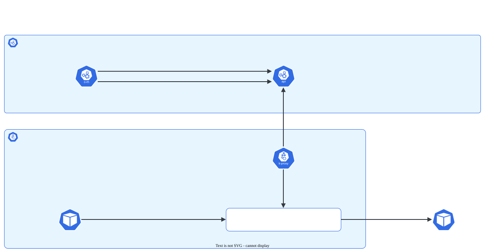

# Services e Endpoints

> **Versão do Kubernetes:** v1.37 · **Última revisão:** 2026-10-25 · **Domínio:** Services & Networking (20%)

## O que é

Pods são descartáveis: cada Pod novo ganha um IP novo. Um **Service** dá a um grupo de Pods um **endereço estável** (IP virtual + nome DNS) e distribui o tráfego entre eles.

Quem decide quais Pods fazem parte do Service é o **selector** (labels). A lista atual de IPs desses Pods fica em objetos **EndpointSlice**, que o cluster mantém sozinho.

Tipos de Service:

| Tipo | Acessível de onde | Uso típico |
|---|---|---|
| `ClusterIP` (padrão) | Só de dentro do cluster | Comunicação entre aplicações |
| `NodePort` | De fora, por `<IP-de-qualquer-nó>:<porta 30000-32767>` | Labs, acesso simples sem load balancer |
| `LoadBalancer` | De fora, por um IP de load balancer da nuvem | Produção em nuvem (AKS, EKS, GKE). Inclui um NodePort e um ClusterIP |
| `ExternalName` | Dentro do cluster | Apelido DNS (CNAME) para um nome externo. Não tem IP nem proxy |
| *Headless* (`clusterIP: None`) | Dentro do cluster | Sem IP virtual: o DNS devolve os IPs dos Pods. Usado com StatefulSet |

Os tipos são cumulativos: `LoadBalancer` ⊃ `NodePort` ⊃ `ClusterIP`.

## Como funciona por dentro

[](../assets/diagramas/03-services-endpoints.svg "Abrir o diagrama em tamanho real")

1. Você cria o Service. O **kube-apiserver** reserva um IP da faixa `--service-cluster-ip-range` (no kubeadm, padrão `10.96.0.0/12`).
2. O **EndpointSlice controller** (dentro do kube-controller-manager) procura os Pods que batem com o selector **e estão Ready**, e grava os IPs deles em EndpointSlices.
3. O **kube-proxy**, em cada nó, observa Services e EndpointSlices e escreve regras no kernel (iptables, nftables ou IPVS) que traduzem `IP-do-Service:port` para `IP-de-um-Pod:targetPort`.
4. O IP do Service é **virtual**: nenhuma interface responde a ping nele. Só existe nas regras do kube-proxy.

**Endpoints × EndpointSlice:** o objeto antigo `Endpoints` (`v1`) foi **depreciado na v1.33**. Ele ainda é servido (`kubectl get endpoints` funciona, com aviso), mas o kube-proxy usa **EndpointSlice** (`discovery.k8s.io/v1`), que divide endpoints em pedaços e escala melhor. Cada slice tem o label `kubernetes.io/service-name=<service>`.

Pod que **não está Ready** (readinessProbe falhando) sai da lista de endpoints prontos e não recebe tráfego. Por isso, "Service sem endpoints" é sinal de selector errado **ou** de Pods não prontos.

## Comandos essenciais

```bash
# Expor um Deployment: o selector é copiado do Deployment (forma mais segura)
kubectl expose deployment web --port=80 --target-port=8080 --name=web-svc

# NodePort via expose (a porta 30000-32767 é sorteada)
kubectl expose deployment web --port=80 --target-port=8080 --type=NodePort --name=web-np

# NodePort com porta fixa: expose não tem --node-port; use create service
# ATENÇÃO: create service usa selector app=<nome-do-service>
kubectl create service nodeport web --tcp=80:8080 --node-port=30080

# Expor um Pod (o Pod precisa ter labels)
kubectl run nginx --image=nginx --labels=app=nginx --port=80
kubectl expose pod nginx --port=80 --name=nginx-svc

# Atalho: criar Pod e Service ClusterIP juntos
kubectl run nginx --image=nginx --port=80 --expose

# Gerar YAML para editar (ex.: mudar selector, adicionar nodePort)
kubectl expose deployment web --port=80 --target-port=8080 --type=NodePort --dry-run=client -o yaml > svc.yaml

# Ver Service, selector e endpoints
kubectl get svc -o wide
kubectl describe svc web-svc                  # campo Endpoints: vazio = problema
kubectl get endpointslices -l kubernetes.io/service-name=web-svc
kubectl get endpoints web-svc                 # ainda funciona; mostra aviso de depreciação

# Conferir se o selector bate com os Pods
kubectl get pods -l app=web --show-labels

# Testar de dentro do cluster com um Pod temporário
kubectl run tmp --image=busybox:1.36 --rm -it --restart=Never -- wget -qO- -T 2 http://web-svc:80

# Testar NodePort de fora (ou de um nó)
curl http://<IP-do-nó>:30080
```

Use `--dry-run=client -o yaml` sempre que precisar de algo que os flags não cobrem: `nodePort` fixo junto com selector certo, várias portas, `externalTrafficPolicy`, Service headless.

## YAML de referência

```yaml
apiVersion: v1
kind: Service
metadata:
  name: web-svc
  namespace: default
spec:
  type: NodePort              # ClusterIP (padrão) | NodePort | LoadBalancer | ExternalName
  selector:
    app: web                  # tem que bater com os labels dos PODS (não do Deployment)
  ports:
    - name: http              # obrigatório quando há mais de uma porta
      protocol: TCP
      port: 80                # porta do Service (quem chama usa esta)
      targetPort: 8080        # porta do container (pode ser o NOME da porta, ex.: "http")
      nodePort: 30080         # só NodePort/LoadBalancer; omitir = sorteada em 30000-32767
```

Service **headless** (o DNS devolve os IPs dos Pods em vez de um IP virtual):

```yaml
apiVersion: v1
kind: Service
metadata:
  name: db
spec:
  clusterIP: None             # é isso que torna o Service headless
  selector:
    app: db
  ports:
    - port: 5432
```

Service **sem selector** + EndpointSlice manual (aponta para algo fora do cluster, ex.: um banco numa VM):

```yaml
apiVersion: v1
kind: Service
metadata:
  name: banco-externo
spec:
  ports:
    - port: 5432
---
apiVersion: discovery.k8s.io/v1
kind: EndpointSlice
metadata:
  name: banco-externo-1
  labels:
    kubernetes.io/service-name: banco-externo   # liga a slice ao Service
addressType: IPv4
ports:
  - port: 5432
endpoints:
  - addresses: ["10.0.0.50"]
```

## Na documentação oficial

- **Página principal:** *Service*. Link: <https://kubernetes.io/docs/concepts/services-networking/service/>
- **Complementares:**
    - *EndpointSlices*: <https://kubernetes.io/docs/concepts/services-networking/endpoint-slices/>
    - *Debug Services* (roteiro de diagnóstico): <https://kubernetes.io/docs/tasks/debug/debug-application/debug-service/>
- **Busca rápida:** `service` (o primeiro resultado costuma ser a página principal)
- **Ctrl+F dentro da página principal:**
    - `type: NodePort`: exemplo com `nodePort` fixo.
    - `targetPort`: porta nomeada e diferença para `port`.
    - `Headless Services`: `clusterIP: None`.
    - `without selectors`: Service apontando para fora do cluster.
    - `externalTrafficPolicy`: `Cluster` × `Local`.

## Pegadinhas da prova

- **Selector errado = Service sem endpoints.** O selector precisa bater com os labels do **template do Pod**, não com os labels do Deployment. Confira com `kubectl describe svc` (campo `Endpoints`).
- **`kubectl create service` inventa o selector** `app=<nome-do-service>`. No teste, `kubectl create service nodeport frontend2 ...` ganhou `{"app":"frontend2"}`. Se o Deployment usa outro label, o Service fica vazio. Prefira `kubectl expose`, ou gere o YAML e corrija o selector.
- **`port` × `targetPort` × `nodePort`.** `port` é a do Service, `targetPort` é a do container, `nodePort` é a do nó. Omitir `targetPort` faz ele assumir o valor de `port`.
- **NodePort fora da faixa** (ex.: 8080) é rejeitado: `spec.ports[0].nodePort: Invalid value: 8080: provided port is not in the valid range. The range of valid ports is 30000-32767`.
- **Namespace.** O Service só seleciona Pods do **próprio namespace**. E o `kubectl expose` sem `-n` cria em `default`.
- **Ping no IP do Service não responde**, e isso é normal. Teste com `wget`/`curl` na porta.
- **Pods não Ready** não entram nos endpoints. Se o selector está certo e mesmo assim não há endpoints, olhe a readinessProbe.
- **LoadBalancer em cluster kubeadm** fica com `EXTERNAL-IP <pending>` para sempre, porque não há cloud controller. Não é erro seu. Se a questão pedir acesso externo num cluster assim, use NodePort.
- **`kubectl get endpoints` mostra aviso de depreciação** (`Warning: v1 Endpoints is deprecated in v1.33+; use discovery.k8s.io/v1 EndpointSlice`). Ainda funciona e serve para conferir. Em YAML novo, use EndpointSlice.

## Pratique

**Enunciado (como na prova):**

> In the namespace `shop`, a Deployment named `frontend` is running with Pods that listen on port `8080`. Expose it with a Service named `frontend-svc` of type `NodePort`, exposing port `80` on the Service and node port `30080`. Verify that the Service has endpoints and is reachable from inside the cluster.

**Tradução:** no namespace `shop` existe um Deployment `frontend` com Pods escutando na porta `8080`. Exponha-o com um Service `frontend-svc` do tipo `NodePort`, com a porta `80` no Service e node port `30080`. Confira que o Service tem endpoints e responde de dentro do cluster.

??? success "Solução"
    ```bash
    # Gera com o selector certo (copiado do Deployment) e acrescenta o nodePort
    kubectl expose deployment frontend -n shop --name=frontend-svc \
      --type=NodePort --port=80 --target-port=8080 \
      --dry-run=client -o yaml > frontend-svc.yaml

    # editar frontend-svc.yaml: em ports[0], acrescentar   nodePort: 30080
    kubectl apply -f frontend-svc.yaml
    ```
    Alternativa: crie com `expose` e depois `kubectl edit svc frontend-svc -n shop` para trocar o `nodePort`.

**Como verificar:**

```bash
kubectl get svc frontend-svc -n shop                     # TYPE NodePort, PORT(S) 80:30080/TCP
kubectl get endpointslices -n shop -l kubernetes.io/service-name=frontend-svc   # IPs dos Pods
kubectl run tmp -n shop --image=busybox:1.36 --rm -it --restart=Never -- wget -qO- -T 2 http://frontend-svc
curl http://<IP-de-um-nó>:30080                         # de fora, ou de um nó
```

Saída real (v1.37.1, Pods com a imagem de teste `agnhost` escutando em 8080):

```console
$ kubectl get svc frontend-svc -n shop
NAME           TYPE       CLUSTER-IP      EXTERNAL-IP   PORT(S)        AGE
frontend-svc   NodePort   10.107.102.39   <none>        80:30080/TCP   1s
$ kubectl get endpointslices -n shop -l kubernetes.io/service-name=frontend-svc
NAME                 ADDRESSTYPE   PORTS   ENDPOINTS                     AGE
frontend-svc-n777v   IPv4          8080    10.244.190.68,10.244.80.209   1s
```

??? tip "No lab / Killercoda"

    - No lab Azure: libere a porta 30080 no NSG das VMs e acesse pelo IP público de um worker. Depois acesse pelo IP do **outro** worker, mesmo sem Pod nele. Por padrão (`externalTrafficPolicy: Cluster`), qualquer nó encaminha.
    - Mude para `externalTrafficPolicy: Local` e repita: agora só o nó que tem Pod responde. No teste, com o único Pod no `w1`, o NodePort respondeu `200` pelos dois workers em `Cluster`; em `Local`, só pelo `w1`.
    - Quebre o selector de propósito (`kubectl edit svc`) e veja os endpoints sumirem. Depois coloque uma readinessProbe que falha e observe o mesmo efeito.
    - Em um nó, rode `iptables-save | grep frontend-svc` (ou `nft list ruleset | grep frontend`, se o kube-proxy estiver em modo nftables) para ver as regras que o kube-proxy criou. Descubra o modo com `kubectl -n kube-system get cm kube-proxy -o yaml | grep mode` (no lab kubeadm: `mode: iptables`). Na v1.37.1, o `kube-proxy --help` lista os modos `iptables` (padrão), `ipvs` e `nftables`, sem marcar o IPVS como depreciado.
