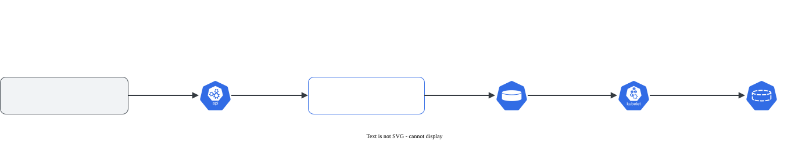

# Expansão de PVC

> **Versão do Kubernetes:** v1.37 · **Última revisão:** 2026-10-25 · **Domínio:** Storage (10%)

## O que é

Aumentar o tamanho de um volume que já existe, **sem recriar** o PVC e sem perder dados. Basta editar `spec.resources.requests.storage` do PVC para um valor maior.

Três condições:

1. A **StorageClass** do PVC tem `allowVolumeExpansion: true`.
2. O **provisionador/driver** suporta expansão (a maioria dos CSI de nuvem suporta; `hostPath` e `local` não).
3. O valor novo é **maior**. **Não dá para diminuir.**

## Como funciona por dentro

[](../assets/diagramas/04-expansao-pvc.svg "Abrir o diagrama em tamanho real")

São duas etapas:

| Etapa | Quem faz | Quando |
|---|---|---|
| **Controller**: aumentar o disco | `external-resizer` do driver CSI | Logo depois da edição |
| **Nó**: aumentar o filesystem (ext4, xfs) | kubelet | Com o volume montado (expansão **online**, a maioria dos CSI) ou na próxima montagem |

Durante o processo, o PVC mostra condições como `Resizing` e `FileSystemResizePending`. O tamanho só muda em `status.capacity` quando as duas etapas terminam. `spec` (o pedido) e `status` (o real) ficam diferentes enquanto isso.

**Se a classe permite, mas o driver não sabe expandir**, a API aceita o pedido e nada acontece. No lab, com o local-path (que não expande) e `allowVolumeExpansion: true` na classe:

```console
$ kubectl get pvc reports -o jsonpath='{.spec.resources.requests.storage} pedido / {.status.capacity.storage} real{"\n"}'
3Gi pedido / 1Gi real
$ kubectl describe pvc reports | grep ExternalExpanding        # espaços de alinhamento encurtados
  Normal  ExternalExpanding      30s   volume_expand    waiting for an external controller to expand this PVC
```

O PVC fica assim indefinidamente: não há `external-resizer` para fazer a primeira etapa.

## Comandos essenciais

```bash
# A classe permite?
kubectl get sc -o custom-columns=NOME:.metadata.name,EXPANSAO:.allowVolumeExpansion

# Expandir
kubectl patch pvc dados -n app -p '{"spec":{"resources":{"requests":{"storage":"10Gi"}}}}'
kubectl edit pvc dados -n app                   # ou editar à mão

# Acompanhar
kubectl get pvc dados -n app -w                 # CAPACITY muda no fim
kubectl describe pvc dados -n app | grep -A5 -E "Conditions|Events"
kubectl get pvc dados -n app -o jsonpath='{.spec.resources.requests.storage} pedido / {.status.capacity.storage} real{"\n"}'

# Conferir dentro do Pod
kubectl exec -n app web -- df -h /dados

# Permitir expansão numa classe que já existe (allowVolumeExpansion é o único campo mutável relevante)
kubectl patch sc rapido -p '{"allowVolumeExpansion":true}'
```

## YAML de referência

??? example "YAML completo: StorageClass + PersistentVolumeClaim"

    ```yaml
    apiVersion: storage.k8s.io/v1
    kind: StorageClass
    metadata:
      name: expansivel
    provisioner: disk.csi.azure.com
    allowVolumeExpansion: true             # sem isso a edição do PVC é recusada
    reclaimPolicy: Delete
    volumeBindingMode: WaitForFirstConsumer
    ---
    apiVersion: v1
    kind: PersistentVolumeClaim
    metadata:
      name: dados
      namespace: app
    spec:
      storageClassName: expansivel
      accessModes: ["ReadWriteOnce"]
      resources:
        requests:
          storage: 10Gi                    # era 5Gi: só aumentar este número
    ```

## Na documentação oficial

- **Página principal:** *Persistent Volumes*, seção *Expanding Persistent Volumes Claims*. Link: <https://kubernetes.io/docs/concepts/storage/persistent-volumes/#expanding-persistent-volumes-claims>
- **Busca rápida:** `expand pvc`, `allowVolumeExpansion`
- **Ctrl+F dentro da página:**
    - `allowVolumeExpansion`: o requisito na StorageClass.
    - `Resizing an in-use PersistentVolumeClaim`: expansão online.
    - `Recovering from Failure when Expanding Volumes`: voltar de um tamanho que o disco não aceitou.

## Pegadinhas da prova

- **A edição é recusada sem `allowVolumeExpansion: true`.** A mensagem diz `persistentvolumeclaims "reports" is forbidden: only dynamically provisioned pvc can be resized and the storageclass that provisions the pvc must support resize`.
- **PV estático (criado à mão) não expande pela API.** Expansão é coisa de provisionamento dinâmico: a recusa é a mesma mensagem acima.
- **Diminuir não existe.** Pedir menos que o atual é recusado (`spec.resources.requests.storage: Forbidden: field can not be less than status.capacity`).
- **Editar o PV em vez do PVC** não é o caminho. O pedido é feito no **PVC**.
- **`CAPACITY` não mudou?** Olhe as condições do PVC. `FileSystemResizePending` quer dizer que falta a etapa do nó: com drivers sem expansão online, reinicie o Pod que usa o volume.
- **Questão "o PVC deve ter 2Gi"**: confira as duas coisas, `spec.resources.requests.storage` e `status.capacity.storage`.

## Pratique

**Enunciado (como na prova):**

> The PVC `reports` in namespace `finance` uses the StorageClass `standard-csi` and currently has `1Gi`. Expand it to `3Gi` without deleting it. If the StorageClass does not allow expansion, change it so that it does.

**Tradução:** o PVC `reports` do namespace `finance` usa a StorageClass `standard-csi` e tem `1Gi`. Aumente para `3Gi` sem apagá-lo. Se a StorageClass não permitir expansão, altere-a para que permita.

??? success "Solução"
    ```bash
    kubectl get sc standard-csi -o jsonpath='{.allowVolumeExpansion}{"\n"}'     # vazio ou false?
    kubectl patch sc standard-csi -p '{"allowVolumeExpansion":true}'
    kubectl patch pvc reports -n finance -p '{"spec":{"resources":{"requests":{"storage":"3Gi"}}}}'
    kubectl get pvc reports -n finance -w
    ```
    O `allowVolumeExpansion` é um dos poucos campos da StorageClass que dá para mudar depois de criada.

**Como verificar:**

```bash
kubectl get pvc reports -n finance                       # CAPACITY 3Gi
kubectl describe pvc reports -n finance | grep -A4 Events
```

Num cluster com driver CSI que expande, o `CAPACITY` vai a `3Gi` e os eventos mostram `Resizing` (do `external-resizer`) e depois `FileSystemResizeSuccessful` (do kubelet).

!!! warning "O que não foi testado"
    O lab desta página (kubeadm em VMs, com o local-path-provisioner) não tem driver com expansão. Os comandos, as três recusas e o comportamento sem resizer foram conferidos na v1.37.1; o caminho de sucesso, com `CAPACITY` mudando, não. Para vê-lo, use um cluster gerenciado (AKS, EKS, GKE) ou o Killercoda.

??? tip "No lab / Killercoda"

    - Num lab sem driver com expansão (como o kubeadm puro), tente expandir um PVC de PV estático e leia a recusa. É a mensagem que aparece na prova quando falta `allowVolumeExpansion`.
    - Tente diminuir um PVC e leia o erro.
    - No Killercoda ou num cluster gerenciado (AKS, EKS, GKE), expanda um PVC com um Pod usando o volume e acompanhe `df -h` dentro do Pod.
