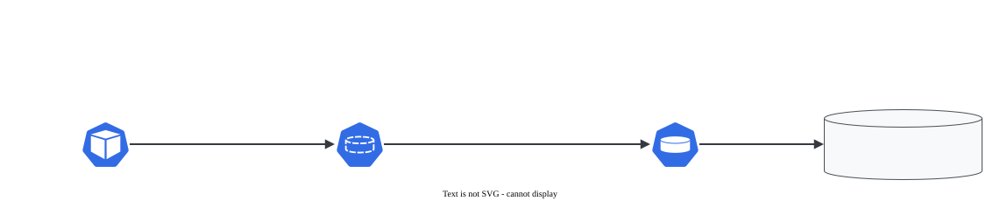

# PV e PVC: binding e accessModes

> **Versão do Kubernetes:** v1.36 · **Última revisão:** 2026-10-23 · **Domínio:** Storage (10%)

## O que é

Dois objetos que separam **quem oferece** disco de **quem pede** disco:

| Objeto | Escopo | Quem cria | O que diz |
|---|---|---|---|
| **PersistentVolume (PV)** | **Cluster** (sem namespace) | Administrador, ou um provisionador automático | "Existe um disco de 10Gi, deste tipo, neste lugar" |
| **PersistentVolumeClaim (PVC)** | **Namespace** | Quem faz o deploy da aplicação | "Preciso de 5Gi, com este modo de acesso" |

O Pod nunca aponta para o PV: ele aponta para o **PVC**, e o PVC é ligado (**bound**) a um PV. Assim a aplicação não precisa saber se o disco é NFS, Azure Disk ou um diretório local.

`accessModes` (o que o volume aceita):

| Modo | Sigla no `kubectl` | Significado |
|---|---|---|
| `ReadWriteOnce` | `RWO` | Leitura e escrita por **um nó** (vários Pods do mesmo nó podem usar) |
| `ReadOnlyMany` | `ROX` | Só leitura por vários nós |
| `ReadWriteMany` | `RWX` | Leitura e escrita por vários nós (NFS, CephFS, Azure Files) |
| `ReadWriteOncePod` | `RWOP` | Leitura e escrita por **um Pod** só, no cluster inteiro |

O modo é uma **promessa de capacidade** usada no binding. Ele não é um bloqueio aplicado pelo Kubernetes (exceto `RWOP`): quem limita de fato é o tipo de armazenamento. Um Azure Disk nunca será `RWX`, declare o que declarar.

## Como funciona por dentro

[](../assets/diagramas/04-pv-pvc.svg "Abrir o diagrama em tamanho real")

O controlador de PV (dentro do kube-controller-manager) liga um PVC a um PV quando **todas** as condições batem:

1. `capacity` do PV **≥** `requests.storage` do PVC.
2. Os `accessModes` pedidos estão entre os do PV.
3. `storageClassName` **igual** nos dois (inclusive os dois vazios).
4. `volumeMode` igual (`Filesystem`, o padrão, ou `Block`).
5. Se o PVC tem `selector`, os labels do PV casam.

O binding é **1 para 1** e exclusivo: um PV de 10Gi ligado a um PVC de 5Gi fica inteiro para ele. O PVC passa a mostrar a capacidade do PV (10Gi). Sem PV compatível, o PVC fica `Pending` até aparecer um (ou até um provisionador criar, ver [StorageClass](storageclass.md)).

Ciclo de vida do PV (coluna `STATUS`):

| Status | Significado |
|---|---|
| `Available` | Livre, esperando um PVC |
| `Bound` | Ligado a um PVC |
| `Released` | O PVC foi apagado, mas o PV ainda guarda o vínculo antigo (ver [reclaimPolicy](reclaim-policy.md)) |
| `Failed` | A recuperação automática falhou |

## Comandos essenciais

```bash
# Não há kubectl create pv/pvc: escreva o YAML (copie da documentação)
kubectl get pv                                  # cluster todo; colunas CLAIM e STATUS
kubectl get pvc -A
kubectl describe pvc dados -n app               # Events dizem por que está Pending
kubectl get pv -o custom-columns=NOME:.metadata.name,CAP:.spec.capacity.storage,MODOS:.spec.accessModes,CLASSE:.spec.storageClassName,STATUS:.status.phase,CLAIM:.spec.claimRef.name

# Quem está usando o PVC?
kubectl describe pvc dados -n app | grep "Used By"

# Conferir dentro do Pod
kubectl exec -n app web -- df -h /dados
kubectl exec -n app web -- sh -c 'echo ok > /dados/teste && cat /dados/teste'

kubectl explain pv.spec
kubectl explain pvc.spec
```

## YAML de referência

PV estático com `hostPath` (bom para lab; em produção seria NFS, CSI etc.):

```yaml
apiVersion: v1
kind: PersistentVolume
metadata:
  name: pv-dados
  labels:
    tipo: local
spec:
  capacity:
    storage: 1Gi
  accessModes:
    - ReadWriteOnce
  persistentVolumeReclaimPolicy: Retain
  storageClassName: manual            # o PVC precisa pedir a mesma classe
  hostPath:
    path: /mnt/dados                  # diretório no NÓ onde o Pod cair
    type: DirectoryOrCreate
```

PVC que liga nele e Pod que usa o PVC:

```yaml
apiVersion: v1
kind: PersistentVolumeClaim
metadata:
  name: dados
  namespace: app
spec:
  storageClassName: manual
  accessModes:
    - ReadWriteOnce
  resources:
    requests:
      storage: 500Mi                  # cabe no PV de 1Gi
  selector:                           # opcional: só PVs com este label
    matchLabels:
      tipo: local
---
apiVersion: v1
kind: Pod
metadata:
  name: web
  namespace: app
spec:
  containers:
    - name: web
      image: nginx:1.27
      volumeMounts:
        - name: dados
          mountPath: /usr/share/nginx/html
  volumes:
    - name: dados
      persistentVolumeClaim:
        claimName: dados              # o nome do PVC, não do PV
```

Ligar um PVC a um PV específico pelo nome (pula a busca):

```yaml
apiVersion: v1
kind: PersistentVolumeClaim
metadata:
  name: dados-fixo
  namespace: app
spec:
  storageClassName: manual
  volumeName: pv-dados                # vai direto para este PV
  accessModes:
    - ReadWriteOnce
  resources:
    requests:
      storage: 1Gi
```

## Na documentação oficial

- **Página principal:** *Persistent Volumes*. Link: <https://kubernetes.io/docs/concepts/storage/persistent-volumes/>
- **Tarefa com hostPath (o YAML acima):** *Configure a Pod to Use a PersistentVolume for Storage*: <https://kubernetes.io/docs/tasks/configure-pod-container/configure-persistent-volume-storage/>
- **Busca rápida:** `persistent volume`
- **Ctrl+F dentro das páginas:**
    - `Access Modes`: a tabela dos quatro modos e o que cada tipo de volume suporta.
    - `Binding`: as regras de ligação.
    - `task-pv-volume` (na tarefa): PV, PVC e Pod prontos para copiar.
    - `Reserving a PersistentVolume`: `volumeName` e `claimRef`.

## Pegadinhas da prova

- **PV não tem namespace; PVC tem.** Colocar `namespace` no PV é ignorado; esquecer o `namespace` do PVC o cria no `default`, e o Pod em outro namespace não o encontra.
- **`storageClassName` precisa bater.** PV com `manual` e PVC sem classe não se ligam. E se o cluster tiver **StorageClass padrão**, um PVC sem `storageClassName` recebe a classe padrão automaticamente e não liga em PV sem classe. Para ligar num PV sem classe, use `storageClassName: ""` explícito.
- **PVC maior que o PV** (ou com `accessModes` que o PV não tem) fica `Pending` para sempre. O evento depende da classe:
    - sem classe: `no persistent volumes available for this claim and no storage class is set`;
    - com um nome de classe que **não existe como objeto StorageClass** (o `manual` dos exemplos): `storageclass.storage.k8s.io "manual" not found`. Parece erro, mas é normal: o nome só serve para casar PV com PVC, e o binding estático funciona assim mesmo.
- **O PVC mostra a capacidade do PV**, não a que pediu. Pediu 500Mi, ligou num PV de 1Gi: `CAPACITY 1Gi`.
- **`claimName` é o nome do PVC.** Pôr o nome do PV no Pod deixa o Pod em `Pending` com `persistentvolumeclaim "..." not found`.
- **`hostPath` é do nó onde o Pod roda.** Num lab com vários workers, o Pod recriado em outro nó vê um diretório vazio.
- **PVC em uso não some na hora.** `kubectl delete pvc` deixa o PVC em `Terminating` até o Pod que o usa ser apagado (proteção `kubernetes.io/pvc-protection`).
- **Mudar `accessModes` ou `storageClassName` de um PVC já criado** não é permitido: apague e recrie.

## Pratique

**Enunciado (como na prova):**

> Create a PersistentVolume `pv-logs` of `2Gi`, access mode `ReadWriteOnce`, storage class `manual`, using hostPath `/mnt/logs`. Create a PersistentVolumeClaim `pvc-logs` in namespace `storage-lab` requesting `1Gi` that binds to it. Finally, create a Pod `logger` (image `busybox:1.36`) in the same namespace that mounts the claim at `/var/log/app` and writes the date to `/var/log/app/out.txt` every 10 seconds.

**Tradução:** crie o PV `pv-logs`, `2Gi`, modo `ReadWriteOnce`, classe `manual`, com hostPath `/mnt/logs`. Crie o PVC `pvc-logs` no namespace `storage-lab`, pedindo `1Gi`, que se ligue a ele. Por fim, crie o Pod `logger` (imagem `busybox:1.36`) no mesmo namespace, montando o PVC em `/var/log/app` e gravando a data em `/var/log/app/out.txt` a cada 10 segundos.

??? success "Solução"
    ```yaml
    apiVersion: v1
    kind: PersistentVolume
    metadata:
      name: pv-logs
    spec:
      capacity:
        storage: 2Gi
      accessModes: ["ReadWriteOnce"]
      storageClassName: manual
      hostPath:
        path: /mnt/logs
    ---
    apiVersion: v1
    kind: PersistentVolumeClaim
    metadata:
      name: pvc-logs
      namespace: storage-lab
    spec:
      storageClassName: manual
      accessModes: ["ReadWriteOnce"]
      resources:
        requests:
          storage: 1Gi
    ---
    apiVersion: v1
    kind: Pod
    metadata:
      name: logger
      namespace: storage-lab
    spec:
      containers:
        - name: logger
          image: busybox:1.36
          command: ["sh", "-c", "while true; do date >> /var/log/app/out.txt; sleep 10; done"]
          volumeMounts:
            - name: logs
              mountPath: /var/log/app
      volumes:
        - name: logs
          persistentVolumeClaim:
            claimName: pvc-logs
    ```
    ```bash
    kubectl create namespace storage-lab
    kubectl apply -f storage.yaml
    ```

**Como verificar:**

```bash
kubectl get pv pv-logs                          # STATUS Bound, CLAIM storage-lab/pvc-logs
kubectl get pvc pvc-logs -n storage-lab         # STATUS Bound, CAPACITY 2Gi
kubectl exec -n storage-lab logger -- tail -2 /var/log/app/out.txt
```

Saída esperada (ilustrativa: nomes, IPs e idades mudam no seu cluster):

```console
$ kubectl get pv pv-logs
NAME      CAPACITY   ACCESS MODES   RECLAIM POLICY   STATUS   CLAIM                  STORAGECLASS   AGE
pv-logs   2Gi        RWO            Retain           Bound    storage-lab/pvc-logs   manual         30s
$ kubectl get pvc pvc-logs -n storage-lab
NAME       STATUS   VOLUME    CAPACITY   ACCESS MODES   STORAGECLASS   AGE
pvc-logs   Bound    pv-logs   2Gi        RWO            manual         30s
```

O PV criado à mão tem `Retain` como padrão. O `Delete` é o padrão dos PVs criados por uma StorageClass.

**No lab / Killercoda:**

- Peça `3Gi` no PVC e leia o evento do `Pending`. Depois crie um PV de 5Gi e veja o PVC ligar sozinho.
- Peça `ReadWriteMany` com o PV `ReadWriteOnce` e confirme que não liga.
- Tire o `storageClassName` do PVC (com o PV em `manual`) e veja o `Pending`.
- Apague o Pod e recrie-o com `nodeName` para o outro worker: o `out.txt` some, porque o `hostPath` é local ao nó.
