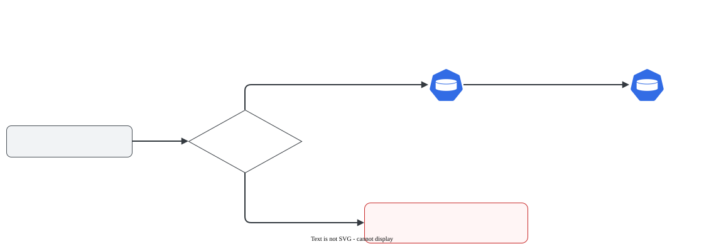

# reclaimPolicy: Retain × Delete

> **Versão do Kubernetes:** v1.37 · **Última revisão:** 2026-10-25 · **Domínio:** Storage (10%)

## O que é

O `persistentVolumeReclaimPolicy` do PV diz **o que acontece com o PV e com o disco real quando o PVC é apagado**:

| Política | PV depois de apagar o PVC | Disco real / dados | Padrão em |
|---|---|---|---|
| **`Retain`** | Fica, com status **`Released`** | **Preservados** | PV criado à mão |
| **`Delete`** | **Apagado** | **Apagados** pelo provisionador | PV criado por StorageClass (padrão da classe) |
| `Recycle` | Volta a `Available` depois de um `rm -rf` | Apagados | Descontinuado. Não use |

`Retain` é a escolha para dados que não podem sumir por engano (banco de produção). `Delete` é a escolha para ambientes descartáveis.

## Como funciona por dentro

[](../assets/diagramas/04-reclaim-policy.svg "Abrir o diagrama em tamanho real")

O ponto que confunde: **`Released` não é `Available`**. O PV `Released` ainda guarda em `spec.claimRef` o PVC antigo (nome, namespace e UID). Um PVC novo, mesmo com o mesmo nome, tem outro UID e **não liga**. Para reaproveitar o PV:

1. (Opcional) limpar ou copiar os dados do disco.
2. Remover o `claimRef`, e o PV volta a `Available`.

O `Delete` só apaga **dados** quando há quem apague o disco: o provisionador que criou o volume. Num PV estático de `hostPath` com `Delete`, ninguém sabe apagar aquele diretório: o PV vai para **`Failed`**, e os arquivos **continuam no nó**. Saída real (kubeadm v1.37.1, PV em `/mnt/hp-delete`):

```console
$ kubectl get pv pv-hp
NAME    CAPACITY   ACCESS MODES   RECLAIM POLICY   STATUS   CLAIM     STORAGECLASS   VOLUMEATTRIBUTESCLASS   REASON   AGE
pv-hp   1Gi        RWO            Delete           Failed   shop/hp   manual         <unset>                          21s
$ kubectl get events -A --field-selector involvedObject.name=pv-hp
NAMESPACE   LAST SEEN   TYPE      REASON               OBJECT                   MESSAGE
default     15s         Warning   VolumeFailedDelete   persistentvolume/pv-hp   host_path deleter only supports /tmp/.+ but received provided /mnt/hp-delete
```

No nó, `ls /mnt/hp-delete` ainda mostrava o arquivo. (Num cluster kind o resultado foi outro: o objeto PV sumiu. Por isso esta página foi validada em VMs com kubeadm, como na prova.)

| PV com `Delete` | Objeto PV | Dados |
|---|---|---|
| Criado por StorageClass com provisionador (no lab, o local-path) | Apagado | **Apagados** (no lab, a pasta `/opt/local-path-provisioner/pvc-...` sumiu do nó) |
| `hostPath` criado à mão | Fica, em **`Failed`** | **Ficam no nó** |

## Comandos essenciais

```bash
kubectl get pv                                    # colunas RECLAIM POLICY e STATUS

# Trocar a política de um PV que já existe (o campo é mutável)
kubectl patch pv pv-dados -p '{"spec":{"persistentVolumeReclaimPolicy":"Retain"}}'

# Proteger os dados de um PV dinâmico ANTES de apagar o PVC
kubectl patch pv $(kubectl get pvc dados -n app -o jsonpath='{.spec.volumeName}') \
  -p '{"spec":{"persistentVolumeReclaimPolicy":"Retain"}}'

# Reaproveitar um PV Released: tirar o vínculo antigo
kubectl get pv pv-dados -o jsonpath='{.spec.claimRef}{"\n"}'
kubectl patch pv pv-dados --type=json -p '[{"op":"remove","path":"/spec/claimRef"}]'

# A política padrão dos PVs dinâmicos vem da StorageClass
kubectl get sc -o custom-columns=NOME:.metadata.name,RECLAIM:.reclaimPolicy
```

## YAML de referência

??? example "YAML completo: PersistentVolume + StorageClass"

    ```yaml
    apiVersion: v1
    kind: PersistentVolume
    metadata:
      name: pv-banco
    spec:
      capacity:
        storage: 5Gi
      accessModes: ["ReadWriteOnce"]
      persistentVolumeReclaimPolicy: Retain   # Retain | Delete (Recycle descontinuado)
      storageClassName: manual
      hostPath:
        path: /mnt/banco
    ---
    # Na StorageClass o campo se chama só reclaimPolicy e vale para os PVs que ela criar
    apiVersion: storage.k8s.io/v1
    kind: StorageClass
    metadata:
      name: guarda-dados
    provisioner: kubernetes.io/no-provisioner
    reclaimPolicy: Retain
    volumeBindingMode: WaitForFirstConsumer
    ```

## Na documentação oficial

- **Página principal:** *Persistent Volumes*, seção *Reclaiming*. Link: <https://kubernetes.io/docs/concepts/storage/persistent-volumes/#reclaiming>
- **Tarefa:** *Change the Reclaim Policy of a PersistentVolume*: <https://kubernetes.io/docs/tasks/administer-cluster/change-pv-reclaim-policy/>
- **Busca rápida:** `reclaim policy`
- **Ctrl+F dentro das páginas:**
    - `Retain`, `Delete`, `Recycle`: o comportamento de cada um.
    - `kubectl patch pv`: o comando pronto na tarefa.
    - `Released`: o que significa e como o admin recupera.

## Pegadinhas da prova

- **Nomes diferentes do mesmo campo:** no PV é `persistentVolumeReclaimPolicy`; na StorageClass é `reclaimPolicy`.
- **PV `Released` não liga em PVC novo.** É preciso remover o `claimRef`. Recriar o PVC com o mesmo nome não resolve: no teste, ele ficou `Pending` com `volume "pvc-548aca91-..." already bound to a different claim.`
- **Mudar a StorageClass não muda PVs que já existem.** Para proteger um PV dinâmico, faça `kubectl patch pv` nele.
- **Patch antes de apagar.** Se a questão pede "apague o PVC mas preserve os dados", mude o PV para `Retain` **antes** do `kubectl delete pvc`.
- **`Delete` em PV estático de hostPath** não apaga o diretório do nó: o PV fica em `Failed` (`host_path deleter only supports /tmp/.+`). Não use isso como prova de que "os dados foram apagados".
- **`Recycle` está descontinuado.** Se aparecer em material antigo, a resposta moderna é provisionamento dinâmico.

## Pratique

**Enunciado (como na prova):**

> A PVC `orders-data` in namespace `shop` is bound to a dynamically provisioned PV. The application is being decommissioned: delete the PVC, but the underlying data **must be preserved**. Afterwards, make the PV available again so that a new PVC named `orders-archive` in namespace `shop` can bind to it.

**Tradução:** o PVC `orders-data` do namespace `shop` está ligado a um PV dinâmico. A aplicação vai ser desativada: apague o PVC, mas os dados **precisam ser preservados**. Depois, deixe o PV disponível de novo para que um PVC novo `orders-archive`, no namespace `shop`, possa se ligar a ele.

??? success "Solução"
    ```bash
    PV=$(kubectl get pvc orders-data -n shop -o jsonpath='{.spec.volumeName}')
    kubectl patch pv $PV -p '{"spec":{"persistentVolumeReclaimPolicy":"Retain"}}'
    kubectl delete pvc orders-data -n shop          # PV vai para Released, dados intactos
    kubectl patch pv $PV --type=json -p '[{"op":"remove","path":"/spec/claimRef"}]'   # volta a Available
    ```
    ```yaml
    apiVersion: v1
    kind: PersistentVolumeClaim
    metadata:
      name: orders-archive
      namespace: shop
    spec:
      storageClassName: <a mesma classe do PV>   # kubectl get pv $PV -o jsonpath='{.spec.storageClassName}'
      volumeName: <nome do PV>                   # garante que liga neste PV e não provisiona outro
      accessModes: ["ReadWriteOnce"]
      resources:
        requests:
          storage: <capacidade do PV>
    ```
    O `volumeName` é importante aqui: sem ele, a StorageClass provisionaria um disco **novo** e vazio para o PVC.

**Como verificar:**

```bash
kubectl get pv $PV                               # RECLAIM POLICY Retain, STATUS Bound, CLAIM shop/orders-archive
kubectl get pvc orders-archive -n shop
```

Saída real (v1.37.1, PV dinâmico do local-path com um arquivo `pedidos.txt` gravado antes):

```console
$ kubectl delete pvc orders-data -n shop; kubectl get pv $PV
persistentvolumeclaim "orders-data" deleted from shop namespace
NAME                                       CAPACITY   ACCESS MODES   RECLAIM POLICY   STATUS     CLAIM              STORAGECLASS   VOLUMEATTRIBUTESCLASS   REASON   AGE
pvc-548aca91-d456-4c00-8ecd-913e60dfe79b   1Gi        RWO            Retain           Released   shop/orders-data   local-path     <unset>                          10s
$ kubectl get pv $PV
NAME                                       CAPACITY   ACCESS MODES   RECLAIM POLICY   STATUS   CLAIM                 STORAGECLASS   VOLUMEATTRIBUTESCLASS   REASON   AGE
pvc-548aca91-d456-4c00-8ecd-913e60dfe79b   1Gi        RWO            Retain           Bound    shop/orders-archive   local-path     <unset>                          24s
```

Um Pod montando o `orders-archive` leu o arquivo antigo: `pedido-42`. Os dados atravessaram a troca de PVC.

??? tip "No lab / Killercoda"

    - Com um PV `hostPath` em `Retain`, grave um arquivo pelo Pod, apague Pod e PVC, e confira no nó (`ls /mnt/...`) que o arquivo continua.
    - Crie um PVC novo com o mesmo nome do antigo e veja que ele **não** liga no PV `Released`. Remova o `claimRef` e veja ligar.
    - Mude um PV `hostPath` para `Delete`, apague o PVC e confira: `kubectl get pv` não mostra mais o PV, mas `ls` no diretório do nó mostra os arquivos lá.
