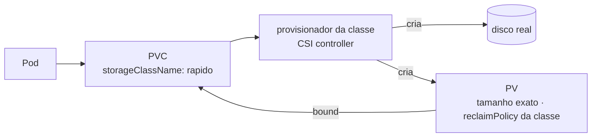

# StorageClass e provisionamento dinâmico

> **Versão do Kubernetes:** v1.36 · **Última revisão:** 2026-10-23 · **Domínio:** Storage (10%)

## O que é

Uma **StorageClass** é um "tipo de disco" que o cluster oferece (`ssd-rapido`, `padrao`, `nfs`). Com ela, ninguém precisa criar PV à mão: o PVC pede a classe e um **provisionador** cria o disco real e o PV na hora. Isso é o **provisionamento dinâmico**.

| Sem StorageClass (estático) | Com StorageClass (dinâmico) |
|---|---|
| Admin cria os PVs antes | PV criado sob demanda, do tamanho pedido |
| PVC procura um PV livre que sirva | PVC dispara a criação do PV |
| Sobra de capacidade (PV de 10Gi para pedido de 1Gi) | Tamanho exato |

Campos da StorageClass:

| Campo | Significado | Padrão |
|---|---|---|
| `provisioner` | Quem cria o disco: um driver CSI (`disk.csi.azure.com`, `ebs.csi.aws.com`, `rancher.io/local-path`) ou `kubernetes.io/no-provisioner` (só estático) | obrigatório |
| `parameters` | Opções do provisionador (tipo de disco, réplicas...) | — |
| `reclaimPolicy` | O que acontece com o PV quando o PVC é apagado | **`Delete`** |
| `volumeBindingMode` | `Immediate`: cria/liga assim que o PVC aparece. `WaitForFirstConsumer`: espera um Pod usar o PVC | `Immediate` |
| `allowVolumeExpansion` | Permite aumentar o PVC depois (ver [Expansão de PVC](expansao-pvc.md)) | `false` |
| `mountOptions` | Opções de montagem do PV | — |

A StorageClass **não tem namespace** e é **imutável** depois de criada (exceto metadata). Para mudar parâmetros, apague e recrie.

## Como funciona por dentro



- O PVC escolhe a classe por `storageClassName`. **Sem o campo**, recebe a **classe padrão** (a que tem a anotação `storageclass.kubernetes.io/is-default-class: "true"`), se houver uma.
- Se a classe padrão for criada **depois**, os PVCs que estavam `Pending` sem classe recebem a padrão automaticamente.
- `storageClassName: ""` (string vazia) é diferente de "sem o campo": quer dizer "nenhuma classe, só PV estático sem classe".
- `WaitForFirstConsumer` existe porque o disco precisa nascer **onde o Pod vai rodar** (mesma zona, ou o mesmo nó num volume local). Até um Pod usar o PVC, ele fica `Pending`, e isso é o **normal** nesse modo.

## Comandos essenciais

```bash
kubectl get storageclass                       # atalho: sc; a padrão aparece com "(default)"
kubectl describe sc rapido

# Tornar uma classe padrão (e tirar o padrão da outra: só uma deve ser padrão)
kubectl patch storageclass rapido -p '{"metadata":{"annotations":{"storageclass.kubernetes.io/is-default-class":"true"}}}'
kubectl patch storageclass antiga -p '{"metadata":{"annotations":{"storageclass.kubernetes.io/is-default-class":"false"}}}'

# Quem provisiona? Os drivers CSI instalados
kubectl get csidrivers
kubectl get pods -A | grep -Ei 'csi|provisioner'

# Acompanhar o provisionamento
kubectl get pvc -w
kubectl describe pvc dados | grep -A6 Events     # ExternalProvisioning, ProvisioningSucceeded, WaitForFirstConsumer

kubectl explain storageclass
```

## YAML de referência

```yaml
apiVersion: storage.k8s.io/v1
kind: StorageClass
metadata:
  name: rapido
  annotations:
    storageclass.kubernetes.io/is-default-class: "true"   # classe padrão
provisioner: disk.csi.azure.com          # driver CSI que cria o disco
parameters:
  skuName: Premium_LRS                   # depende do provisionador
reclaimPolicy: Retain                    # padrão seria Delete
volumeBindingMode: WaitForFirstConsumer
allowVolumeExpansion: true
---
apiVersion: v1
kind: PersistentVolumeClaim
metadata:
  name: dados
spec:
  storageClassName: rapido               # sem o campo: recebe a classe padrão
  accessModes: ["ReadWriteOnce"]
  resources:
    requests:
      storage: 5Gi                       # o PV nasce com exatamente 5Gi
```

Classe sem provisionador, para volumes locais estáticos (é a que se usa com PVs `local`):

```yaml
apiVersion: storage.k8s.io/v1
kind: StorageClass
metadata:
  name: local-storage
provisioner: kubernetes.io/no-provisioner   # não cria nada: os PVs são feitos à mão
volumeBindingMode: WaitForFirstConsumer
```

Para treinar provisionamento dinâmico num lab kubeadm (que não vem com provisionador), o mais comum é o **local-path-provisioner** do Rancher, que cria um diretório no nó para cada PVC. <!-- VERIFICAR: versão atual e URL do manifesto em https://github.com/rancher/local-path-provisioner -->

## Na documentação oficial

- **Página principal:** *Storage Classes*. Link: <https://kubernetes.io/docs/concepts/storage/storage-classes/>
- **Complementar:** *Dynamic Volume Provisioning*: <https://kubernetes.io/docs/concepts/storage/dynamic-provisioning/>
- **Tarefa:** *Change the default StorageClass*: <https://kubernetes.io/docs/tasks/administer-cluster/change-default-storage-class/>
- **Busca rápida:** `storage class`, `default storage class`
- **Ctrl+F dentro das páginas:**
    - `volumeBindingMode`: `Immediate` × `WaitForFirstConsumer`.
    - `is-default-class`: a anotação e o comando `kubectl patch`.
    - `no-provisioner`: a classe para volumes locais.
    - `allowVolumeExpansion`: o requisito para expandir.

## Pegadinhas da prova

- **PVC `Pending` com `WaitForFirstConsumer` não é erro.** O evento diz `waiting for first consumer to be created before binding`. Crie o Pod e o PVC liga.
- **"Sem `storageClassName`" ≠ `storageClassName: ""`.** O primeiro pega a classe padrão; o segundo recusa qualquer classe.
- **Duas classes padrão** ao mesmo tempo: o Kubernetes usa a mais nova, mas é configuração errada. Ao trocar a padrão, tire a anotação da antiga.
- **O `reclaimPolicy` padrão da StorageClass é `Delete`**: apagar o PVC apaga o disco e os dados. Se a questão pede preservar dados, use `Retain` na classe ou mude o PV depois (ver [reclaimPolicy](reclaim-policy.md)).
- **StorageClass é imutável.** `kubectl edit` em `parameters` ou `reclaimPolicy` é recusado. Apague e recrie com o mesmo nome; PVs já criados não mudam.
- **O nome da classe é o que liga tudo.** Questão diz "use a classe `fast`"? Confira o nome exato em `kubectl get sc` antes.
- **Sem provisionador, a StorageClass não cria nada.** Um PVC de uma classe cujo provisionador não está instalado fica `Pending` com `waiting for a volume to be created, either by external provisioner "..."`.

## Pratique

**Enunciado (como na prova):**

> Create a StorageClass named `local-wait` using provisioner `kubernetes.io/no-provisioner` and binding mode `WaitForFirstConsumer`, and make it the default StorageClass of the cluster. Create a PVC `data` in namespace `sc-lab` requesting `1Gi` **without** specifying a storage class, and confirm it got `local-wait` assigned.

**Tradução:** crie a StorageClass `local-wait` com o provisionador `kubernetes.io/no-provisioner` e modo `WaitForFirstConsumer`, e torne-a a classe padrão do cluster. Crie o PVC `data` no namespace `sc-lab`, pedindo `1Gi` **sem** informar classe, e confirme que ele recebeu `local-wait`.

??? success "Solução"
    ```yaml
    apiVersion: storage.k8s.io/v1
    kind: StorageClass
    metadata:
      name: local-wait
      annotations:
        storageclass.kubernetes.io/is-default-class: "true"
    provisioner: kubernetes.io/no-provisioner
    volumeBindingMode: WaitForFirstConsumer
    ---
    apiVersion: v1
    kind: PersistentVolumeClaim
    metadata:
      name: data
      namespace: sc-lab
    spec:
      accessModes: ["ReadWriteOnce"]
      resources:
        requests:
          storage: 1Gi
    ```
    ```bash
    kubectl create namespace sc-lab
    kubectl apply -f sc.yaml
    ```
    Se já existir outra classe padrão, tire a anotação dela com `kubectl patch` (comando acima).

**Como verificar:**

```bash
kubectl get sc                                  # local-wait (default)
kubectl get pvc data -n sc-lab -o jsonpath='{.spec.storageClassName}{"\n"}'
kubectl describe pvc data -n sc-lab | grep -A3 Events
```

Saída esperada (ilustrativa: nomes, IPs e idades mudam no seu cluster):

```console
$ kubectl get sc
NAME                   PROVISIONER                    RECLAIMPOLICY   VOLUMEBINDINGMODE      ALLOWVOLUMEEXPANSION   AGE
local-wait (default)   kubernetes.io/no-provisioner   Delete          WaitForFirstConsumer   false                  10s
$ kubectl get pvc data -n sc-lab -o jsonpath='{.spec.storageClassName}{"\n"}'
local-wait
$ kubectl describe pvc data -n sc-lab | grep -A3 Events
Events:
  Type    Reason                Age   From                         Message
  ----    ------                ----  ----                         -------
  Normal  WaitForFirstConsumer  5s    persistentvolume-controller  waiting for first consumer to be created before binding
```

**No lab / Killercoda:**

- Crie um Pod que usa o PVC `data`: como a classe não provisiona nada, o evento muda para a falta de PV. Crie um PV `local` ou `hostPath` com `storageClassName: local-wait` e veja ligar.
- Crie um PVC sem classe **antes** de criar a classe padrão. Depois crie a classe e confira que o PVC recebeu `local-wait`.
- Instale o local-path-provisioner e repita com provisionamento dinâmico de verdade: o PV aparece sozinho, com o tamanho exato.
- Ao terminar, apague a classe ou tire a anotação de padrão para não afetar os próximos exercícios.
