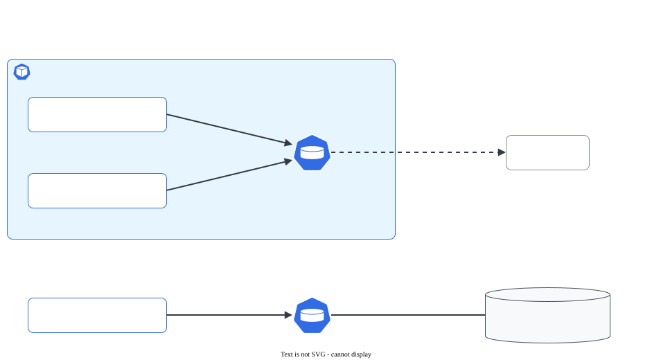

# Volumes em Pods: emptyDir e hostPath

> **Versão do Kubernetes:** v1.36 · **Última revisão:** 2026-10-23 · **Domínio:** Storage (10%)

## O que é

O sistema de arquivos de um container é **descartável**: se o container reinicia, o que ele gravou some. Volumes resolvem isso. Os dois tipos mais simples não precisam de PV nem de PVC, e são declarados direto no Pod:

| | `emptyDir` | `hostPath` |
|---|---|---|
| Onde fica | Diretório criado pelo kubelet para o Pod (disco do nó ou RAM) | Um caminho **existente no nó** |
| Nasce | Vazio, quando o Pod é criado no nó | Com o que já estiver no nó |
| Sobrevive a restart do container | **Sim** | Sim |
| Sobrevive à remoção do Pod | **Não**: some junto | **Sim**: continua no nó |
| Compartilhado entre containers do Pod | **Sim** (o uso principal) | Sim |
| Uso típico | Cache, arquivo temporário, troca de arquivos entre sidecar e app | Agente que lê arquivos do nó (logs, socket do runtime), lab |
| Risco | Encher o disco do nó (use `sizeLimit`) | **Segurança**: acesso ao sistema de arquivos do nó |

## Como funciona por dentro

[](../assets/diagramas/04-volumes-emptydir-hostpath.svg "Abrir o diagrama em tamanho real")

- O `emptyDir` fica em `/var/lib/kubelet/pods/<uid-do-pod>/volumes/kubernetes.io~empty-dir/<nome>` no nó. Com `medium: Memory` vira um **tmpfs** (RAM): rápido, mas conta no limite de memória do container.
- O `hostPath` monta o caminho do nó **onde o Pod caiu**. Pod recriado em outro nó = outro diretório.
- Volumes são declarados uma vez em `spec.volumes` e montados em cada container em `volumeMounts` (pode ser num caminho diferente em cada um).

Tipos do campo `hostPath.type` (validação antes de montar):

| `type` | Comportamento |
|---|---|
| `""` (vazio, padrão) | Nenhuma checagem |
| `DirectoryOrCreate` | Cria o diretório (permissão 0755) se não existir |
| `Directory` | Diretório precisa existir, senão o Pod não sobe |
| `FileOrCreate` | Cria o arquivo vazio se não existir (o diretório pai precisa existir) |
| `File` | Arquivo precisa existir |
| `Socket`, `CharDevice`, `BlockDevice` | Precisa existir e ser desse tipo |

## Comandos essenciais

```bash
# Não há flag de volume no kubectl run: gere o YAML e edite
kubectl run app --image=busybox:1.36 --dry-run=client -o yaml -- sleep 3600 > app.yaml

# Conferir montagens
kubectl describe pod app | grep -A8 Volumes
kubectl exec app -c app -- df -h /cache                 # tmpfs = emptyDir em memória
kubectl exec app -c sidecar -- cat /cache/arquivo       # outro container do mesmo Pod lê

# No nó: onde está o emptyDir
kubectl get pod app -o jsonpath='{.metadata.uid}{"\n"}'
sudo ls /var/lib/kubelet/pods/<uid>/volumes/kubernetes.io~empty-dir/

# Pod com hostPath: em que nó caiu (é o disco desse nó)
kubectl get pod agente -o wide

kubectl explain pod.spec.volumes.emptyDir
kubectl explain pod.spec.volumes.hostPath
```

## YAML de referência

`emptyDir` compartilhado entre dois containers:

??? example "YAML completo: Pod"

    ```yaml
    apiVersion: v1
    kind: Pod
    metadata:
      name: app
    spec:
      containers:
        - name: app
          image: busybox:1.36
          command: ["sh", "-c", "while true; do date >> /cache/log.txt; sleep 5; done"]
          volumeMounts:
            - name: cache
              mountPath: /cache
        - name: sidecar
          image: busybox:1.36
          command: ["sh", "-c", "tail -F /dados/log.txt"]
          volumeMounts:
            - name: cache
              mountPath: /dados               # mesmo volume, outro caminho
              readOnly: true
      volumes:
        - name: cache
          emptyDir:
            sizeLimit: 100Mi                  # passou disso: o Pod é expulso
            # medium: Memory                  # tmpfs na RAM
    ```

`hostPath` para ler os logs do nó:

```yaml
apiVersion: v1
kind: Pod
metadata:
  name: agente
spec:
  containers:
    - name: agente
      image: busybox:1.36
      command: ["sh", "-c", "ls /host-log; sleep 3600"]
      volumeMounts:
        - name: log-do-no
          mountPath: /host-log
          readOnly: true                  # quase sempre só leitura
  volumes:
    - name: log-do-no
      hostPath:
        path: /var/log
        type: Directory                   # precisa existir no nó
```

## Na documentação oficial

- **Página principal:** *Volumes*. Link: <https://kubernetes.io/docs/concepts/storage/volumes/>
- **Tarefa:** *Configure a Pod to Use a Volume for Storage* (emptyDir): <https://kubernetes.io/docs/tasks/configure-pod-container/configure-volume-storage/>
- **Tarefa:** *Communicate Between Containers in the Same Pod Using a Shared Volume*: <https://kubernetes.io/docs/tasks/access-application-cluster/communicate-containers-same-pod-shared-volume/>
- **Busca rápida:** `emptydir`, `hostpath`
- **Ctrl+F dentro da página principal:**
    - `emptyDir configuration example`: o YAML com `sizeLimit` e `medium`.
    - `hostPath volume types`: a tabela de `type`.
    - `hostPath configuration example`: o YAML pronto.

## Pegadinhas da prova

- **`emptyDir` sobrevive a restart do container, não à remoção do Pod.** `kubectl delete pod` (ou o Deployment trocar o Pod) leva os dados embora.
- **Montar volume num diretório esconde o conteúdo original** daquele diretório na imagem.
- **`hostPath` é do nó.** Num cluster com vários workers, o Pod pode cair em outro nó e não achar o arquivo. Se a questão exige o mesmo nó, use `nodeName` ou `nodeSelector`.
- **`type: Directory` com caminho inexistente**: o Pod fica em `ContainerCreating` e o evento diz `hostPath type check failed`. Use `DirectoryOrCreate` quando a questão não garantir que o caminho existe.
- **`emptyDir` com `medium: Memory`** conta como memória do container. Encher o tmpfs pode causar `OOMKilled`.
- **`sizeLimit` estourado** expulsa o Pod (`Evicted`), não dá erro de escrita na hora.
- **Sidecar que lê arquivo do outro container**: os dois precisam montar **o mesmo** volume (mesmo `name` em `volumeMounts`), mesmo que em caminhos diferentes.

## Pratique

**Enunciado (como na prova):**

> Create a Pod `shared` in namespace `vol-lab` with two containers using image `busybox:1.36`. Container `writer` writes the current date to `/out/date.txt` every 5 seconds. Container `reader` must be able to read that file at `/in/date.txt`. The data must not outlive the Pod. Additionally, mount the node directory `/var/log` read-only at `/node-logs` in the `reader` container.

**Tradução:** crie o Pod `shared` no namespace `vol-lab` com dois containers `busybox:1.36`. O container `writer` grava a data em `/out/date.txt` a cada 5 segundos. O container `reader` precisa ler esse arquivo em `/in/date.txt`. Os dados não podem sobreviver ao Pod. Além disso, monte o diretório do nó `/var/log`, somente leitura, em `/node-logs` no container `reader`.

??? success "Solução"
    ```yaml
    apiVersion: v1
    kind: Pod
    metadata:
      name: shared
      namespace: vol-lab
    spec:
      containers:
        - name: writer
          image: busybox:1.36
          command: ["sh", "-c", "while true; do date > /out/date.txt; sleep 5; done"]
          volumeMounts:
            - name: troca
              mountPath: /out
        - name: reader
          image: busybox:1.36
          command: ["sh", "-c", "sleep 3600"]
          volumeMounts:
            - name: troca
              mountPath: /in
            - name: logs
              mountPath: /node-logs
              readOnly: true
      volumes:
        - name: troca
          emptyDir: {}                 # "não sobreviver ao Pod" = emptyDir
        - name: logs
          hostPath:
            path: /var/log
            type: Directory
    ```
    ```bash
    kubectl create namespace vol-lab
    kubectl apply -f shared.yaml
    ```

**Como verificar:**

```bash
kubectl exec -n vol-lab shared -c reader -- cat /in/date.txt
kubectl exec -n vol-lab shared -c reader -- ls /node-logs | head -3
kubectl exec -n vol-lab shared -c reader -- touch /node-logs/x     # deve falhar: somente leitura
```

Saída esperada (ilustrativa: nomes, IPs e idades mudam no seu cluster):

```console
$ kubectl exec -n vol-lab shared -c reader -- cat /in/date.txt
Fri Oct 23 18:40:05 UTC 2026
$ kubectl exec -n vol-lab shared -c reader -- touch /node-logs/x
touch: /node-logs/x: Read-only file system
command terminated with exit code 1
```

??? tip "No lab / Killercoda"

    - Force o restart do `writer`: no nó onde o Pod está, `sudo crictl stop $(sudo crictl ps --name writer -q)`. O `RESTARTS` vai a 1 e o arquivo continua lá. Apague o Pod e recrie: o arquivo sumiu. (`kubectl exec ... -- kill 1` não serve: o PID 1 do container ignora o sinal e nada reinicia.)
    - Troque o `emptyDir` por `medium: Memory` e confira com `df -h /out` que virou `tmpfs`.
    - Use `hostPath` com `type: Directory` num caminho que não existe e leia o evento.
    - Ache o diretório do `emptyDir` no nó, em `/var/lib/kubelet/pods/<uid>/volumes/`.
