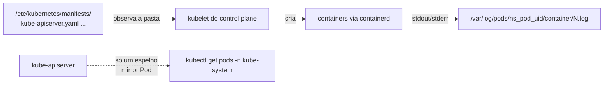

# Control plane fora: crictl, /var/log/pods, manifestos

> **Versão do Kubernetes:** v1.36 · **Última revisão:** 2026-10-23 · **Domínio:** Troubleshooting (30%)

## O que é

Num cluster kubeadm, os quatro componentes do control plane são **static Pods**: o kubelet do control plane lê os manifestos em `/etc/kubernetes/manifests/` e roda os containers direto, **sem depender do API server**. Por isso:

- Se o **kube-apiserver** cai, o `kubectl` para de funcionar. A investigação é no nó, com `crictl` e arquivos de log.
- Para "consertar" um componente, você **edita o manifesto**; o kubelet percebe a mudança e recria o container sozinho.

O que cada componente fora do ar causa:

| Componente | Sintoma |
|---|---|
| **kube-apiserver** | `kubectl`: `The connection to the server 10.0.1.4:6443 was refused` (ou timeout). Nada funciona |
| **etcd** | O apiserver fica reiniciando (não acha o etcd); `kubectl` intermitente ou com erro `etcdserver: request timed out` |
| **kube-scheduler** | Pods novos ficam `Pending` **sem nenhum evento** |
| **kube-controller-manager** | Deployment criado sem ReplicaSet/Pods; `scale` sem efeito; nada é recriado |

## Como funciona por dentro



- O Pod que aparece em `kubectl get pods -n kube-system` (`kube-apiserver-cp`) é um **mirror Pod**: só um reflexo. Apagá-lo com `kubectl delete` não faz nada; o kubelet o recria.
- O kubelet varre a pasta periodicamente. Manifesto **salvo com erro de YAML** = o container some e não volta, e o kubelet registra o erro no `journalctl`.
- **Tirar o arquivo da pasta para o componente; devolver, volta.** É o jeito seguro de "reiniciar" um static Pod.
- Os logs ficam em disco no nó, mesmo quando o API server está fora:
    - `/var/log/pods/<namespace>_<pod>_<uid>/<container>/<restart>.log`: o arquivo real.
    - `/var/log/containers/<pod>_<namespace>_<container>-<id>.log`: links para os de cima.
    - `/var/log/pods/` só abre como **root** (`sudo -i`). Cada linha tem o formato `<data> <stdout|stderr> F <mensagem>`.

## Comandos essenciais

```bash
# kubectl não responde? Vá para o nó do control plane
ssh cp
sudo -i

# Containers do control plane (rodando ou não)
crictl ps -a | grep -E 'kube-apiserver|etcd|kube-scheduler|kube-controller'
crictl ps -a --name kube-apiserver                 # STATE Exited + ATTEMPT subindo = reiniciando
crictl logs <container-id>                         # log do container (inclusive Exited)
crictl logs --tail 30 $(crictl ps -a --name kube-apiserver -q | head -1)
crictl pods --name kube-apiserver
crictl inspect <container-id> | grep -i -A3 exitcode

# Os mesmos logs direto do disco
ls /var/log/pods/ | grep kube-system_kube-apiserver
tail -30 /var/log/pods/kube-system_kube-apiserver-cp_*/kube-apiserver/*.log
ls -l /var/log/containers/ | grep apiserver

# Manifestos
ls /etc/kubernetes/manifests/
grep -n -E 'image:|--etcd-servers|--advertise-address|--secure-port|- --' /etc/kubernetes/manifests/kube-apiserver.yaml | head -40

# O kubelet reclama de manifesto inválido aqui
journalctl -u kubelet --no-pager | grep -iE 'manifest|static|apiserver' | tail -10

# "Reiniciar" um static Pod com segurança
mv /etc/kubernetes/manifests/kube-scheduler.yaml /tmp/
#   (espere o container sumir: crictl ps | grep scheduler)
mv /tmp/kube-scheduler.yaml /etc/kubernetes/manifests/

# Com o kubectl funcionando, o atalho
kubectl get pods -n kube-system
kubectl logs -n kube-system kube-apiserver-cp
kubectl get --raw='/readyz?verbose' | tail -5
```

## YAML de referência

O manifesto do kube-apiserver, com os pontos onde cenários da prova costumam plantar o erro:

```yaml
# /etc/kubernetes/manifests/kube-apiserver.yaml (trecho)
apiVersion: v1
kind: Pod
metadata:
  name: kube-apiserver
  namespace: kube-system
spec:
  hostNetwork: true
  containers:
    - name: kube-apiserver
      image: registry.k8s.io/kube-apiserver:v1.36.5    # tag inexistente = ImagePull no nó
      command:
        - kube-apiserver
        - --advertise-address=10.0.1.4
        - --etcd-servers=https://127.0.0.1:2379        # porta errada = apiserver não sobe
        - --etcd-cafile=/etc/kubernetes/pki/etcd/ca.crt
        - --etcd-certfile=/etc/kubernetes/pki/apiserver-etcd-client.crt
        - --etcd-keyfile=/etc/kubernetes/pki/apiserver-etcd-client.key
        - --secure-port=6443
        - --tls-cert-file=/etc/kubernetes/pki/apiserver.crt
        - --tls-private-key-file=/etc/kubernetes/pki/apiserver.key
        - --authorization-mode=Node,RBAC
      volumeMounts:
        - name: k8s-certs
          mountPath: /etc/kubernetes/pki               # caminho de cert fora do volume = arquivo não encontrado
          readOnly: true
  volumes:
    - name: k8s-certs
      hostPath:
        path: /etc/kubernetes/pki
        type: DirectoryOrCreate
```

## Na documentação oficial

- **Página principal:** *Troubleshooting Clusters*. Link: <https://kubernetes.io/docs/tasks/debug/debug-cluster/>
- **Complementares:**
    - *Debugging Kubernetes nodes with crictl*: <https://kubernetes.io/docs/tasks/debug/debug-cluster/crictl/>
    - *Create static Pods*: <https://kubernetes.io/docs/tasks/configure-pod-container/static-pod/>
    - *Logging Architecture* (onde ficam os logs no nó): <https://kubernetes.io/docs/concepts/cluster-administration/logging/>
    - *kube-apiserver* (referência de flags): <https://kubernetes.io/docs/reference/command-line-tools-reference/kube-apiserver/>
- **Busca rápida:** `crictl`, `static pod`
- **Ctrl+F dentro das páginas:**
    - `crictl ps -a`, `crictl logs` (em crictl): listar e ler logs.
    - `staticPodPath` (em static Pods): a pasta observada.
    - `/var/log/pods` (em Logging Architecture): o layout dos arquivos.

## Pegadinhas da prova

- **`kubectl` não funciona ⇒ não perca tempo nele.** Vá direto para `crictl ps -a` no control plane.
- **Container `Exited` com `ATTEMPT` aumentando** = sobe e morre. A causa está no `crictl logs` dele ou no arquivo em `/var/log/pods/`.
- **Container que nem aparece no `crictl ps -a`** = o kubelet não conseguiu ler o manifesto (YAML inválido) ou a imagem não baixa. Olhe o `journalctl -u kubelet`.
- **Faça backup antes de editar:** `cp /etc/kubernetes/manifests/kube-apiserver.yaml /root/kube-apiserver.yaml.bak`. **Fora** da pasta de manifestos: o kubelet lê todo arquivo dali (só ignora nomes que começam com `.`), e um `.bak` lá dentro é tratado como outro manifesto de static Pod. Veja [o teste abaixo](#teste-real-um-bak-dentro-da-pasta-de-manifestos): com o mesmo `metadata.name`, ele não vira um segundo Pod, mas **substitui** o original e faz suas edições no `.yaml` serem ignoradas.
- **`kubectl delete pod kube-apiserver-cp` não reinicia nada**: é um mirror Pod. O kubelet o recria em segundos e o container continua o mesmo (mesmo ID, 0 restarts em `crictl ps`).
- **Espere depois de salvar.** O kubelet leva alguns segundos para recriar, e o apiserver mais uns 30–60 s para responder. `watch crictl ps` em vez de editar de novo.
- **Scheduler fora:** o sintoma é discreto. Pod `Pending` **sem evento `FailedScheduling`** é a pista.
- **Controller-manager fora:** `kubectl create deployment` funciona (o apiserver grava), mas `kubectl get rs` não mostra nada novo.

## Teste real: um `.bak` dentro da pasta de manifestos

Feito num cluster kind v1.36.4 (kubelet com `staticPodPath: /etc/kubernetes/manifests`, igual ao kubeadm), em 2026-10-23.

**1. Copiar o manifesto do scheduler para `kube-scheduler.yaml.bak` na mesma pasta.** O kubelet não criou um segundo Pod: os dois arquivos têm o mesmo `metadata.name`, então geram o mesmo nome de Pod (`kube-scheduler-<nó>`). Mas o Pod ganhou outro UID (o kubelet calcula o UID do static Pod a partir do conteúdo **e do caminho** do arquivo), e o kubelet tratou isso como um Pod novo. Ele matou o container que rodava e subiu outro, num sandbox novo (`POD ID` diferente):

```console
# crictl ps -a --name kube-scheduler        (colunas CREATED, IMAGE e NAMESPACE recortadas)
CONTAINER       STATE     NAME             ATTEMPT   POD ID          POD
15b689bf1e494   Running   kube-scheduler   0         b2a5dfb6d06d2   kube-scheduler-cka-teste-control-plane
90c33f72e20ab   Exited    kube-scheduler   0         53a6c585bd891   kube-scheduler-cka-teste-control-plane
```

No `journalctl -u kubelet`, a troca aparece como um mirror Pod que "não bate" com o static Pod:

```console
kubelet.go:3482] "Trying to delete pod" pod="kube-system/kube-scheduler-cka-teste-control-plane" podUID="17df22cd-..."
kubelet.go:3488] "Deleted mirror pod as it didn't match the static Pod" pod="kube-system/kube-scheduler-cka-teste-control-plane"
kubelet.go:3499] "Creating a mirror pod for static pod" pod="kube-system/kube-scheduler-cka-teste-control-plane"
```

Nenhuma linha de erro ou aviso sobre o `.bak`: o kubelet não avisa que há dois arquivos para o mesmo Pod.

**2. Com o `.bak` ainda lá, editar o `kube-scheduler.yaml`** (acrescentar `--v=4`). O arquivo mudou, mas o container continuou **sem** a flag por mais de 40 s: o Pod em execução estava seguindo o `.bak`. É o pior efeito para a prova: você corrige o manifesto certo e nada acontece.

```console
# grep -c -- '--v=4' /etc/kubernetes/manifests/kube-scheduler.yaml
1
# crictl inspect <id-do-scheduler> | grep -c -- '--v=4'
0
```

**3. Apagar o `.bak`.** O kubelet trocou o Pod de novo (o scheduler ficou ~15 s fora) e só então a edição entrou no container (`crictl inspect` passou a mostrar `--v=4`).

**4. Arquivo oculto (`.kube-scheduler.yaml`) na pasta:** ignorado. O ID do container não mudou.

Conclusão: o backup vai **fora** da pasta (`/root/`, `/tmp/`). Se você precisa deixar uma cópia ali, ela tem que começar com `.`.

## Pratique

**Enunciado (como na prova):**

> New Pods in the cluster stay in `Pending` state, but existing Pods keep running. Find the cause and fix it. Then create a Pod `check` with image `nginx:1.27` in namespace `default` and make sure it is `Running`.

**Tradução:** Pods novos ficam `Pending`, mas os que já existiam continuam rodando. Descubra a causa e corrija. Depois crie o Pod `check`, imagem `nginx:1.27`, no namespace `default`, e garanta que fique `Running`.

Para montar o cenário no lab (no control plane): `sudo mv /etc/kubernetes/manifests/kube-scheduler.yaml /root/`.

??? success "Solução"
    ```bash
    kubectl run check --image=nginx:1.27
    kubectl describe pod check | sed -n '/Events/,$p'     # Events: <none> → ninguém tentou agendar
    kubectl get pods -n kube-system | grep scheduler      # não aparece
    ssh cp
    sudo -i
    ls /etc/kubernetes/manifests/                         # falta kube-scheduler.yaml
    crictl ps -a --name kube-scheduler                    # nada
    find / -name 'kube-scheduler.yaml' -not -path '*/proc/*' 2>/dev/null
    mv /root/kube-scheduler.yaml /etc/kubernetes/manifests/
    crictl ps --name kube-scheduler                       # Running
    exit; exit
    kubectl get pod check -w                              # Pending → ContainerCreating → Running
    ```
    `Pending` **sem nenhum evento** separa "o scheduler não está rodando" de "o scheduler tentou e não achou nó" (que gera `FailedScheduling`). Na prova o manifesto pode ter um erro em vez de ter sumido: aí `crictl ps -a` mostra o container `Exited` e o `crictl logs` dá a causa.

**Como verificar:**

```bash
kubectl get pods -n kube-system -l component=kube-scheduler
kubectl get pod check -o wide
```

Saída esperada (ilustrativa: nomes, IPs e idades mudam no seu cluster):

```console
$ kubectl describe pod check | sed -n '/Events/,$p'
Events:          <none>
$ kubectl get pods -n kube-system -l component=kube-scheduler
NAME                READY   STATUS    RESTARTS   AGE
kube-scheduler-cp   1/1     Running   0          40s
$ kubectl get pod check -o wide
NAME    READY   STATUS    RESTARTS   AGE   IP              NODE
check   1/1     Running   0          2m    10.244.80.230   w2
```

**No lab / Killercoda:**

- Faça backup do manifesto do kube-apiserver **fora** da pasta, troque `--etcd-servers` para a porta `2380` e acompanhe com `watch crictl ps -a`: o apiserver sobe e morre. Leia o motivo em `/var/log/pods/kube-system_kube-apiserver-*/`. Restaure o backup.
- Quebre a indentação do manifesto do scheduler e veja o container sumir e o erro aparecer no `journalctl -u kubelet`.
- Deixe um `kube-scheduler.yaml.bak` **dentro** da pasta de manifestos, edite o `kube-scheduler.yaml` e confira com `crictl inspect` que a edição não entrou. Compare com o [teste real](#teste-real-um-bak-dentro-da-pasta-de-manifestos).
- Pare o controller-manager (`mv` do manifesto) e crie um Deployment: confira que nenhum ReplicaSet aparece.
