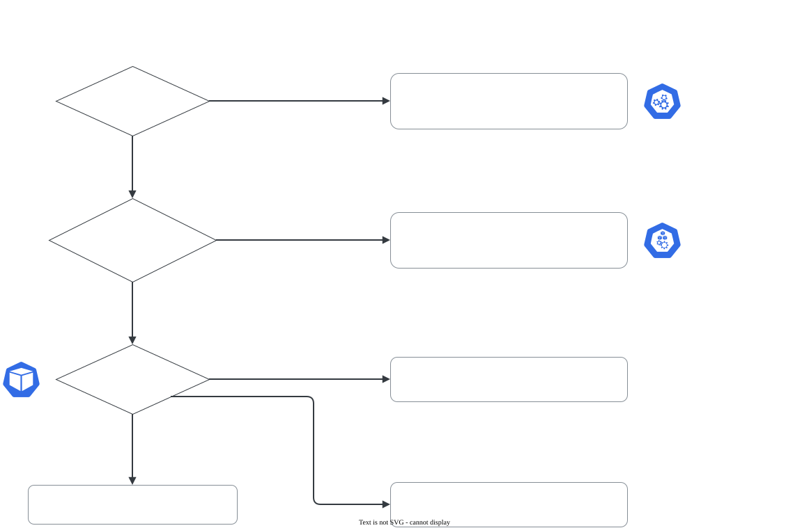

# 5. Troubleshooting (30%)

O maior domínio da prova: quase um terço dos pontos. E não é só ele, porque todo outro domínio também cobra "faça funcionar". A habilidade central é **olhar a fonte certa primeiro**: Events, logs do container, logs do nó ou o runtime.

## Itens do currículo e onde estão

| Item do currículo | Página |
|---|---|
| Troubleshoot clusters and nodes | [Nó NotReady](no-notready.md) |
| Troubleshoot cluster components | [Control plane fora](control-plane.md) |
| Monitor cluster and application resource usage | [Logs e eventos](logs-eventos.md) (`kubectl top`) |
| Manage and evaluate container output streams | [Logs e eventos](logs-eventos.md) |
| Troubleshoot services and networking | [Services e Endpoints](../03-services-networking/services-endpoints.md) · [DNS do cluster](../03-services-networking/dns.md) · [NetworkPolicy](../03-services-networking/network-policy.md) |
| *(aplicações, cobrado em todo o exame)* | [Pods: Pending, CrashLoopBackOff, ImagePullBackOff](pods.md) |

<!-- VERIFICAR: conferir a lista acima contra a versão atual do currículo em https://github.com/cncf/curriculum -->

## Ordem sugerida de estudo

1. **Logs e eventos**: saber onde cada informação mora é a base de tudo.
2. **Pods**: o roteiro por estado (`Pending` → scheduler, `ImagePullBackOff` → imagem, `CrashLoopBackOff` → aplicação).
3. **Nó NotReady**: kubelet, containerd e certificados, por SSH.
4. **Control plane fora**: `crictl`, `/var/log/pods/` e os manifestos dos static Pods.

## Roteiro de primeira olhada

