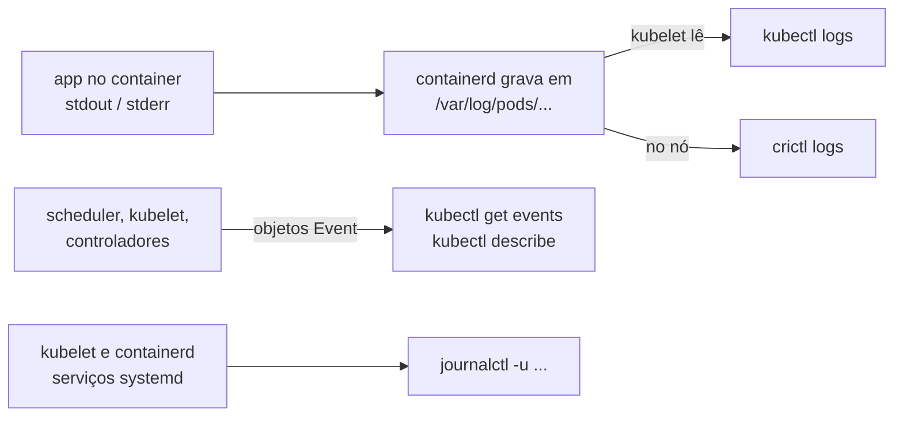

# Logs e eventos: onde procurar o quê

> **Versão do Kubernetes:** v1.36 · **Última revisão:** 2026-10-23 · **Domínio:** Troubleshooting (30%)

## O que é

Troubleshooting é saber **qual fonte responde a qual pergunta**. Há quatro fontes, e cada uma enxerga uma camada:

| Fonte | Responde | Não responde |
|---|---|---|
| **Events** (`kubectl get events`, fim do `kubectl describe`) | O que o **Kubernetes** fez ou tentou: agendar, baixar imagem, montar volume, matar por probe | O que a aplicação escreveu |
| **Logs do container** (`kubectl logs`) | O que a **aplicação** escreveu no stdout/stderr | Por que o container não chegou a rodar |
| **Logs do nó** (`journalctl -u kubelet`, `-u containerd`) | Problemas do **kubelet e do runtime**: nó NotReady, manifesto inválido, certificado | Erros da aplicação |
| **Arquivos e runtime no nó** (`/var/log/pods/`, `crictl logs`) | Logs dos containers **mesmo sem API server** (control plane fora) | — |

E uma quinta, para "monitorar o uso de recursos": **`kubectl top`**, que precisa do metrics-server.

## Como funciona por dentro



- **Events são objetos da API**, por namespace, guardados por pouco tempo (padrão **1 hora**, flag `--event-ttl` do apiserver). Evento de ontem não existe mais.
- **`kubectl logs` lê o arquivo do nó via kubelet.** Por isso só funciona se o kubelet do nó e o API server estiverem de pé.
- O log do container é guardado por **restart**: `0.log`, `1.log`... O `--previous` lê o anterior. Quando o Pod é apagado, os logs vão junto.
- O kubelet rotaciona os logs pelo tamanho (`containerLogMaxSize`, padrão 10Mi; `containerLogMaxFiles`, padrão 5).

## Comandos essenciais

```bash
# --- Events ---
kubectl get events -n app --sort-by=.lastTimestamp            # mais recentes por último
kubectl get events -A --field-selector type=Warning
kubectl get events -n app --field-selector involvedObject.name=web-7d4b9c-x2k4j
kubectl get events -n app --field-selector reason=FailedScheduling
kubectl events -n app --for pod/web --watch                   # comando dedicado, com filtro por objeto
kubectl describe pod web | sed -n '/Events/,$p'

# --- Logs de container ---
kubectl logs web                                  # Pod com um container
kubectl logs web -c sidecar                       # escolher o container
kubectl logs web --all-containers
kubectl logs web --previous                       # execução anterior, quando o container já reiniciou e está rodando
kubectl logs web -f --tail=50 --since=10m --timestamps
kubectl logs deploy/web                           # um Pod do Deployment
kubectl logs -l app=web --prefix --max-log-requests=10   # todos os Pods do label
kubectl logs job/backup

# Gravar o resultado num arquivo (formato de muitas questões)
kubectl logs web -c app | grep ERROR > /opt/erros.txt

# --- Nó ---
journalctl -u kubelet --no-pager --since "15 min ago"
journalctl -u containerd --no-pager | tail -20
crictl ps -a
crictl logs <container-id>
ls /var/log/pods/
tail -f /var/log/pods/<ns>_<pod>_<uid>/<container>/0.log

# --- Uso de recursos (metrics-server) ---
kubectl top nodes
kubectl top pods -A --sort-by=memory
kubectl top pods -n app --containers
kubectl top pod -l app=web --sort-by=cpu --no-headers | head -1   # o Pod que mais usa CPU
```

## YAML de referência

O padrão de log do Kubernetes é: **a aplicação escreve no stdout/stderr**. Uma aplicação que escreve num arquivo dentro do container não aparece no `kubectl logs`; a solução clássica é um **sidecar** que lê o arquivo e o repete no stdout dele:

```yaml
apiVersion: v1
kind: Pod
metadata:
  name: app-com-sidecar
spec:
  containers:
    - name: app
      image: busybox:1.36
      command: ["sh", "-c", "i=0; while true; do echo \"$i $(date)\" >> /var/log/app.log; i=$((i+1)); sleep 2; done"]
      volumeMounts:
        - name: logs
          mountPath: /var/log
  initContainers:
    - name: log-sidecar                 # sidecar nativo: init container com restartPolicy Always
      image: busybox:1.36
      restartPolicy: Always
      command: ["sh", "-c", "tail -n+1 -F /var/log/app.log"]
      volumeMounts:
        - name: logs
          mountPath: /var/log
  volumes:
    - name: logs
      emptyDir: {}
```

```bash
kubectl logs app-com-sidecar -c log-sidecar -f    # agora o log do arquivo aparece aqui
```

## Na documentação oficial

- **Página principal:** *Logging Architecture*. Link: <https://kubernetes.io/docs/concepts/cluster-administration/logging/>
- **Complementares:**
    - *kubectl logs* (todas as flags): <https://kubernetes.io/docs/reference/kubectl/generated/kubectl_logs/>
    - *kubectl events*: <https://kubernetes.io/docs/reference/kubectl/generated/kubectl_events/>
    - *Resource metrics pipeline* (metrics-server, `kubectl top`): <https://kubernetes.io/docs/tasks/debug/debug-cluster/resource-metrics-pipeline/>
    - *Sidecar Containers*: <https://kubernetes.io/docs/concepts/workloads/pods/sidecar-containers/>
- **Busca rápida:** `logging architecture`, `kubectl logs`
- **Ctrl+F dentro das páginas:**
    - `Streaming sidecar container`: o YAML do sidecar que lê arquivo de log.
    - `Log rotation`: `containerLogMaxSize`.
    - `--previous` (em kubectl logs).

## Pegadinhas da prova

- **Pod que nunca rodou não tem log.** `Pending`, `ImagePullBackOff`, `CreateContainerConfigError`: a resposta está nos **Events**.
- **Pod com vários containers**: sem `-c`, o `kubectl logs` usa o container padrão (anotação `kubectl.kubernetes.io/default-container`) ou o primeiro, e avisa. Leia o aviso: pode não ser o container que a questão pede.
- **`--previous` só ajuda se o container já voltou a rodar.** Com o container morto esperando o backoff, o `kubectl logs` sem flag já mostra a execução que morreu, e o `--previous` pode responder `unable to retrieve container logs`. Detalhes em [Pods](pods.md).
- **`kubectl get events` sem `--sort-by` não sai em ordem cronológica.** Use `--sort-by=.lastTimestamp`.
- **Evento some depois de 1 hora.** Reproduza o problema (apague e recrie o Pod) para gerar os eventos de novo.
- **`kubectl top` com `error: Metrics API not available`** = falta metrics-server. Não é algo que você corrige com `kubectl top`.
- **Questão "escreva o nome do Pod que mais consome CPU em /opt/x.txt"**: `kubectl top pod --sort-by=cpu --no-headers | head -1 | awk '{print $1}' > /opt/x.txt`. Confira o namespace e o label pedidos.
- **Control plane fora = sem `kubectl logs`.** Vá para `crictl logs` ou `/var/log/pods/` no nó.

## Pratique

**Enunciado (como na prova):**

> In namespace `logs-lab`, Pod `app-com-sidecar` writes its log only to a file inside the container. Extract all log lines containing the number `5` that were produced so far and save them to `/opt/app-5.txt`. Then, list all Warning events of namespace `logs-lab` ordered by time and save them to `/opt/warnings.txt`.

**Tradução:** no namespace `logs-lab`, o Pod `app-com-sidecar` escreve o log só num arquivo dentro do container. Extraia todas as linhas de log com o número `5` geradas até agora e grave em `/opt/app-5.txt`. Depois, liste todos os eventos `Warning` do namespace `logs-lab` em ordem de tempo e grave em `/opt/warnings.txt`.

??? success "Solução"
    ```bash
    kubectl get pod app-com-sidecar -n logs-lab -o jsonpath='{.spec.containers[*].name} {.spec.initContainers[*].name}{"\n"}'
    kubectl logs app-com-sidecar -n logs-lab -c log-sidecar | grep 5 > /opt/app-5.txt
    kubectl get events -n logs-lab --field-selector type=Warning --sort-by=.lastTimestamp > /opt/warnings.txt
    ```
    O container `app` não tem nada no stdout; quem expõe o arquivo é o sidecar. Sem sidecar, a alternativa seria `kubectl exec app-com-sidecar -n logs-lab -c app -- cat /var/log/app.log | grep 5`.

**Como verificar:**

```bash
head -3 /opt/app-5.txt
kubectl logs app-com-sidecar -n logs-lab -c app | wc -l      # 0: o app não escreve no stdout
cat /opt/warnings.txt
```

Saída esperada (ilustrativa: nomes, IPs e idades mudam no seu cluster):

```console
$ head -3 /opt/app-5.txt
5 Fri Oct 23 18:50:10 UTC 2026
15 Fri Oct 23 18:50:30 UTC 2026
25 Fri Oct 23 18:50:50 UTC 2026
$ kubectl logs app-com-sidecar -n logs-lab -c app | wc -l
0
```

**No lab / Killercoda:**

- No nó onde o Pod roda, ache o mesmo log em `/var/log/pods/logs-lab_app-com-sidecar_*/log-sidecar/0.log` e compare com o `kubectl logs`.
- Use `crictl logs` com o ID do container do sidecar e confira que é o mesmo conteúdo.
- Crie um Pod que falha e use `kubectl events --for pod/<nome> --watch` para ver os eventos chegando.
- Instale o metrics-server e pratique `kubectl top pods --sort-by=memory -A`.
