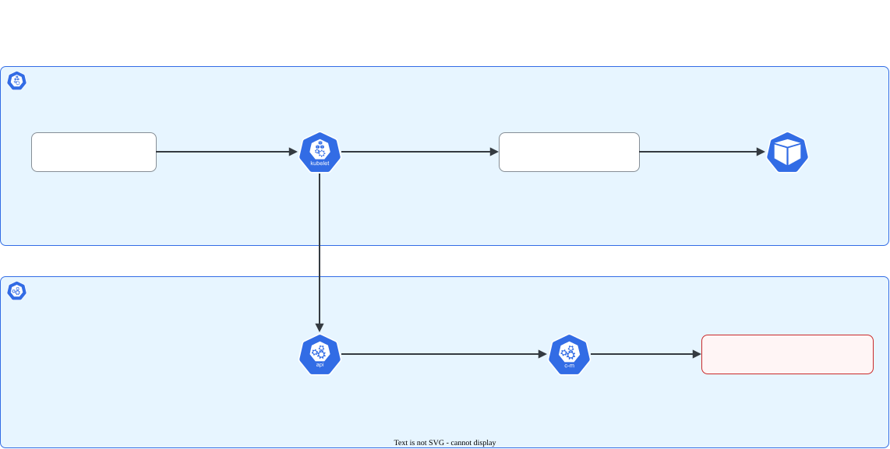

# Nó NotReady: kubelet, containerd, certificados

> **Versão do Kubernetes:** v1.36 · **Última revisão:** 2026-10-23 · **Domínio:** Troubleshooting (30%)

## O que é

Um nó fica `NotReady` quando o **kubelet** daquele nó **para de reportar** ao API server, ou reporta que não consegue rodar Pods. Quase sempre a causa está **no próprio nó**, e a investigação é por SSH, não pelo `kubectl`.

| Condição do nó (`kubectl describe node`) | `Status` | Quer dizer |
|---|---|---|
| `Ready` | `True` | Tudo certo |
| `Ready` | `False` | O kubelet reporta, mas algo impede Pods (runtime, CNI) |
| `Ready` | `Unknown` | O kubelet **parou de reportar** (kubelet parado, nó desligado, rede, certificado) |
| `MemoryPressure` / `DiskPressure` / `PIDPressure` | `True` | Falta de recurso: o kubelet começa a expulsar Pods |

As causas mais cobradas, em ordem de frequência:

| Causa | Sintoma no `describe node` | Confirmação no nó |
|---|---|---|
| **kubelet parado ou desabilitado** | `Kubelet stopped posting node status`, condições `Unknown` | `systemctl status kubelet` → `inactive` |
| **kubelet não sobe** (config errada, flag inválida, swap) | Idem | `journalctl -u kubelet` → erro na partida |
| **containerd parado** | `Ready False`, `container runtime is down` | `systemctl status containerd`, `crictl ps` falha |
| **CNI ausente ou quebrado** | `Ready False`, `NetworkPluginNotReady ... cni plugin not initialized` | Pods do CNI no nó, `/etc/cni/net.d/` vazio |
| **Certificado do kubelet expirado/inválido** | `Unknown` | `journalctl -u kubelet` → `x509: certificate has expired` ou `Unauthorized` |
| **Endereço do API server errado** em `kubelet.conf` | `Unknown` | `journalctl -u kubelet` → `connection refused` / `no such host` |
| **Disco cheio** | `DiskPressure True` | `df -h /var/lib/kubelet /var/lib/containerd` |

## Como funciona por dentro

[](../assets/diagramas/05-no-notready.svg "Abrir o diagrama em tamanho real")

Os arquivos do kubelet num nó kubeadm (memorize os caminhos):

| Arquivo | O que tem |
|---|---|
| `/var/lib/kubelet/config.yaml` | Configuração do kubelet (`staticPodPath`, `cgroupDriver`, `containerRuntimeEndpoint`...) |
| `/etc/kubernetes/kubelet.conf` | kubeconfig do kubelet: **endereço do API server** e certificado do cliente |
| `/var/lib/kubelet/pki/kubelet-client-current.pem` | Certificado de cliente do kubelet (rotacionado sozinho com `rotateCertificates: true`) |
| `/usr/lib/systemd/system/kubelet.service.d/10-kubeadm.conf` | Drop-in do systemd que monta a linha de comando do kubelet (é onde os pacotes `pkgs.k8s.io` o põem; instalações antigas usam `/etc/systemd/system/kubelet.service.d/`). `systemctl status kubelet` mostra o caminho na linha `Drop-In` |
| `/var/lib/kubelet/kubeadm-flags.env` | Flags extras gravadas pelo kubeadm |
| `/etc/containerd/config.toml` | Configuração do containerd (`SystemdCgroup = true`) |

Quando o nó fica `Unknown`/`NotReady`, o node controller põe os taints `node.kubernetes.io/unreachable` ou `not-ready`, com `NoSchedule` (nada novo entra) **e** `NoExecute`. Os Pods têm toleration de 300 s para o `NoExecute`: **depois de 5 minutos**, os Pods de Deployment são recriados em outros nós.

Parar o kubelet ou o containerd **não para os containers que já rodam**: cada container é mantido por um processo `containerd-shim`, que continua vivo. O nó fica `NotReady`, mas a aplicação pode seguir atendendo até o `NoExecute` tirar os Pods de lá.

O que se vê no lab (v1.36) em cada caso:

| Falha | `kubectl get nodes` | Condição `Ready` | Tempo até aparecer |
|---|---|---|---|
| kubelet parado | `NotReady` | `Unknown` · `NodeStatusUnknown` · `Kubelet stopped posting node status.` | ~50 s |
| containerd parado | `NotReady` | `False` · `KubeletNotReady` · `container runtime is down` | ~30 s |

## Comandos essenciais

```bash
# Do control plane: qual nó e por quê
kubectl get nodes
kubectl describe node w1 | sed -n '/Conditions/,/Addresses/p'
kubectl describe node w1 | grep -i taints

# No nó com problema
ssh w1
sudo -i

# 1. kubelet
systemctl status kubelet
journalctl -u kubelet --no-pager | tail -30       # ou: journalctl -u kubelet -f
journalctl -u kubelet --since "10 min ago" --no-pager | grep -iE 'error|fail|x509'

# 2. container runtime
systemctl status containerd
crictl ps                                        # falha se o containerd estiver fora
crictl info | head -20

# 3. configuração
cat /var/lib/kubelet/config.yaml
grep server: /etc/kubernetes/kubelet.conf        # endereço do API server certo?
systemctl cat kubelet                            # unidade + drop-ins: de onde vem cada flag

# 4. certificado do kubelet
openssl x509 -in /var/lib/kubelet/pki/kubelet-client-current.pem -noout -dates -subject

# 5. recursos
df -h /var/lib/kubelet /var/lib/containerd
free -m
swapon --show                                    # swap ligado derruba o kubelet se failSwapOn=true

# Corrigir e subir
systemctl daemon-reload                          # depois de mexer em unidade/drop-in
systemctl enable --now kubelet                   # inicia E habilita no boot
systemctl restart containerd
```

## YAML de referência

O nó não tem manifesto próprio, mas a **configuração do kubelet** é YAML e é onde muitos cenários da prova escondem o erro:

```yaml
# /var/lib/kubelet/config.yaml (trecho de um nó kubeadm)
apiVersion: kubelet.config.k8s.io/v1beta1
kind: KubeletConfiguration
cgroupDriver: systemd                                      # tem que ser igual ao do containerd
containerRuntimeEndpoint: unix:///var/run/containerd/containerd.sock
staticPodPath: /etc/kubernetes/manifests
rotateCertificates: true
clusterDNS:
  - 10.96.0.10
clusterDomain: cluster.local
authentication:
  x509:
    clientCAFile: /etc/kubernetes/pki/ca.crt
```

```yaml
# /etc/kubernetes/kubelet.conf (trecho): o endereço do API server
apiVersion: v1
kind: Config
clusters:
  - cluster:
      certificate-authority-data: <base64>
      server: https://10.0.1.4:6443        # IP/porta errados = nó NotReady (Unknown)
    name: kubernetes
users:
  - name: default-auth
    user:
      client-certificate: /var/lib/kubelet/pki/kubelet-client-current.pem
      client-key: /var/lib/kubelet/pki/kubelet-client-current.pem
```

## Na documentação oficial

- **Página principal:** *Troubleshooting Clusters*. Link: <https://kubernetes.io/docs/tasks/debug/debug-cluster/>
- **Complementares:**
    - *Debugging Kubernetes nodes with crictl*: <https://kubernetes.io/docs/tasks/debug/debug-cluster/crictl/>
    - *Nodes* (condições e heartbeats): <https://kubernetes.io/docs/concepts/architecture/nodes/>
    - *Configure cgroup driver*: <https://kubernetes.io/docs/tasks/administer-cluster/kubeadm/configure-cgroup-driver/>
    - *Certificate Management with kubeadm* (renovação do kubelet): <https://kubernetes.io/docs/tasks/administer-cluster/kubeadm/kubeadm-certs/>
- **Busca rápida:** `troubleshooting clusters`, `crictl`
- **Ctrl+F dentro das páginas:**
    - `Example debugging: Shutdown of a node`: como o nó parado aparece no `describe`.
    - `Node status` → `Conditions` (em Nodes): a tabela de condições.
    - `crictl ps`, `crictl logs`: os comandos do runtime.

Veja também: [Certificados com kubeadm](../01-cluster-architecture/kubeadm-certs.md).

## Pegadinhas da prova

- **`systemctl start` não basta se o serviço estiver desabilitado**: o cenário pode reiniciar o nó. Use `systemctl enable --now kubelet`.
- **Mexeu em unidade ou drop-in do systemd?** `systemctl daemon-reload` antes do `restart`. Sem isso, a mudança é ignorada.
- **O `journalctl -u kubelet` tem a resposta**, mas é verboso. Filtre: `| grep -iE 'error|fail'` e olhe as **últimas** linhas, que são da tentativa mais recente.
- **Binário em caminho errado**: o drop-in pode apontar para `/usr/local/bin/kubelet` enquanto o binário está em `/usr/bin/kubelet`. `systemctl cat kubelet` mostra a linha `ExecStart`; `which kubelet` mostra onde ele está.
- **`cgroupDriver` diferente** entre kubelet (`systemd`) e containerd (`SystemdCgroup = false`) faz Pods reiniciarem sem parar ou o kubelet falhar.
- **Não confunda os certificados.** O do kubelet (cliente) fica em `/var/lib/kubelet/pki/` e é rotacionado sozinho; os do control plane ficam em `/etc/kubernetes/pki/` e são renovados com `kubeadm certs renew`.
- **Depois de corrigir, espere.** O nó volta a `Ready` em alguns segundos; confira com `kubectl get nodes -w` antes de seguir.
- **Saia do nó** (`exit` duas vezes) antes da próxima questão.

## Pratique

**Enunciado (como na prova):**

> Node `w1` is in `NotReady` state. Investigate and fix the issue so that the node becomes `Ready`. The fix must survive a reboot of the node.

**Tradução:** o nó `w1` está `NotReady`. Investigue e corrija para que ele volte a `Ready`. A correção precisa sobreviver a um reboot do nó.

Para montar o cenário no lab (no `w1`): `sudo systemctl disable --now kubelet`.

??? success "Solução"
    ```bash
    kubectl describe node w1 | sed -n '/Conditions/,/Addresses/p'   # Unknown: Kubelet stopped posting node status
    ssh w1
    sudo -i
    systemctl status kubelet                 # inactive (dead), disabled
    journalctl -u kubelet --no-pager | tail -5
    systemctl enable --now kubelet           # "sobreviver a reboot" = enable
    systemctl status kubelet                 # active (running)
    exit; exit
    kubectl get nodes -w
    ```
    `Unknown` em todas as condições aponta para "o kubelet parou de falar". Se o `systemctl status` mostrasse `activating (auto-restart)`, o kubelet estaria subindo e morrendo: a causa estaria no `journalctl` (config, certificado, endereço do API server).

**Como verificar:**

```bash
kubectl get nodes
ssh w1 'systemctl is-enabled kubelet; systemctl is-active kubelet'
```

Saída esperada (ilustrativa: nomes, IPs e idades mudam no seu cluster):

```console
$ kubectl get nodes
NAME   STATUS     ROLES           AGE   VERSION
cp     Ready      control-plane   6h    v1.36.5
w1     NotReady   <none>          6h    v1.36.5
w2     Ready      <none>          6h    v1.36.5
$ kubectl describe node w1 | grep -A2 "Ready "
  Ready            Unknown   Fri, 23 Oct 2026 18:40:12 +0000   Fri, 23 Oct 2026 18:41:01 +0000   NodeStatusUnknown   Kubelet stopped posting node status.
```

**No lab / Killercoda:**

- Pare o **containerd** em vez do kubelet (`systemctl stop containerd`) e compare as condições do nó com o caso do kubelet parado.
- Edite `/etc/kubernetes/kubelet.conf` com uma porta errada (`:6444`), reinicie o kubelet e leia o `journalctl`. Desfaça depois.
- Mude o `cgroupDriver` em `/var/lib/kubelet/config.yaml` para `cgroupfs`, reinicie e leia o erro.
- Confira a validade do certificado do kubelet com `openssl x509 ... -dates` e compare com `kubeadm certs check-expiration` no control plane.
- Faça uma cópia de cada arquivo antes de editar (`cp arquivo arquivo.bak`), para voltar rápido.
