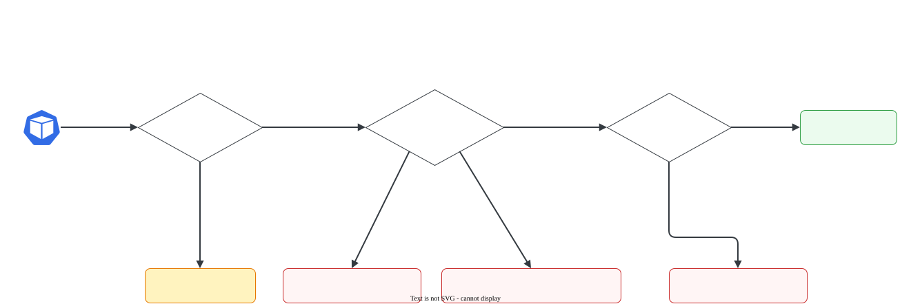

# Pods: Pending, CrashLoopBackOff, ImagePullBackOff

> **Versão do Kubernetes:** v1.36 · **Última revisão:** 2026-10-23 · **Domínio:** Troubleshooting (30%)

## O que é

Os estados de Pod com problema que mais caem na prova. Cada um aponta para **uma fase diferente** da vida do Pod, e isso já diz onde procurar:

| `STATUS` | Fase em que parou | Quem reclama | Onde está a resposta |
|---|---|---|---|
| `Pending` | **Agendamento**: nenhum nó escolhido | kube-scheduler | `kubectl describe pod` → Events (`FailedScheduling`) |
| `ContainerCreating` (parado) | **Preparação** no nó: volume, rede | kubelet | Events (`FailedMount`, `FailedCreatePodSandBox`) |
| `ErrImagePull` → `ImagePullBackOff` | **Download da imagem** | kubelet / runtime | Events (`Failed` com a mensagem do registry) |
| `CreateContainerConfigError` | **Configuração** do container | kubelet | Events: ConfigMap/Secret/chave inexistente |
| `RunContainerError` | **Início** do processo | runtime | Events: comando ou executável inexistente |
| `CrashLoopBackOff` | **Execução**: o processo sobe e morre | o próprio app | `kubectl logs --previous` + `Last State` (exit code) |
| `Running` mas `0/1` | **Readiness** falhando | kubelet (probe) | Events (`Unhealthy`) |
| `OOMKilled` (em `Last State`) | **Execução**: memória acima do limite | kernel | `describe` → `Reason: OOMKilled`, exit 137 |

`BackOff` quer dizer que o kubelet está **esperando para tentar de novo**, com espera crescente (10 s, 20 s, 40 s... até 5 min). Não é a causa: a causa está na tentativa que falhou.

## Como funciona por dentro

[](../assets/diagramas/05-pods.svg "Abrir o diagrama em tamanho real")

Exit codes que ajudam a fechar o diagnóstico de `CrashLoopBackOff`:

| Exit code | Significado comum |
|---|---|
| `0` | O processo **terminou com sucesso**, e com `restartPolicy: Always` o kubelet reinicia. Comando que não fica rodando (ex.: `echo`) |
| `1` | Erro genérico da aplicação: leia o log |
| `126` | Comando existe mas não é executável (permissão) |
| `127` | **Comando não encontrado** (erro de digitação no `command`, binário que não existe na imagem) |
| `137` | Morto com SIGKILL: **OOMKilled** ou liveness probe falhando |
| `139` | Segmentation fault |
| `143` | Morto com SIGTERM (encerramento normal, ou liveness) |

## Comandos essenciais

```bash
# Visão geral: STATUS, RESTARTS e em que nó está
kubectl get pods -A -o wide | grep -v -E 'Running|Completed'
kubectl get pods --field-selector=status.phase=Pending -A

# O comando mais importante: Events no fim + State/Last State de cada container
kubectl describe pod web
kubectl describe pod web | sed -n '/Events/,$p'

# Logs: sem flag = execução atual (ou a que acabou de morrer, se o container está parado no backoff)
kubectl logs web
kubectl logs web --previous                    # execução anterior, quando o container já voltou a rodar
kubectl logs web -c sidecar --previous         # Pod com mais de um container
kubectl logs web -c init-db                    # init container

# Motivo e exit code direto
kubectl get pod web -o jsonpath='{.status.containerStatuses[0].lastState.terminated}{"\n"}'

# Conferir o que o Pod está pedindo
kubectl get pod web -o yaml | grep -E 'image:|command|args' -A2
kubectl get pod web -o jsonpath='{.spec.containers[*].image}{"\n"}'

# Corrigir: Pod avulso não aceita mudar quase nada → exporte, edite, recrie
kubectl get pod web -o yaml > web.yaml
kubectl replace --force -f web.yaml            # apaga e recria
# Pod de Deployment: corrija o Deployment, não o Pod
kubectl set image deployment/web nginx=nginx:1.27
kubectl edit deployment web
```

## YAML de referência

Três Pods quebrados de propósito, cada um com uma falha clássica (bons para treinar a leitura do `describe`):

```yaml
apiVersion: v1
kind: Pod
metadata:
  name: imagem-errada
spec:
  containers:
    - name: c
      image: nginx:1.999-naoexiste      # ErrImagePull → ImagePullBackOff
---
apiVersion: v1
kind: Pod
metadata:
  name: comando-errado
spec:
  containers:
    - name: c
      image: busybox:1.36
      command: ["sh", "-c", "comando-que-nao-existe"]   # exit 127 → CrashLoopBackOff
---
apiVersion: v1
kind: Pod
metadata:
  name: grande-demais
spec:
  containers:
    - name: c
      image: nginx:1.27
      resources:
        requests:
          cpu: "64"                     # nenhum nó tem 64 CPUs → Pending (Insufficient cpu)
```

Causas de `Pending` e a mensagem que aparece em `FailedScheduling`:

| Causa | Trecho da mensagem |
|---|---|
| Requests maiores que o livre no nó | `Insufficient cpu` / `Insufficient memory` |
| Taint sem toleration | `had untolerated taint(s)` |
| `nodeSelector` / affinity sem nó compatível | `didn't match Pod's node affinity/selector` |
| Anti-affinity | `didn't match pod anti-affinity rules` |
| PVC inexistente ou sem PV | `persistentvolumeclaim "x" not found` / `didn't find available persistent volumes to bind` |
| Nó `cordon` | `node(s) were unschedulable` |
| **kube-scheduler fora do ar** | **Nenhum evento.** O Pod fica `Pending` sem `FailedScheduling` (ver [Control plane](control-plane.md)) |

## Na documentação oficial

- **Página principal:** *Debug Pods*. Link: <https://kubernetes.io/docs/tasks/debug/debug-application/debug-pods/>
- **Complementares:**
    - *Debug Running Pods* (`kubectl debug`, containers efêmeros): <https://kubernetes.io/docs/tasks/debug/debug-application/debug-running-pod/>
    - *Determine the Reason for Pod Failure*: <https://kubernetes.io/docs/tasks/debug/debug-application/determine-reason-pod-failure/>
    - *Pod Lifecycle* (fases e estados): <https://kubernetes.io/docs/concepts/workloads/pods/pod-lifecycle/>
- **Busca rápida:** `debug pods`, `crashloopbackoff`
- **Ctrl+F dentro das páginas:**
    - `My pod stays pending`, `My pod stays waiting`, `My pod is crashing`: o roteiro de cada estado.
    - `Container restart policy` (em Pod Lifecycle): o backoff de 10 s até 5 min.
    - `kubectl debug`: container efêmero para Pod sem shell.

## Pegadinhas da prova

- **`logs` ou `logs --previous`?** Depende de o container estar morto ou rodando de novo (testado em v1.36):
    - container **morto, esperando o backoff** (`CrashLoopBackOff`, `Error`): o `kubectl logs` **sem flag** já mostra o log da execução que morreu. O `--previous` pode falhar com `unable to retrieve container logs`, porque o kubelet só guarda o último container morto.
    - container que **morreu e já voltou a rodar** (crash depois de minutos, liveness): o `kubectl logs` mostra só a execução nova, e o `--previous` mostra a que morreu.
    - Na dúvida, rode os dois.
- **`describe` primeiro, `logs` depois.** `ImagePullBackOff`, `Pending` e `CreateContainerConfigError` **não têm log**: o container nunca rodou. A resposta está nos Events.
- **Exit code 0 em CrashLoopBackOff** não é bug da aplicação: o comando terminou. O `STATUS` alterna entre `Completed` e `CrashLoopBackOff`, com `RESTARTS` subindo. Um Pod de Deployment precisa de um processo que **fique rodando**.
- **Imagem: confira o nome inteiro.** Tag inexistente dá `not found`; registry privado sem `imagePullSecrets` dá `unauthorized` / `pull access denied`. A mensagem do evento diz qual.
- **Pod avulso não aceita `kubectl edit`** na maioria dos campos (só `image`, `activeDeadlineSeconds`, tolerations novas). Para mudar `command`, `resources` etc., use `kubectl replace --force -f` com o YAML corrigido.
- **Pod de Deployment: corrija o Deployment.** Editar ou apagar o Pod não adianta: o ReplicaSet recria igual.
- **`Pending` sem nenhum evento** = o scheduler não está rodando. Vá para o control plane.
- **`0/1 Running` com 0 restarts** = readiness probe falhando. **Muitos restarts com `Running`** = liveness probe matando o container (exit 137/143).

## Pratique

**Enunciado (como na prova):**

> In namespace `broken`, the Deployment `api` has no ready Pods. Find out why and fix it so that all replicas become `Running` and ready. Do not delete the Deployment.

**Tradução:** no namespace `broken`, o Deployment `api` não tem nenhum Pod pronto. Descubra o motivo e corrija para que todas as réplicas fiquem `Running` e prontas. Não apague o Deployment.

Para montar o cenário no lab:

```bash
kubectl create namespace broken
kubectl create deployment api -n broken --image=nginx:1.27-alpne --replicas=2   # erro de digitação na tag
```

??? success "Solução"
    ```bash
    kubectl get pods -n broken                                   # ErrImagePull / ImagePullBackOff
    kubectl describe pod -n broken -l app=api | sed -n '/Events/,$p'
    #   Failed ... failed to pull and unpack image "docker.io/library/nginx:1.27-alpne": ... not found
    kubectl set image deployment/api -n broken nginx=nginx:1.27-alpine
    kubectl rollout status deployment/api -n broken
    ```
    O evento mostra a tag com erro de digitação (`alpne`). A correção vai no **Deployment** (`set image`), que gera Pods novos; apagar os Pods antigos não resolveria.

**Como verificar:**

```bash
kubectl get deploy api -n broken                       # READY 2/2
kubectl get pods -n broken
```

Saída esperada (ilustrativa: nomes, IPs e idades mudam no seu cluster):

```console
$ kubectl get pods -n broken
NAME                   READY   STATUS             RESTARTS   AGE
api-5d9c7f6b8d-7xk2p   0/1     ImagePullBackOff   0          40s
$ kubectl get deploy api -n broken
NAME   READY   UP-TO-DATE   AVAILABLE   AGE
api    2/2     2            2           90s
```

**No lab / Killercoda:**

- Aplique os três Pods quebrados do YAML de referência e, para cada um, diga a causa **só pelo `describe`**, antes de olhar o YAML.
- Crie um Pod com `command: ["echo", "oi"]` e veja `CrashLoopBackOff` com exit code 0.
- Crie um Pod com liveness probe numa porta errada e observe os restarts com `Running`.
- Use `kubectl debug -it <pod> --image=busybox:1.36 --target=<container>` num Pod de imagem sem shell (ex.: `registry.k8s.io/pause`).
