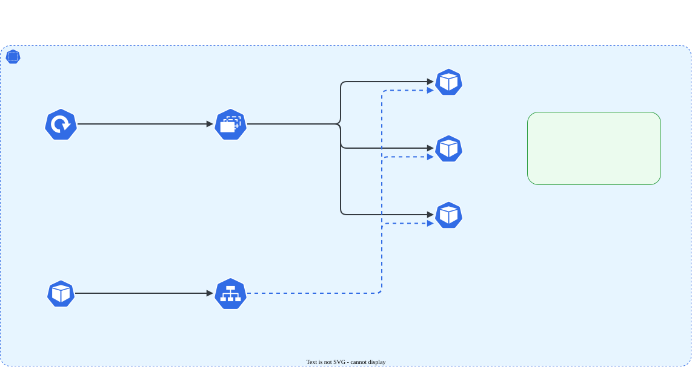

# Fundamentos: Pod, namespace, labels, Deployment e Service

> **Versão do Kubernetes:** v1.37 · **Última revisão:** 2026-10-25 · Passo 1 da trilha [Começar do zero](iniciante.md)

Os cinco objetos que aparecem em quase toda questão da prova. As outras páginas do site partem do princípio de que eles já estão claros.

## Os cinco objetos

| Objeto | O que é | Detalhe que importa |
|---|---|---|
| **Pod** | A menor unidade que o Kubernetes roda: um ou mais containers que compartilham IP e volumes | Pod avulso apagado não volta. O IP muda a cada Pod novo |
| **Namespace** | Divisão lógica do cluster: nomes só precisam ser únicos dentro dele | Sem `-n`, o `kubectl` usa o namespace do contexto (normalmente `default`) |
| **Label** | Par chave=valor colado num objeto (`app=loja`) | Não tem significado sozinho: serve para outros objetos **selecionarem** |
| **Deployment** | Mantém N cópias de um Pod rodando e faz a troca de versão | Cria um **ReplicaSet**, que é quem cria os Pods |
| **Service** | Nome e IP fixos na frente de um grupo de Pods | Escolhe os Pods pelo **selector** de labels |

[](../assets/diagramas/00-fundamentos.svg "Abrir o diagrama em tamanho real")

## Pod e namespace

```console
$ kubectl create namespace estudo
namespace/estudo created
$ kubectl -n estudo run web --image=nginx:1.27 --labels=app=web,time=loja
pod/web created
$ kubectl -n estudo get pods -o wide --show-labels
NAME   READY   STATUS    RESTARTS   AGE   IP              NODE   NOMINATED NODE   READINESS GATES   LABELS
web    1/1     Running   0          0s    10.244.190.86   w1     <none>           <none>            app=web,time=loja
```

`-o wide` mostra o IP e o nó; `--show-labels`, os labels. Um Pod avulso apagado some de vez:

```console
$ kubectl -n estudo delete pod web
pod "web" deleted from estudo namespace
$ kubectl -n estudo get pods
No resources found in estudo namespace.
```

## Deployment, ReplicaSet e Pods

```console
$ kubectl -n estudo create deployment loja --image=nginx:1.27 --replicas=3
deployment.apps/loja created
$ kubectl -n estudo get deploy,rs,pods
NAME                   READY   UP-TO-DATE   AVAILABLE   AGE
deployment.apps/loja   3/3     3            3           1s

NAME                              DESIRED   CURRENT   READY   AGE
replicaset.apps/loja-77bcbb65d4   3         3         3       1s

NAME                        READY   STATUS    RESTARTS   AGE
pod/loja-77bcbb65d4-jgrc5   1/1     Running   0          1s
pod/loja-77bcbb65d4-qjhc9   1/1     Running   0          1s
pod/loja-77bcbb65d4-rq77k   1/1     Running   0          1s
```

O nome dos Pods é `<deployment>-<hash do ReplicaSet>-<sufixo>`. Apague um: o ReplicaSet cria outro na hora, com nome novo (`mppth`):

```console
$ kubectl -n estudo delete pod loja-77bcbb65d4-jgrc5
pod "loja-77bcbb65d4-jgrc5" deleted from estudo namespace
$ kubectl -n estudo get pods -l app=loja
NAME                    READY   STATUS    RESTARTS   AGE
loja-77bcbb65d4-mppth   1/1     Running   0          7s
loja-77bcbb65d4-qjhc9   1/1     Running   0          8s
loja-77bcbb65d4-rq77k   1/1     Running   0          8s
```

Por isso, num Pod de Deployment, a correção vai sempre no **Deployment**: editar ou apagar o Pod não muda nada, o ReplicaSet recria igual.

## Labels e selectors

O `kubectl create deployment loja` pôs o label `app=loja` no template dos Pods. Filtre por label com `-l`:

```bash
kubectl -n estudo get pods -l app=loja                    # um label
kubectl -n estudo label pod -l app=loja ambiente=teste    # acrescentar label a vários Pods
kubectl -n estudo get pods -l app=loja,ambiente=teste     # os dois (E)
```

O Deployment acha os Pods dele pelo selector `app=loja`; o Service, também. Se o label não bater, o objeto "não enxerga" os Pods.

## Service

```console
$ kubectl -n estudo expose deployment loja --port=80
service/loja exposed
$ kubectl -n estudo get svc loja
NAME   TYPE        CLUSTER-IP      EXTERNAL-IP   PORT(S)   AGE
loja   ClusterIP   10.104.32.88   <none>        80/TCP    0s
$ kubectl -n estudo get endpointslices -l kubernetes.io/service-name=loja
NAME         ADDRESSTYPE   PORTS   ENDPOINTS                                   AGE
loja-2mkvr   IPv4          80      10.244.190.93,10.244.190.88,10.244.80.217   2s
```

Os três IPs em `ENDPOINTS` são os Pods do Deployment. Para testar, chame o Service pelo nome de dentro do cluster:

```bash
kubectl -n estudo run tmp --rm -it --restart=Never --image=busybox:1.36 -- wget -qO- -T 3 http://loja
```

A resposta foi a página `Welcome to nginx!`. Tipos de Service, portas e DNS estão em [Services e Endpoints](../03-services-networking/services-endpoints.md) e [DNS do cluster](../03-services-networking/dns.md).

## Tarefa

> No namespace `estudo`, crie um Deployment `loja` com 3 réplicas da imagem `nginx:1.27`, exponha-o com um Service na porta 80 e confirme, de dentro do cluster, que o Service responde. Depois apague um dos Pods e confira que o Deployment volta a ter 3.

??? success "Solução"
    ```bash
    kubectl create namespace estudo
    kubectl -n estudo create deployment loja --image=nginx:1.27 --replicas=3
    kubectl -n estudo expose deployment loja --port=80
    kubectl -n estudo run tmp --rm -it --restart=Never --image=busybox:1.36 -- wget -qO- -T 3 http://loja
    kubectl -n estudo delete pod $(kubectl -n estudo get pods -l app=loja -o jsonpath='{.items[0].metadata.name}')
    kubectl -n estudo get deploy loja      # READY 3/3 de novo
    ```
